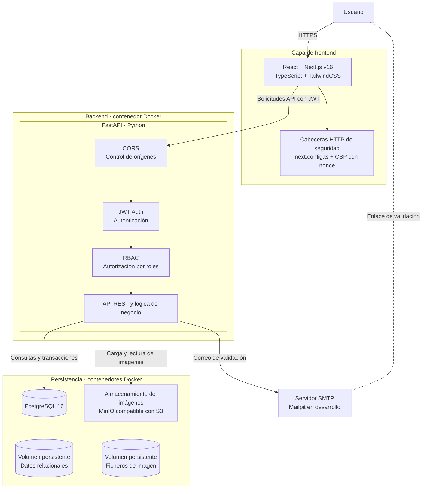

# TK-073 · Documentación: JWT, roles y CORS dentro de la API y cabeceras de Next.js en lugar de Helmet

| Campo | Valor |
|---|---|
| **Tipo** | Documentación |
| **Componente** | `readme.md` (§2.1 diagrama y justificación, §2.2 descripción de componentes, §2.5 seguridad) |
| **Historia** | HU-33 Ver dónde se aplica la seguridad en el diagrama de arquitectura (Épica 12) |
| **Prioridad** | Baja |
| **Depende de** | — |
| **Referencias** | API: `presentation/main.py` (`CORSMiddleware`), `presentation/dependencies.py` (`CurrentUserDep`), `infrastructure/security/jwt_tokens.py`, `application/authorization/community_access.py` (`CommunityAccess`). Web: `next.config.ts` (`headers()`), `src/proxy.ts` y `src/lib/security/csp.ts` (CSP con *nonce*, TK-046) |

Las inferencias que no aparecen explícitamente en el README se marcan con `(asumido)`.

## 1. Contexto y objetivo

La documentación de arquitectura describe la seguridad como se planteó antes de implementarla:

- El diagrama de §2.1 dibuja un subgrafo «Capa de seguridad» (CORS → JWT Auth → RBAC) entre el frontend y el backend, como si fuera un componente o un salto de red independiente. §2.2 repite el mismo modelo con el componente «Capa de seguridad».
- El frontend incluye un nodo «Helmet», y §2.1, §2.2 y §2.5 hablan de Helmet. La web no usa Helmet: las cabeceras se configuran en Next.js.

Implementación real:

| Mecanismo | Dónde se aplica |
|---|---|
| CORS | API: `CORSMiddleware`, registrado en `create_app()` con `CORS_ORIGINS` |
| JWT Auth | API: `CurrentUserDep` (`get_current_user`) valida el token con `JwtTokenService` (HS256) |
| RBAC | API: `CommunityAccess.require_member` / `require_role` y `platform_role` |
| Cabeceras HTTP | Web: `headers()` de `next.config.ts` (`X-Content-Type-Options`, `X-Frame-Options`, `Referrer-Policy`, `Permissions-Policy`, HSTS solo en producción) y `poweredByHeader: false` |
| CSP | Web: `src/proxy.ts` genera una `Content-Security-Policy` con un *nonce* por petición (`buildCsp`) |

**Objetivo:** que el README muestre la seguridad donde se aplica: CORS, JWT y roles dentro de FastAPI, en el orden en que se aplican a cada petición, y las cabeceras de la web en Next.js, sin Helmet.

## 2. Alcance

**Incluye**
- §2.1, diagrama:
  - Eliminar el subgrafo «Capa de seguridad» y dibujar CORS, JWT Auth y RBAC dentro de un subgrafo «FastAPI · Python» del backend, antes de «API REST y lógica de negocio».
  - Sustituir el nodo «Helmet» por «Cabeceras HTTP de seguridad» (`next.config.ts` + CSP con *nonce*).
  - La flecha «Solicitudes API con JWT» sale de Next.js y llega al primer paso de la API (CORS); las flechas hacia PostgreSQL, MinIO y SMTP salen de la lógica de negocio.
- §2.1, justificación: describir CORS, JWT y RBAC dentro de la API y las cabeceras en Next.js, sin Helmet.
- §2.2: quitar el componente «Capa de seguridad»; describir CORS, JWT y roles en «API y lógica de negocio» y las cabeceras y la CSP en «Frontend web».
- §2.5: sustituir «Cabeceras HTTP de seguridad con Helmet» por cómo se configuran en Next.js.

**No incluye**
- Cambios en el código o en la configuración de seguridad.
- El resto de diagramas (despliegue §2.4, modelo de datos §3.1).
- Los tickets copiados en §6 del README (p. ej. TK-003), que se conservan como se escribieron.
- El comentario de `next.config.ts` («equivalentes a Helmet»), que sigue siendo correcto.

## 3. Requisitos técnicos

### 3.1 Diagrama

Diagrama propuesto (comprobado con `mermaid-cli`):



- Desaparecen `SEC`, `HELMET` y la flecha «Solicitud autorizada»; se conservan los demás ids y textos.
- El subgrafo anidado usa un id distinto de los nodos (`FASTAPI`) para no chocar con `API`.
- El enlace de validación se escribe `U <-.- SMTP` (misma flecha): con `SMTP -.-> U` y el subgrafo anidado, Mermaid coloca al usuario al final del diagrama.

### 3.2 Textos

- Mismo estilo y nivel de detalle que el resto del README.
- §2.5 debe nombrar las cabeceras que se envían de verdad y explicar que la CSP lleva un *nonce* por petición y que HSTS solo se envía en producción.
- Nombres de ficheros y cabeceras copiados de la implementación.

## 4. Criterios de aceptación

**AC1 — Seguridad dentro de FastAPI (HU-33 AC1)**
- **Given** el `readme.md` actualizado
- **When** abro el diagrama de §2.1
- **Then** CORS, JWT Auth y RBAC están dentro de «FastAPI · Python», en ese orden y antes de la lógica de negocio, y no existe «Capa de seguridad»

**AC2 — Descripción coherente (HU-33 AC2)**
- **Given** §2.1 (justificación) y §2.2
- **When** leo cómo se protege la API
- **Then** CORS, JWT y roles se describen como parte de la API y no hay un componente «Capa de seguridad»

**AC3 — Cabeceras de la web (HU-33 AC3)**
- **Given** §2.1, §2.2 y §2.5
- **When** busco cómo protege la web sus respuestas
- **Then** las cabeceras aparecen en Next.js (`next.config.ts`) y la CSP con *nonce* en `proxy.ts`, y Helmet no se menciona como parte de la arquitectura

**AC4 — Diagrama válido (HU-33 AC4)**
- **Given** el diagrama nuevo
- **When** lo renderizo con Mermaid
- **Then** se muestra sin errores, con el usuario arriba y la persistencia abajo

## 5. Plan de tareas

1. Diagrama de §2.1.
2. Justificación de §2.1 y descripción de componentes de §2.2.
3. Cabeceras de seguridad en §2.5.
4. Comprobar que ningún otro texto de §1 a §5 habla de una capa de seguridad intermedia ni de Helmet.
5. Renderizar el diagrama.

## 6. Verificación

```bash
grep -n -i "capa de seguridad" readme.md   # sin resultados
grep -n -i "helmet" readme.md              # solo para decir que no se usa (§2.1, §2.5) y en los tickets copiados de §6
# Renderizar el bloque Mermaid de §2.1 (guardado en /tmp/arquitectura.mmd):
docker run --rm -u "$(id -u):$(id -g)" -v /tmp:/data minlag/mermaid-cli -i /data/arquitectura.mmd -o /data/arquitectura.svg
```

Revisar también la vista previa del `readme.md` en GitHub.

## 7. Definición de terminado

- [ ] Los criterios de aceptación se cumplen.
- [ ] Diagrama Mermaid válido.
- [ ] Cambios revisados y fusionados mediante pull request.

## 8. Riesgos y decisiones abiertas

- **Flecha del frontend:** las llamadas a la API salen del servidor de Next (Server Actions y páginas de servidor), no del navegador. El diagrama no distingue cliente y servidor de Next, como hasta ahora (asumido).
