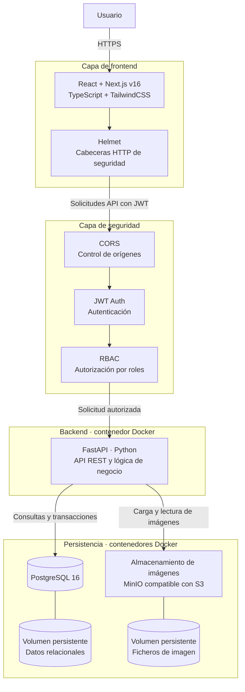
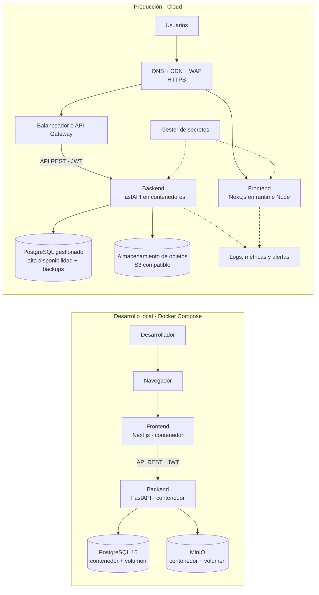

## Índice

0. [Ficha del proyecto](#0-ficha-del-proyecto)
1. [Descripción general del producto](#1-descripción-general-del-producto)
2. [Arquitectura del sistema](#2-arquitectura-del-sistema)
3. [Modelo de datos](#3-modelo-de-datos)
4. [Especificación de la API](#4-especificación-de-la-api)
5. [Historias de usuario](#5-historias-de-usuario)
6. [Tickets de trabajo](#6-tickets-de-trabajo)
7. [Pull requests](#7-pull-requests)

---

## 0. Ficha del proyecto

### **0.1. Tu nombre completo:**

Sergio Fernández García

### **0.2. Nombre del proyecto:**

EntreVecinos

### **0.3. Descripción breve del proyecto:**

**EntreVecinos** es una aplicación web de proximidad diseñada para facilitar el intercambio de productos, servicios y oportunidades entre personas que pertenecen a una misma comunidad, urbanización, barrio o entorno geográfico reducido.

La plataforma funciona como un escaparate y tablón de anuncios digital, donde cualquier usuario puede publicar aquello que quiere vender, ofrecer, comprar, intercambiar o encontrar, y donde el resto de miembros puede descubrir fácilmente qué hay disponible cerca de ellos.

### **0.4. URL del proyecto:**

**Pendiente**. Se proporcionará al completar el presente proyecto.

### 0.5. URL o archivo comprimido del repositorio

https://github.com/serfer2/AI4Devs-finalproject


---

## 1. Descripción general del producto

### **1.1. Objetivo:**

#### Propósito del producto

Crear una plataforma de intercambio de proximidad que conecte a las personas de una misma comunidad, urbanización, barrio o entorno geográfico reducido, facilitando que puedan **encontrar, ofrecer, comprar, vender, regalar o intercambiar productos y servicios** de forma sencilla y cercana.

El producto digitaliza el tradicional **tablón de anuncios local**, convirtiéndolo en un espacio organizado, accesible y dinámico donde la oferta y la demanda de una comunidad puedan encontrarse.

#### ¿Qué valor aporta?

##### Para las personas

- Permite encontrar productos y servicios **cerca de casa**.
- Facilita vender o dar una segunda vida a objetos que ya no se utilizan.
- Permite encontrar personas que ofrecen servicios o ayuda dentro del propio entorno.
- Reduce la dispersión de anuncios entre grupos de WhatsApp, Facebook, carteles físicos y otras plataformas.
- Facilita el contacto entre personas con necesidades u ofertas complementarias.
- Aporta un contexto de **proximidad y confianza** frente a los marketplaces generalistas.

##### Para los profesionales

- Proporciona un escaparate dirigido específicamente a personas de su entorno.
- Permite dar visibilidad a productos, servicios y habilidades sin depender de plataformas generalistas.
- Facilita encontrar clientes potenciales cercanos.
- Permite a profesionales y pequeños negocios locales promocionarse dentro de las comunidades donde trabajan.

##### Para las comunidades

- Facilita el intercambio y la colaboración entre sus miembros.
- Favorece el aprovechamiento de recursos existentes dentro de la propia comunidad.
- Puede contribuir a fortalecer las relaciones entre vecinos y generar nuevas oportunidades de colaboración.

#### ¿Qué problema soluciona?

Actualmente, muchas oportunidades de intercambio local están **fragmentadas y son difíciles de descubrir**.

Una persona puede necesitar un producto, contratar un servicio, encontrar ayuda o buscar un objeto concreto mientras, al mismo tiempo, otra persona cercana está ofreciendo exactamente aquello que necesita.

Sin embargo, ambas personas pueden no llegar a encontrarse porque la información está dispersa entre:

- Grupos de WhatsApp.
- Grupos de Facebook.
- Plataformas de compraventa generalistas.
- Carteles físicos.
- Recomendaciones personales.
- Conversaciones entre vecinos.

El producto crea un **punto de encuentro único y organizado** para concentrar esa oferta y demanda local.

#### Propuesta de valor

> **Conectar lo que una persona necesita con lo que otra persona cercana puede ofrecer.**

La diferencia fundamental frente a un marketplace generalista es que el producto no se centra únicamente en la **transacción**, sino en la **proximidad**: conseguir que las personas descubran oportunidades que existen a pocos minutos de ellas y que, de otro modo, podrían permanecer invisibles.

---

### **1.2. Características y funcionalidades principales:**

EntreVecinos combina las características de un **marketplace**, un **tablón de anuncios** y una **red de intercambio de proximidad**. Sus funcionalidades principales son:

#### Registro y perfiles

- Registro mediante correo electrónico y creación de un perfil personal con fotografía, nombre, teléfono y correo electrónico.
- Asociación de cada usuario a una comunidad o zona.
- Perfil profesional opcional para quienes ofrecen servicios habitualmente, con servicios, zona de actuación, descripción, fotografías y disponibilidad.

#### Comunidades y zonas

- Creación de comunidades que representan urbanizaciones, barrios u otros grupos locales.
- Incorporación de usuarios a una comunidad.
- Asociación de las publicaciones a las comunidades correspondientes.
- Herramientas para que los administradores de comunidad aprueben solicitudes de acceso, gestionen usuarios y moderen publicaciones.

#### Publicaciones y anuncios

Los usuarios pueden crear, editar y eliminar anuncios para ofrecer o solicitar productos y servicios en las comunidades a las que pertenecen. Cada publicación puede incluir título, descripción, fotografías, categoría, tipo de anuncio, precio y fecha de publicación.

Los tipos de publicación disponibles son:

- **Vendo:** productos que el usuario quiere vender.
- **Busco:** productos que necesita encontrar.
- **Ofrezco:** servicios que puede prestar.
- **Necesito:** servicios que necesita contratar.
- **Regalo:** productos que ofrece gratuitamente.
- **Otros:** anuncios que no encajan en las modalidades anteriores.

#### Búsqueda, filtros y detalle

- Búsqueda de publicaciones por palabras clave.
- Filtros por comunidad y tipo de publicación.
- Ordenación por precio o fecha de publicación.
- Página de detalle con título, fotografías, descripción, precio, información del anunciante y fecha de publicación, además de una opción para contactar.

#### Mensajería y notificaciones

- Mensajería privada entre usuarios para contactar con anunciantes.
- Gestión de conversaciones asociadas a publicaciones.
- Avisos al usuario cuando recibe respuestas a sus anuncios.

#### Denuncias y administración

- Los usuarios pueden denunciar publicaciones.
- Los administradores pueden revisar y gestionar denuncias.
- Panel de administración para gestionar usuarios, comunidades, publicaciones y denuncias.

#### Diseño responsive

La interfaz se adapta a ordenadores, tablets y smartphones para facilitar el uso desde distintos tamaños de pantalla.

### MVP

El MVP debe permitir que un vecino publique una oferta o necesidad dentro de su comunidad y que otra persona pueda encontrarla y contactar con él. Para cubrir ese recorrido, incluiría:
1. **Registro y perfil básico**
   - Registro, inicio y cierre de sesión con correo electrónico.
   - Perfil con nombre y datos de contacto.
   - Asociación del usuario a una comunidad.
   - Tras registrarse o iniciar sesión, llevar al usuario a la lista de comunidades si todavía no pertenece a ninguna, o directamente a su comunidad si solo pertenece a una.
2. **Comunidades**
   - Crear o seleccionar una comunidad local.
   - Permitir que sus miembros vean los anuncios asociados a ella.
   - Incluir una gestión sencilla de acceso, por ejemplo, aprobación por parte de un administrador.
   - Las comunidades nuevas quedan pendientes hasta que un administrador de la plataforma las aprueba; las que crea él quedan activas al momento. Cada usuario puede tener solo una comunidad pendiente a la vez.
3. **Gestión de anuncios**
   - Crear, editar y eliminar anuncios propios.
   - Marcar los anuncios propios como reservados o finalizados.
   - Incluir título, descripción, categoría, tipo de publicación, precio opcional, fotografías y fecha.
   - Ofrecer los tipos principales: Vendo, Busco, Ofrezco, Necesito y Regalo. «Otros» puede servir como categoría general.
4. **Explorar y encontrar anuncios**
   - Ver los anuncios de la comunidad.
   - Buscar por palabras clave.
   - Filtrar por comunidad y tipo de publicación.
   - Ordenar por fecha o precio.
5. **Detalle y contacto**
   - Consultar la información completa del anuncio y del anunciante.
   - Contactar con quien publicó el anuncio. Para el MVP puede bastar un canal de contacto directo; la mensajería interna puede añadirse cuando el flujo básico esté validado.
6. **Administración mínima**
   - Contar con una persona administradora que pueda gestionar miembros y retirar anuncios problemáticos.
 
Quedan para una fase posterior el perfil profesional, las notificaciones automáticas, el sistema completo de denuncias y el panel avanzado de administración.

---

### **1.3. Diseño y experiencia de usuario:**

> Proporciona imágenes y/o videotutorial mostrando la experiencia del usuario desde que aterriza en la aplicación, pasando por todas las funcionalidades principales.

**Pendiente**. Se proporcionará una vez completado el desarrollo del frontend.

---

### **1.4. Instrucciones de instalación:**
> Documenta de manera precisa las instrucciones para instalar y poner en marcha el proyecto en local (librerías, backend, frontend, servidor, base de datos, migraciones y semillas de datos, etc.)

**Pendiente**. Se proporcionará una vez completado el desarrollo de backend y frontend.

---

## 2. Arquitectura del Sistema

### **2.1. Diagrama de arquitectura:**
> Usa el formato que consideres más adecuado para representar los componentes principales de la aplicación y las tecnologías utilizadas. Explica si sigue algún patrón predefinido, justifica por qué se ha elegido esta arquitectura, y destaca los beneficios principales que aportan al proyecto y justifican su uso, así como sacrificios o déficits que implica.


### 2.1. Diagrama de arquitectura



#### Patrón arquitectónico
La solución sigue una arquitectura cliente-servidor de tres capas: presentación, lógica de negocio y persistencia. El backend se organiza como un monolito modular, con una API FastAPI dividida internamente por áreas funcionales, como usuarios, comunidades y publicaciones.

**Justificación**

Next.js proporciona la interfaz web; FastAPI concentra las reglas de negocio y expone la API REST. PostgreSQL almacena los datos estructurados y relacionados. MinIO almacena los ficheros de imagen, mientras que PostgreSQL conserva sus metadatos y referencias. Los volúmenes persistentes mantienen los datos aunque se recreen los contenedores.

JWT Auth valida la identidad y RBAC comprueba los permisos en el backend. CORS restringe los orígenes autorizados a comunicarse con la API. Helmet configura cabeceras HTTP de seguridad para el frontend. Como Helmet pertenece al ecosistema Node.js, si Next.js se ejecuta sin un servidor Node personalizado, las cabeceras equivalentes deben configurarse en Next.js o en un proxy frontal.

**Beneficios**

- La separación de responsabilidades facilita el desarrollo y el mantenimiento.
- Docker ayuda a reproducir y desplegar los componentes.
- El almacenamiento de objetos evita guardar el contenido de las imágenes en PostgreSQL.
- El frontend y el backend pueden escalarse por separado.
- El monolito modular mantiene sencilla la operación inicial y permite organizar el código por áreas funcionales.

**Sacrificios y déficits**
- Hay varios componentes que configurar y mantener, así como credenciales, permisos y copias de seguridad para los volúmenes.
- MinIO añade complejidad frente al almacenamiento local, aunque permite migrar a otros servicios compatibles con S3.
- El monolito modular no permite escalar cada módulo de negocio independientemente.
- Los volúmenes Docker requieren copias de seguridad para proteger los datos ante fallos del servidor.


### **2.2. Descripción de componentes principales:**

- **Frontend web:** construido con **React**, **Next.js v16** y **TypeScript**. Presenta las páginas de la aplicación y permite a los usuarios buscar, consultar y gestionar anuncios. **TailwindCSS** se utiliza para crear y adaptar los estilos a ordenadores, tablets y móviles.

- **Capa de seguridad:** protege el acceso entre frontend y backend. **JWT Auth** identifica a los usuarios mediante tokens; **RBAC** controla las acciones permitidas según el rol; **CORS** limita los orígenes autorizados; y **Helmet** configura cabeceras HTTP de seguridad en el servidor Node.js del frontend. La API debe validar los tokens y permisos en el backend.

- **API y lógica de negocio:** desarrollada en **Python con FastAPI** y ejecutada en un contenedor Docker. Gestiona usuarios, comunidades y publicaciones, aplica las reglas del producto y proporciona endpoints REST al frontend. También coordina el acceso a la base de datos y al almacenamiento de imágenes.

- **Base de datos relacional:** **PostgreSQL 16**, desplegada en un contenedor Docker. Guarda la información estructurada, como usuarios, comunidades, anuncios y mensajes. Un volumen persistente conserva los datos cuando se reinicia o recrea el contenedor.

- **Almacenamiento de imágenes:** un servicio compatible con S3, como **MinIO**, almacena las fotografías de los anuncios y perfiles. Sus ficheros se conservan en un volumen persistente. PostgreSQL guarda las referencias y metadatos de cada imagen, mientras que el backend gestiona las cargas y lecturas.

- **Contenedores y red de despliegue:** **Docker** ejecuta frontend, backend, PostgreSQL y almacenamiento de imágenes en servicios separados. La base de datos y el almacenamiento deberían permanecer en una red interna, accesibles desde el backend, y no exponerse directamente a los usuarios.

### **2.3. Descripción de alto nivel del proyecto y estructura de ficheros**

```
entrevecinos/
├── apps/
│   ├── web/                         # Aplicación web
│   │   ├── src/
│   │   │   ├── app/                 # Rutas y layouts de Next.js
│   │   │   ├── features/            # Funcionalidades organizadas por dominio
│   │   │   │   ├── auth/
│   │   │   │   ├── communities/
│   │   │   │   ├── listings/
│   │   │   │   └── messaging/
│   │   │   ├── components/          # Componentes compartidos de interfaz
│   │   │   ├── lib/                 # Clientes API y utilidades
│   │   │   └── styles/              # Estilos globales y configuración visual
│   │   ├── public/                  # Recursos estáticos
│   │   ├── Dockerfile
│   │   └── package.json
│   │
│   └── api/                         # API de Python y FastAPI
│       ├── src/
│       │   └── entrevecinos/
│       │       ├── domain/          # Entidades y reglas de negocio
│       │       ├── application/     # Casos de uso y puertos
│       │       ├── infrastructure/ # PostgreSQL, imágenes y servicios externos
│       │       └── presentation/    # Endpoints, esquemas y dependencias FastAPI
│       ├── tests/
│       ├── Dockerfile
│       └── pyproject.toml
│
├── packages/                        # Código compartido, si es necesario
│   └── api-contracts/               # Contratos o esquemas compartidos
│
├── infra/
│   ├── docker-compose.yml           # Servicios y redes locales
│   ├── postgres/                    # Inicialización y configuración de PostgreSQL
│   └── storage/                     # Configuración del almacenamiento de imágenes
│
├── docs/                            # Arquitectura y documentación del proyecto
├── .env.example                     # Variables de entorno de ejemplo
├── .gitignore
└── README.md
```

#### Propósito de las carpetas

- **`apps/web`** contiene la aplicación React con Next.js. `app/` define las rutas; `features/` agrupa pantallas, componentes y lógica de cada funcionalidad; y `components/` reúne elementos reutilizables.
- **`apps/api`** contiene el backend FastAPI. Separa las reglas de negocio de los detalles del framework, la base de datos y otros servicios.
- **`packages/`** aloja contratos compartidos cuando frontend y backend necesitan una definición común. Conviene evitar duplicar lógica de negocio entre aplicaciones.
- **`infra/`** guarda la configuración para ejecutar servicios como la API, PostgreSQL y el almacenamiento de imágenes.
- **`docs/`** contiene diagramas, decisiones de arquitectura e información técnica complementaria.

#### Arquitectura y buenas prácticas

El repositorio aplica una **arquitectura limpia** en el backend, organizada en capas:

- **Dominio:** reglas y entidades del negocio, sin dependencias de FastAPI o PostgreSQL.
- **Aplicación:** casos de uso que coordinan las operaciones y dependen de interfaces o puertos.
- **Infraestructura:** implementaciones concretas, como repositorios PostgreSQL y almacenamiento de imágenes.
- **Presentación:** endpoints y modelos de entrada y salida de FastAPI.

Las dependencias apuntan hacia el núcleo: dominio y aplicación no dependen de infraestructura. Así se pueden cambiar tecnologías externas sin alterar las reglas principales del producto.

En el frontend, `features/` organiza el código por funcionalidad para mantener juntas sus páginas, componentes y lógica específica. Las rutas y layouts propios de Next.js permanecen en `app/`; los componentes y utilidades compartidos se extraen solo cuando tienen más de un uso.

Esta estructura mantiene el despliegue coordinado desde un repositorio común y, a la vez, establece límites claros entre módulos. El principal coste es que requiere mantener convenciones y configuración para varias aplicaciones; para un MVP, conviene evitar crear capas o paquetes compartidos que todavía no aporten valor.

### **2.4. Infraestructura y despliegue**



#### Desarrollo local

Docker Compose levanta los componentes necesarios en el equipo del desarrollador: frontend Next.js, API FastAPI, PostgreSQL y MinIO. Como MinIO ya no publica imágenes Docker oficiales, se usa la compilación comunitaria `pgsty/minio` con versión fija (licencia AGPLv3, usada sin modificar como servicio independiente); el detalle está en TK-019. Los servicios se comunican por una red de Docker y los datos sobreviven a reinicios mediante volúmenes persistentes.

Esta configuración facilita arrancar el proyecto con un entorno reproducible y probar la integración entre componentes. Las credenciales locales deben ser de desarrollo y no reutilizarse en producción.

#### Producción en cloud

En producción, el frontend y la API se despliegan en servicios con runtime compatible con Node.js y contenedores, respectivamente. Un proveedor cloud puede ofrecerlos como servicios gestionados de contenedores. El tráfico público entra por DNS y HTTPS; CDN y WAF pueden proteger y distribuir el contenido web, mientras que un balanceador o API Gateway dirige las solicitudes a la API.

PostgreSQL se sustituye por una instancia gestionada, preferiblemente con alta disponibilidad, copias de seguridad y recuperación a un punto en el tiempo. Las imágenes pasan de MinIO local a almacenamiento de objetos cloud compatible con S3. Las credenciales se obtienen de un gestor de secretos, y logs y métricas se centralizan para facilitar la operación.

#### Diferencias técnicas principales

- **Ejecución:** Compose coordina contenedores en una sola máquina; en cloud, los servicios pueden ejecutarse en plataformas administradas y escalar según la demanda.
- **Persistencia:** los volúmenes locales sirven para desarrollo. En producción, la base de datos y las imágenes deben residir en almacenamiento gestionado, con copias de seguridad y políticas de retención.
- **Seguridad:** producción requiere HTTPS, secretos protegidos, reglas de red restrictivas y acceso privado desde la API a la base de datos. JWT, RBAC y CORS siguen aplicándose en la API.
- **Disponibilidad y observabilidad:** la producción necesita monitorización, alertas, gestión de errores y un plan de recuperación ante fallos.
- **Despliegue:** una canalización CI/CD puede construir y publicar imágenes Docker, ejecutar comprobaciones y desplegar versiones controladas.

Para un MVP, conviene usar servicios gestionados para PostgreSQL y almacenamiento de imágenes, y mantener frontend y API en contenedores desplegables de forma independiente.

**Pendiente**: La infraestructura cloud concreta depende del proveedor y del tráfico esperado. Se completará en la entrega 3 del presente proyecto. 


### **2.5. Seguridad**

Según la arquitectura descrita en el README, el proyecto contempla las siguientes prácticas de seguridad. Como el desarrollo y el despliegue figuran como pendientes, se presentan como medidas previstas; su implementación debe confirmarse en el código y en la configuración de producción.

- **Autenticación mediante JWT:** la API valida los tokens de acceso para identificar al usuario en las solicitudes protegidas. Por ejemplo, al crear un anuncio, el frontend enviaría `Authorization: Bearer <token>`. La clave de firma debe guardarse como secreto y no incluirse en el repositorio.

- **Autorización basada en roles (RBAC):** el backend comprueba los permisos antes de realizar cada operación. Por ejemplo, solo un administrador de comunidad debería poder aprobar solicitudes o moderar publicaciones. Ocultar un botón en la interfaz no sustituye la comprobación de permisos en la API.

- **Control de orígenes mediante CORS:** la API debe aceptar solicitudes web únicamente desde los dominios autorizados. Por ejemplo, producción podría permitir `https://entrevecinos.example.com` y rechazar otros orígenes. CORS no reemplaza la autenticación ni impide por sí solo las solicitudes realizadas fuera de un navegador.

- **Cabeceras HTTP de seguridad con Helmet:** Helmet puede configurar cabeceras como `X-Content-Type-Options: nosniff` y `Strict-Transport-Security` en el servidor Node.js del frontend. Si Next.js se ejecuta sin un servidor Node personalizado, estas cabeceras deben configurarse en Next.js o en el proxy frontal.

- **Cifrado del tráfico:** el acceso público de producción debe utilizar HTTPS para proteger las comunicaciones entre usuarios, frontend y API. Los tokens no deben enviarse a través de conexiones HTTP sin cifrar.

- **Aislamiento de base de datos y archivos:** PostgreSQL y MinIO —o el almacenamiento compatible con S3 usado en producción— deben permanecer en una red privada y ser accesibles desde el backend, sin exponer sus puertos directamente a Internet.

- **Gestión de secretos:** las credenciales de PostgreSQL, las claves JWT y las credenciales del almacenamiento deben guardarse en variables protegidas o en un gestor de secretos. Por ejemplo, `.env.example` puede documentar `DATABASE_URL` y `JWT_SECRET` con valores ficticios; el archivo `.env` real debe excluirse del repositorio.

- **Protección de datos persistentes:** la arquitectura utiliza volúmenes para conservar PostgreSQL y las imágenes. En producción, estos datos deben contar con copias de seguridad y una política de retención. Por ejemplo, se pueden programar copias periódicas y comprobar que es posible restaurarlas.

- **Validación y control de acceso a imágenes:** el backend debe verificar los permisos de quien carga o consulta una imagen y validar los ficheros recibidos. Por ejemplo, puede aceptar solo formatos permitidos, como JPEG, PNG o WebP, y aplicar un tamaño máximo.

### **2.6. Tests**

> Describe brevemente algunos de los tests realizados

**Pendiente** para la entrega 2.

---

## 3. Modelo de Datos

### **3.1. Diagrama del modelo de datos:**

```Mermaid
erDiagram
    USER {
        UUID id PK "Identificador; NOT NULL"
        VARCHAR email UK "VARCHAR(320); normalizado a minúsculas; NOT NULL"
        VARCHAR password_hash "VARCHAR(255); hash de contraseña; NOT NULL"
        VARCHAR full_name "VARCHAR(120); NOT NULL"
        VARCHAR phone "VARCHAR(32); NULL"
        UUID avatar_asset_id FK "NULL; FK a media_asset.id"
        user_role platform_role "NOT NULL; DEFAULT user"
        BOOLEAN is_active "NOT NULL; DEFAULT true"
        TIMESTAMPTZ created_at "NOT NULL"
        TIMESTAMPTZ updated_at "NOT NULL"
        TIMESTAMPTZ deleted_at "NULL; borrado lógico"
    }

    COMMUNITY {
        UUID id PK "Identificador; NOT NULL"
        VARCHAR name "VARCHAR(120); NOT NULL"
        TEXT description "NULL"
        VARCHAR postal_code "VARCHAR(16); NULL"
        VARCHAR city "VARCHAR(120); NULL"
        UUID created_by FK "NOT NULL; FK a user.id"
        BOOLEAN is_active "NOT NULL; DEFAULT true"
        TIMESTAMPTZ created_at "NOT NULL"
        TIMESTAMPTZ updated_at "NOT NULL"
    }

    COMMUNITY_MEMBERSHIP {
        UUID community_id PK, FK "NOT NULL; FK a community.id"
        UUID user_id PK, FK "NOT NULL; FK a user.id"
        membership_role role "NOT NULL; DEFAULT member"
        membership_status status "NOT NULL; DEFAULT pending"
        UUID reviewed_by FK "NULL; FK a user.id"
        TIMESTAMPTZ requested_at "NOT NULL"
        TIMESTAMPTZ reviewed_at "NULL"
        TIMESTAMPTZ joined_at "NULL"
    }

    CATEGORY {
        UUID id PK "Identificador; NOT NULL"
        VARCHAR name UK "VARCHAR(80); NOT NULL"
        VARCHAR slug UK "VARCHAR(100); NOT NULL"
        BOOLEAN is_active "NOT NULL; DEFAULT true"
    }

    LISTING {
        UUID id PK "Identificador; NOT NULL"
        UUID community_id FK "NOT NULL; FK a community.id"
        UUID owner_id FK "NOT NULL; FK a user.id"
        UUID category_id FK "NOT NULL; FK a category.id"
        VARCHAR title "VARCHAR(160); NOT NULL"
        TEXT description "NOT NULL"
        listing_type type "NOT NULL"
        NUMERIC price "NUMERIC(10,2); NULL; CHECK price >= 0"
        CHAR currency "CHAR(3); código ISO 4217; NULL"
        listing_status status "NOT NULL; DEFAULT active"
        TIMESTAMPTZ published_at "NOT NULL"
        TIMESTAMPTZ created_at "NOT NULL"
        TIMESTAMPTZ updated_at "NOT NULL"
        TIMESTAMPTZ deleted_at "NULL; borrado lógico"
    }

    MEDIA_ASSET {
        UUID id PK "Identificador; NOT NULL"
        UUID uploaded_by FK "NOT NULL; FK a user.id"
        VARCHAR object_key UK "VARCHAR(512); NOT NULL"
        VARCHAR mime_type "VARCHAR(100); NOT NULL"
        BIGINT size_bytes "NOT NULL; CHECK size_bytes > 0"
        CHAR sha256 "CHAR(64); NULL"
        TIMESTAMPTZ created_at "NOT NULL"
    }

    LISTING_IMAGE {
        UUID listing_id PK, FK "NOT NULL; FK a listing.id"
        UUID asset_id PK, FK "NOT NULL; FK a media_asset.id"
        SMALLINT position "NOT NULL; DEFAULT 0; CHECK position >= 0"
        BOOLEAN is_cover "NOT NULL; DEFAULT false"
    }

    CONVERSATION {
        UUID id PK "Identificador; NOT NULL"
        UUID listing_id FK "NOT NULL; FK a listing.id"
        UUID buyer_id FK "NOT NULL; FK a user.id"
        UUID seller_id FK "NOT NULL; FK a user.id; CHECK buyer_id <> seller_id"
        conversation_status status "NOT NULL; DEFAULT open"
        TIMESTAMPTZ created_at "NOT NULL"
        TIMESTAMPTZ updated_at "NOT NULL"
    }

    MESSAGE {
        UUID id PK "Identificador; NOT NULL"
        UUID conversation_id FK "NOT NULL; FK a conversation.id"
        UUID sender_id FK "NOT NULL; FK a user.id"
        TEXT body "NOT NULL; no vacío"
        TIMESTAMPTZ created_at "NOT NULL"
        TIMESTAMPTZ read_at "NULL"
        TIMESTAMPTZ deleted_at "NULL; borrado lógico"
    }

    NOTIFICATION {
        UUID id PK "Identificador; NOT NULL"
        UUID recipient_id FK "NOT NULL; FK a user.id"
        UUID message_id FK "NULL; FK a message.id"
        notification_type type "NOT NULL"
        JSONB payload "NULL"
        TIMESTAMPTZ created_at "NOT NULL"
        TIMESTAMPTZ read_at "NULL"
    }

    PROFESSIONAL_PROFILE {
        UUID id PK "Identificador; NOT NULL"
        UUID user_id FK, UK "NOT NULL; FK a user.id; un perfil por usuario"
        TEXT description "NOT NULL"
        VARCHAR service_area "VARCHAR(160); NOT NULL"
        TEXT availability "NULL"
        BOOLEAN is_active "NOT NULL; DEFAULT true"
        TIMESTAMPTZ created_at "NOT NULL"
        TIMESTAMPTZ updated_at "NOT NULL"
    }

    PROFESSIONAL_SERVICE {
        UUID id PK "Identificador; NOT NULL"
        UUID professional_profile_id FK "NOT NULL; FK a professional_profile.id"
        VARCHAR name "VARCHAR(120); NOT NULL"
        TEXT description "NULL"
        BOOLEAN is_active "NOT NULL; DEFAULT true"
    }

    PROFESSIONAL_PROFILE_IMAGE {
        UUID professional_profile_id PK, FK "NOT NULL; FK a professional_profile.id"
        UUID asset_id PK, FK "NOT NULL; FK a media_asset.id"
        SMALLINT position "NOT NULL; DEFAULT 0; CHECK position >= 0"
    }

    REPORT {
        UUID id PK "Identificador; NOT NULL"
        UUID listing_id FK "NOT NULL; FK a listing.id"
        UUID reporter_id FK "NOT NULL; FK a user.id"
        report_reason reason "NOT NULL"
        TEXT details "NULL"
        report_status status "NOT NULL; DEFAULT pending"
        UUID reviewed_by FK "NULL; FK a user.id"
        TEXT resolution "NULL"
        TIMESTAMPTZ created_at "NOT NULL"
        TIMESTAMPTZ reviewed_at "NULL"
    }

    USER ||--o{ COMMUNITY : "crea"
    USER ||--o{ COMMUNITY_MEMBERSHIP : "solicita membresía"
    COMMUNITY ||--o{ COMMUNITY_MEMBERSHIP : "incluye miembros"
    USER o|--o{ COMMUNITY_MEMBERSHIP : "revisa solicitudes"

    USER ||--o{ LISTING : "publica"
    COMMUNITY ||--o{ LISTING : "contiene"
    CATEGORY ||--o{ LISTING : "clasifica"

    USER ||--o{ MEDIA_ASSET : "carga"
    MEDIA_ASSET o|--o{ USER : "puede ser avatar"
    LISTING ||--o{ LISTING_IMAGE : "incluye imágenes"
    MEDIA_ASSET ||--o{ LISTING_IMAGE : "se adjunta a anuncios"

    LISTING ||--o{ CONVERSATION : "origina"
    USER ||--o{ CONVERSATION : "participa como comprador"
    USER ||--o{ CONVERSATION : "participa como anunciante"
    CONVERSATION ||--o{ MESSAGE : "contiene"
    USER ||--o{ MESSAGE : "envía"
    USER ||--o{ NOTIFICATION : "recibe"
    MESSAGE o|--o{ NOTIFICATION : "puede generar"

    USER ||--o| PROFESSIONAL_PROFILE : "puede tener"
    PROFESSIONAL_PROFILE ||--o{ PROFESSIONAL_SERVICE : "ofrece"
    PROFESSIONAL_PROFILE ||--o{ PROFESSIONAL_PROFILE_IMAGE : "incluye imágenes"
    MEDIA_ASSET ||--o{ PROFESSIONAL_PROFILE_IMAGE : "se adjunta a perfiles"

    LISTING ||--o{ REPORT : "recibe denuncias"
    USER ||--o{ REPORT : "denuncia"
    USER o|--o{ REPORT : "revisa"
```


### **3.2. Descripción de entidades principales:**

El modelo cubre las funciones descritas en el README: usuarios, comunidades, anuncios, imágenes, mensajería, notificaciones, perfiles profesionales y moderación. Se propone para **PostgreSQL 16**. Las tablas se nombran en singular, igual que las entidades (`community`, `listing`…), salvo la de usuarios, que se llama `users` porque `user` es una palabra reservada de PostgreSQL. Los campos marcados `NOT NULL` no admiten valores nulos; `NULL` indica que el dato es opcional.

#### 1. `user` — Usuario

- `id UUID` — **PK**, identificador.
- `email VARCHAR(320)` — `NOT NULL`, `UNIQUE`; correo normalizado a minúsculas.
- `password_hash VARCHAR(255)` — `NOT NULL`; hash de contraseña, nunca la contraseña en texto claro.
- `full_name VARCHAR(120)` — `NOT NULL`.
- `phone VARCHAR(32)` — `NULL`.
- `avatar_asset_id UUID` — `NULL`, **FK** → `media_asset.id`.
- `platform_role user_role` — `NOT NULL`, `DEFAULT 'user'`; rol global.
- `is_active BOOLEAN` — `NOT NULL`, `DEFAULT TRUE`.
- `created_at TIMESTAMPTZ` — `NOT NULL`.
- `updated_at TIMESTAMPTZ` — `NOT NULL`.
- `deleted_at TIMESTAMPTZ` — `NULL`; permite borrado lógico.

#### 2. `community` — Comunidad

- `id UUID` — **PK**.
- `name VARCHAR(120)` — `NOT NULL`.
- `description TEXT` — `NULL`.
- `postal_code VARCHAR(16)` — `NULL`.
- `city VARCHAR(120)` — `NULL`.
- `created_by UUID` — `NOT NULL`, **FK** → `user.id`.
- `is_active BOOLEAN` — `NOT NULL`, `DEFAULT TRUE`. En el MVP, `FALSE` significa pendiente de aprobación por un `platform_admin`.
- `created_at TIMESTAMPTZ` — `NOT NULL`.
- `updated_at TIMESTAMPTZ` — `NOT NULL`.

#### 3. `community_membership` — Relación entre usuarios y comunidades

Resuelve la relación muchos-a-muchos entre usuarios y comunidades.

- `community_id UUID` — **PK compuesta**, **FK** → `community.id`.
- `user_id UUID` — **PK compuesta**, **FK** → `user.id`.
- `role membership_role` — `NOT NULL`, `DEFAULT 'member'`.
- `status membership_status` — `NOT NULL`, `DEFAULT 'pending'`.
- `reviewed_by UUID` — `NULL`, **FK** → `user.id`; administrador que revisó la solicitud.
- `requested_at TIMESTAMPTZ` — `NOT NULL`.
- `reviewed_at TIMESTAMPTZ` — `NULL`.
- `joined_at TIMESTAMPTZ` — `NULL`.

La clave primaria compuesta `(community_id, user_id)` impide que un usuario tenga dos membresías para la misma comunidad.

#### 4. `category` — Categoría de anuncios

- `id UUID` — **PK**.
- `name VARCHAR(80)` — `NOT NULL`, `UNIQUE`.
- `slug VARCHAR(100)` — `NOT NULL`, `UNIQUE`; identificador legible para URLs.
- `is_active BOOLEAN` — `NOT NULL`, `DEFAULT TRUE`.

#### 5. `listing` — Anuncio

- `id UUID` — **PK**.
- `community_id UUID` — `NOT NULL`, **FK** → `community.id`.
- `owner_id UUID` — `NOT NULL`, **FK** → `user.id`.
- `category_id UUID` — `NOT NULL`, **FK** → `category.id`.
- `title VARCHAR(160)` — `NOT NULL`.
- `description TEXT` — `NOT NULL`.
- `type listing_type` — `NOT NULL`; modalidad del anuncio.
- `price NUMERIC(10,2)` — `NULL`; precio opcional.
- `currency CHAR(3)` — `NULL`; código ISO 4217 cuando hay precio.
- `status listing_status` — `NOT NULL`, `DEFAULT 'active'`.
- `published_at TIMESTAMPTZ` — `NOT NULL`.
- `created_at TIMESTAMPTZ` — `NOT NULL`.
- `updated_at TIMESTAMPTZ` — `NOT NULL`.
- `deleted_at TIMESTAMPTZ` — `NULL`; borrado lógico.

Restricciones recomendadas: `CHECK (price IS NULL OR price >= 0)` y exigir moneda cuando el anuncio tiene precio. Los anuncios sin precio, como los regalos, pueden dejar `price` y `currency` a `NULL`.

#### 6. `media_asset` — Fichero de imagen

Guarda metadatos y ubicación del fichero; el binario se almacena en MinIO o en un servicio de objetos compatible con S3.

- `id UUID` — **PK**.
- `uploaded_by UUID` — `NOT NULL`, **FK** → `user.id`.
- `object_key VARCHAR(512)` — `NOT NULL`, `UNIQUE`; clave del fichero en el almacenamiento.
- `mime_type VARCHAR(100)` — `NOT NULL`.
- `size_bytes BIGINT` — `NOT NULL`, `CHECK (size_bytes > 0)`.
- `sha256 CHAR(64)` — `NULL`; hash opcional para verificar integridad.
- `created_at TIMESTAMPTZ` — `NOT NULL`.

#### 7. `listing_image` — Imagen de anuncio

- `listing_id UUID` — **PK compuesta**, **FK** → `listing.id`.
- `asset_id UUID` — **PK compuesta**, **FK** → `media_asset.id`.
- `position SMALLINT` — `NOT NULL`, `DEFAULT 0`, `CHECK (position >= 0)`.
- `is_cover BOOLEAN` — `NOT NULL`, `DEFAULT FALSE`.

La clave compuesta `(listing_id, asset_id)` evita asociar dos veces la misma imagen al mismo anuncio.

#### 8. `conversation` — Conversación

Una conversación está vinculada a un anuncio y a sus dos participantes.

- `id UUID` — **PK**.
- `listing_id UUID` — `NOT NULL`, **FK** → `listing.id`.
- `buyer_id UUID` — `NOT NULL`, **FK** → `user.id`; usuario interesado.
- `seller_id UUID` — `NOT NULL`, **FK** → `user.id`; anunciante.
- `status conversation_status` — `NOT NULL`, `DEFAULT 'open'`.
- `created_at TIMESTAMPTZ` — `NOT NULL`.
- `updated_at TIMESTAMPTZ` — `NOT NULL`.

Restricciones recomendadas: `CHECK (buyer_id <> seller_id)` y `UNIQUE (listing_id, buyer_id, seller_id)` para evitar conversaciones duplicadas entre los mismos usuarios por el mismo anuncio.

#### 9. `message` — Mensaje

- `id UUID` — **PK**.
- `conversation_id UUID` — `NOT NULL`, **FK** → `conversation.id`.
- `sender_id UUID` — `NOT NULL`, **FK** → `user.id`.
- `body TEXT` — `NOT NULL`, no vacío tras quitar espacios.
- `created_at TIMESTAMPTZ` — `NOT NULL`.
- `read_at TIMESTAMPTZ` — `NULL`.
- `deleted_at TIMESTAMPTZ` — `NULL`; borrado lógico.

La aplicación debe comprobar que el remitente pertenece a la conversación.

#### 10. `notification` — Notificación

- `id UUID` — **PK**.
- `recipient_id UUID` — `NOT NULL`, **FK** → `user.id`.
- `message_id UUID` — `NULL`, **FK** → `message.id`.
- `type notification_type` — `NOT NULL`.
- `payload JSONB` — `NULL`; datos auxiliares de la notificación.
- `created_at TIMESTAMPTZ` — `NOT NULL`.
- `read_at TIMESTAMPTZ` — `NULL`.

#### 11. `professional_profile` — Perfil profesional

- `id UUID` — **PK**.
- `user_id UUID` — `NOT NULL`, `UNIQUE`, **FK** → `user.id`; un perfil profesional por usuario.
- `description TEXT` — `NOT NULL`.
- `service_area VARCHAR(160)` — `NOT NULL`.
- `availability TEXT` — `NULL`.
- `is_active BOOLEAN` — `NOT NULL`, `DEFAULT TRUE`.
- `created_at TIMESTAMPTZ` — `NOT NULL`.
- `updated_at TIMESTAMPTZ` — `NOT NULL`.

#### 12. `professional_service` — Servicio profesional ofrecido

- `id UUID` — **PK**.
- `professional_profile_id UUID` — `NOT NULL`, **FK** → `professional_profile.id`.
- `name VARCHAR(120)` — `NOT NULL`.
- `description TEXT` — `NULL`.
- `is_active BOOLEAN` — `NOT NULL`, `DEFAULT TRUE`.

#### 13. `professional_profile_image` — Imagen de perfil profesional

- `professional_profile_id UUID` — **PK compuesta**, **FK** → `professional_profile.id`.
- `asset_id UUID` — **PK compuesta**, **FK** → `media_asset.id`.
- `position SMALLINT` — `NOT NULL`, `DEFAULT 0`, `CHECK (position >= 0)`.

#### 14. `report` — Denuncia

- `id UUID` — **PK**.
- `listing_id UUID` — `NOT NULL`, **FK** → `listing.id`.
- `reporter_id UUID` — `NOT NULL`, **FK** → `user.id`.
- `reason report_reason` — `NOT NULL`.
- `details TEXT` — `NULL`.
- `status report_status` — `NOT NULL`, `DEFAULT 'pending'`.
- `reviewed_by UUID` — `NULL`, **FK** → `user.id`.
- `resolution TEXT` — `NULL`.
- `created_at TIMESTAMPTZ` — `NOT NULL`.
- `reviewed_at TIMESTAMPTZ` — `NULL`.

#### Tipos enumerados

Se recomienda definir estos enums en PostgreSQL:

- `user_role`: `user`, `platform_admin`
- `membership_role`: `member`, `community_admin`, `moderator`
- `membership_status`: `pending`, `approved`, `rejected`, `blocked`
- `listing_type`: `sell`, `wanted`, `offer_service`, `need_service`, `free`, `other`
- `listing_status`: `draft`, `active`, `reserved`, `completed`, `hidden`, `deleted`
- `conversation_status`: `open`, `closed`, `archived`
- `notification_type`: `new_message`, `listing_response`, `system`
- `report_reason`: `inappropriate`, `fraud`, `prohibited_item`, `spam`, `other`
- `report_status`: `pending`, `reviewing`, `resolved`, `rejected`

#### Índices recomendados

Las claves primarias y restricciones `UNIQUE` crean índices automáticamente. Además, estos índices cubren las consultas más habituales:

| Tabla | Índice | Uso |
|---|---|---|
| `community_membership` | `(user_id, status)` | Listar comunidades y solicitudes de un usuario |
| `community_membership` | `(community_id, status)` | Gestionar miembros y solicitudes de una comunidad |
| `listing` | `(community_id, status, published_at DESC)` | Mostrar anuncios recientes de una comunidad |
| `listing` | `(community_id, type, published_at DESC)` | Filtrar anuncios por tipo |
| `listing` | `(category_id, published_at DESC)` | Filtrar anuncios por categoría |
| `listing` | `(price)` | Ordenar por precio |
| `listing` | GIN sobre `title` y `description` | Búsqueda de texto completo |
| `listing_image` | `(asset_id)` | Encontrar anuncios que referencian una imagen |
| `conversation` | `(listing_id, buyer_id, seller_id)` | Localizar conversaciones de un anuncio |
| `message` | `(conversation_id, created_at)` | Cargar mensajes en orden cronológico |
| `notification` | `(recipient_id, read_at, created_at DESC)` | Consultar notificaciones recientes y pendientes |
| `report` | `(status, created_at)` | Listar denuncias pendientes de revisión |
| `professional_service` | `(professional_profile_id, is_active)` | Listar servicios activos de un perfil |
| `professional_profile_image` | `(asset_id)` | Encontrar perfiles que referencian una imagen |

Para búsqueda de texto completo, puede crearse una columna `tsvector` generada o un índice GIN sobre una expresión `to_tsvector` que combine título y descripción. Si la mayoría de consultas solo muestran anuncios activos, pueden evaluarse índices parciales con `WHERE status = 'active'`.

Las reglas `ON DELETE` deben definirse explícitamente. Para anuncios y usuarios conviene considerar el borrado lógico para preservar el historial; para tablas de relación como `listing_image`, puede usarse `ON DELETE CASCADE` al eliminar el anuncio correspondiente.

---

## 4. Especificación de la API

El endpoint de consulta incluye búsqueda, filtros y ordenación; el de creación exige un JWT y una membresía aprobada en la comunidad. El canal de contacto del MVP puede basarse en los datos del anunciante; la mensajería interna queda fuera de estos endpoints iniciales.

```yaml
openapi: 3.1.0
info:
  title: API de EntreVecinos
  version: 1.0.0
  description: API REST para el MVP del marketplace local EntreVecinos.
servers:
  - url: https://api.entrevecinos.example.com/v1
    description: Producción
  - url: http://localhost:8000/v1
    description: Desarrollo local

tags:
  - name: Anuncios
    description: Consulta y publicación de anuncios
  - name: Autenticación
    description: Registro e inicio de sesión

paths:
  /communities/{community_id}/listings:
    parameters:
      - name: community_id
        in: path
        required: true
        description: Identificador de la comunidad cuyos anuncios se consultan o publican.
        schema:
          type: string
          format: uuid

    get:
      tags: [Anuncios]
      summary: Buscar anuncios de una comunidad
      description: Permite explorar anuncios y aplicar búsqueda, filtros y ordenación.
      security:
        - bearerAuth: []
      parameters:
        - name: q
          in: query
          required: false
          description: >-
            Busca palabras clave en el título y la descripción. Se recortan los espacios: vacío equivale a
            no enviarlo; con menos de 2 caracteres responde 422. Las palabras de un solo carácter se ignoran.
          schema:
            type: string
            maxLength: 160
        - name: type
          in: query
          required: false
          description: Filtra por modalidad de anuncio.
          schema:
            $ref: "#/components/schemas/ListingType"
        - name: category_id
          in: query
          required: false
          description: Filtra por categoría.
          schema:
            type: string
            format: uuid
        - name: sort
          in: query
          required: false
          description: Campo de ordenación.
          schema:
            type: string
            enum: [published_at, price]
            default: published_at
        - name: order
          in: query
          required: false
          description: Dirección de ordenación.
          schema:
            type: string
            enum: [asc, desc]
            default: desc
        - name: page
          in: query
          required: false
          schema:
            type: integer
            minimum: 1
            default: 1
        - name: page_size
          in: query
          required: false
          schema:
            type: integer
            minimum: 1
            maximum: 100
            default: 20
      responses:
        "200":
          description: Anuncios encontrados.
          content:
            application/json:
              schema:
                type: object
                required: [items, page, page_size, total]
                properties:
                  items:
                    type: array
                    items:
                      $ref: "#/components/schemas/Listing"
                  page:
                    type: integer
                  page_size:
                    type: integer
                  total:
                    type: integer
        "401":
          $ref: "#/components/responses/Unauthorized"
        "403":
          description: El usuario no pertenece a la comunidad o no puede acceder a ella.
        "404":
          description: Comunidad no encontrada.

    post:
      tags: [Anuncios]
      summary: Publicar un anuncio
      description: Crea un anuncio en la comunidad. El usuario debe tener una membresía aprobada.
      security:
        - bearerAuth: []
      requestBody:
        required: true
        content:
          application/json:
            schema:
              $ref: "#/components/schemas/ListingCreate"
            example:
              category_id: "98bff8e2-588e-4cdf-8ba2-03166a249477"
              title: "Bicicleta infantil"
              description: "Bicicleta en buen estado, poco uso."
              type: sell
              price: 45.00
              currency: EUR
      responses:
        "201":
          description: Anuncio creado.
          content:
            application/json:
              schema:
                $ref: "#/components/schemas/Listing"
        "400":
          description: Datos inválidos o precio/moneda incompatibles.
        "401":
          $ref: "#/components/responses/Unauthorized"
        "403":
          description: El usuario no tiene una membresía aprobada en la comunidad.
        "404":
          description: Comunidad o categoría no encontrada.

  /auth/register:
    post:
      tags: [Autenticación]
      summary: Registrar una cuenta
      description: Crea una cuenta y devuelve un token JWT para iniciar la sesión.
      security: []
      requestBody:
        required: true
        content:
          application/json:
            schema:
              $ref: "#/components/schemas/RegisterRequest"
            example:
              email: "vecino@example.com"
              password: "UnaClaveSegura123!"
              full_name: "Alex Vecino"
      responses:
        "201":
          description: Cuenta creada.
          content:
            application/json:
              schema:
                $ref: "#/components/schemas/AuthResponse"
        "409":
          description: Ya existe una cuenta con ese correo electrónico.
        "422":
          description: Datos de registro inválidos.

  /auth/token:
    post:
      tags: [Autenticación]
      summary: Iniciar sesión
      description: Valida las credenciales y emite un token JWT.
      security: []
      requestBody:
        required: true
        content:
          application/json:
            schema:
              $ref: "#/components/schemas/LoginRequest"
            example:
              email: "vecino@example.com"
              password: "UnaClaveSegura123!"
      responses:
        "200":
          description: Inicio de sesión correcto.
          content:
            application/json:
              schema:
                $ref: "#/components/schemas/AuthResponse"
        "401":
          description: Correo o contraseña incorrectos.
        "422":
          description: Datos de acceso inválidos.

components:
  securitySchemes:
    bearerAuth:
      type: http
      scheme: bearer
      bearerFormat: JWT
      description: Token JWT enviado en la cabecera Authorization.

  schemas:
    ListingType:
      type: string
      enum: [sell, wanted, offer_service, need_service, free, other]

    ListingStatus:
      type: string
      enum: [active, reserved, completed, hidden]

    RegisterRequest:
      type: object
      additionalProperties: false
      required: [email, password, full_name]
      properties:
        email:
          type: string
          format: email
          maxLength: 320
        password:
          type: string
          format: password
          minLength: 12
          maxLength: 128
        full_name:
          type: string
          minLength: 1
          maxLength: 120

    LoginRequest:
      type: object
      additionalProperties: false
      required: [email, password]
      properties:
        email:
          type: string
          format: email
        password:
          type: string
          format: password

    AuthResponse:
      type: object
      required: [access_token, token_type, expires_in, user]
      properties:
        access_token:
          type: string
          description: JWT de acceso.
        token_type:
          type: string
          enum: [Bearer]
        expires_in:
          type: integer
          description: Duración del token en segundos.
        user:
          type: object
          required: [id, email, full_name]
          properties:
            id:
              type: string
              format: uuid
            email:
              type: string
              format: email
            full_name:
              type: string

    ListingCreate:
      type: object
      additionalProperties: false
      required: [category_id, title, description, type]
      properties:
        category_id:
          type: string
          format: uuid
        title:
          type: string
          minLength: 1
          maxLength: 160
        description:
          type: string
          minLength: 1
        type:
          $ref: "#/components/schemas/ListingType"
        price:
          type: ["number", "null"]
          minimum: 0
          multipleOf: 0.01
        currency:
          type: ["string", "null"]
          pattern: "^[A-Z]{3}$"
          description: Código de moneda ISO 4217; requerido si se indica precio.

    Listing:
      type: object
      required:
        - id
        - community_id
        - owner
        - category_id
        - title
        - description
        - type
        - status
        - published_at
      properties:
        id:
          type: string
          format: uuid
        community_id:
          type: string
          format: uuid
        owner:
          type: object
          required: [id, full_name]
          properties:
            id:
              type: string
              format: uuid
            full_name:
              type: string
            phone:
              type: ["string", "null"]
        category_id:
          type: string
          format: uuid
        title:
          type: string
        description:
          type: string
        type:
          $ref: "#/components/schemas/ListingType"
        price:
          type: ["number", "null"]
          minimum: 0
        currency:
          type: ["string", "null"]
        image_urls:
          type: array
          items:
            type: string
            format: uri
        status:
          $ref: "#/components/schemas/ListingStatus"
        published_at:
          type: string
          format: date-time

  responses:
    Unauthorized:
      description: Token ausente, inválido o caducado.
      content:
        application/json:
          schema:
            $ref: "#/components/schemas/Error"
          example:
            detail: "Autenticación requerida."

    Error:
      type: object
      properties:
        detail:
          type: string
```

---

## 5. Historias de Usuario

He utilizado `openspec` junto con Claude para elaborar las historias de usuario

Las historias completas del MVP (18 historias en 6 épicas) están en [`docs/product/user-stories.md`](docs/product/user-stories.md). Se seleccionan tres que cubren el recorrido principal del MVP: publicar, encontrar y contactar.

### **Historia de Usuario 1** — HU-07 Publicar un anuncio

**Como** miembro de una comunidad, **quiero** publicar un anuncio con su información y fotografías, **para** ofrecer o solicitar productos y servicios a mis vecinos.

**AC1 — Publicación correcta**

- **Given** que soy miembro aprobado de una comunidad
- **When** completo título, descripción, categoría y tipo (Vendo, Busco, Ofrezco, Necesito, Regalo u Otros) y publico
- **Then** el anuncio aparece en el listado de la comunidad con la fecha de publicación actual

**AC2 — Precio opcional**

- **Given** que estoy creando un anuncio
- **When** lo publico sin precio (asumido: es habitual en Regalo o Busco)
- **Then** el anuncio se publica sin precio y se muestra sin él

**AC3 — Fotografías**

- **Given** que estoy creando un anuncio
- **When** adjunto una o varias fotografías (asumido: con un máximo de imágenes y de tamaño por imagen)
- **Then** las fotografías se muestran en el anuncio

**AC4 — Campos obligatorios**

- **Given** que estoy creando un anuncio
- **When** intento publicar sin título, descripción, categoría o tipo
- **Then** veo un mensaje de error en los campos que faltan y el anuncio no se publica

**AC5 — Sin acceso aprobado**

- **Given** que no soy miembro aprobado de la comunidad
- **When** intento publicar un anuncio en ella
- **Then** no puedo hacerlo

### **Historia de Usuario 2** — HU-11 Buscar anuncios por palabras clave

**Como** miembro, **quiero** buscar anuncios por palabras clave, **para** encontrar rápidamente lo que necesito.

**AC1 — Coincidencias**

- **Given** que estoy en el listado de mi comunidad
- **When** escribo una palabra clave y busco
- **Then** veo solo los anuncios cuyo título o descripción la contienen

**AC2 — Sin resultados**

- **Given** que estoy en el listado de mi comunidad
- **When** busco una palabra que no aparece en ningún anuncio
- **Then** veo un mensaje de que no hay resultados

**AC3 — Limpiar la búsqueda**

- **Given** que he aplicado una búsqueda
- **When** la borro
- **Then** vuelvo a ver todos los anuncios de la comunidad

**AC4 — Búsqueda demasiado corta**

- **Given** que estoy en el listado de mi comunidad
- **When** busco un texto de menos de 2 caracteres
- **Then** veo un mensaje que indica que la búsqueda debe tener al menos 2 caracteres y el listado no cambia

### **Historia de Usuario 3** — HU-15 Contactar con el anunciante

**Como** miembro interesado en un anuncio, **quiero** contactar directamente con quien lo publicó, **para** acordar la compra, el servicio o el intercambio.

**AC1 — Canal de contacto visible**

- **Given** que soy miembro aprobado y estoy en el detalle de un anuncio
- **When** elijo la opción de contactar
- **Then** se me muestran los datos de contacto directos del anunciante (teléfono y/o correo, según los que haya informado) (asumido)

**AC2 — Anunciante sin teléfono**

- **Given** que el anunciante no ha informado teléfono
- **When** elijo contactar
- **Then** se me muestra su correo electrónico como canal de contacto (asumido)

**AC3 — Datos protegidos**

- **Given** que no he iniciado sesión o no soy miembro aprobado de la comunidad
- **When** intento ver los datos de contacto de un anuncio
- **Then** no se me muestran (asumido)

---

## 6. Tickets de Trabajo

Los tickets completos están en [`docs/product/tickets/`](docs/product/tickets/). Los tres primeros tickets del desarrollo preparan el entorno: base de datos (Docker Compose con PostgreSQL 16), esqueleto del backend (FastAPI) y configuración del frontend (Next.js).

**Ticket 1** — TK-001 · Infraestructura: Docker Compose con PostgreSQL 16

| Campo | Valor |
|---|---|
| **Tipo** | Infraestructura / DevOps |
| **Componente** | `infra/` |
| **Prioridad** | Alta (bloquea TK-002 y TK-003) |
| **Depende de** | — |
| **Referencias** | `readme.md` §2.1 (arquitectura), §2.3 (estructura de ficheros), §2.4 (desarrollo local), §2.5 (seguridad) |

Las inferencias que no aparecen explícitamente en el README se marcan con `(asumido)`.

#### 1. Contexto y objetivo

El README define que el entorno local se levanta con Docker Compose y que PostgreSQL 16 se ejecuta en un contenedor con volumen persistente, dentro de una red interna y sin exponerse a Internet. El repositorio aún no contiene ninguna configuración de Docker.

**Objetivo:** crear la base de la configuración de Docker Compose del proyecto con un primer servicio, `db` (PostgreSQL 16), con datos persistentes, credenciales fuera del repositorio y comprobación de salud, de forma que TK-002 y TK-003 puedan añadir sus servicios sobre esta base.

#### 2. Alcance

**Incluye**
- Fichero `infra/docker-compose.yml` con el servicio `db`, un volumen con nombre y las redes.
- Fichero `.env.example` con las variables de la base de datos y `.env` excluido del repositorio.
- Carpeta `infra/postgres/` con el espacio previsto en el README para inicialización y configuración.
- Ajustes de `.gitignore` necesarios.
- Documentación breve de uso en `infra/README.md`.

**No incluye**
- Esquema, tablas, enums, migraciones ni datos semilla (tickets posteriores de base de datos).
- Servicios `api` y `web` (TK-002 y TK-003).
- Almacenamiento de imágenes, copias de seguridad automáticas y configuración de producción.

#### 3. Requisitos técnicos

##### 3.1 Servicio `db`

- **Imagen:** `postgres:16` (Debian) (asumido: se prefiere a la variante Alpine porque el modelo de datos prevé búsqueda de texto completo y la variante glibc evita diferencias de *collation* respecto a producción). Fijar solo la versión mayor en local; fijar la menor en el ticket de producción.
- **Volumen persistente:** volumen con nombre `db_data` montado en `/var/lib/postgresql/data`. No usar *bind mounts* a carpetas del repositorio para los datos.
- **Credenciales:** `POSTGRES_USER`, `POSTGRES_PASSWORD` y `POSTGRES_DB` se leen del entorno. `POSTGRES_PASSWORD` es obligatoria: si falta, Compose debe fallar con un mensaje claro (`${POSTGRES_PASSWORD:?...}`).
- **Zona horaria:** `TZ=UTC` y `PGTZ=UTC` (asumido: el modelo usa `TIMESTAMPTZ`).
- **Healthcheck:** `pg_isready -U $POSTGRES_USER -d $POSTGRES_DB` con intervalo, *timeout*, reintentos y `start_period` explícitos. Los servicios que dependan de `db` usarán `depends_on: condition: service_healthy`.
- **Reinicio:** `restart: unless-stopped`.
- **Inicialización:** montar `infra/postgres/initdb/` en `/docker-entrypoint-initdb.d/` en modo solo lectura. Esos scripts solo se ejecutan cuando el volumen está vacío; documentarlo. La carpeta se entrega vacía (con `.gitkeep`).

##### 3.2 Redes

- `data`: red interna (`internal: true`) para `db` y, más adelante, `api`. Impide que la base de datos sea accesible desde fuera de Docker.
- `edge`: red normal donde se conectarán `web` y `api` (se usa en TK-002 y TK-003; se declara ya para no reescribir el fichero).

##### 3.3 Acceso desde el host

- Por defecto, `db` **no publica puertos**, en línea con §2.5 del README.
- Para depurar con un cliente local se ofrece un mecanismo opcional (asumido): un fichero `infra/docker-compose.db-debug.yml` que publica `127.0.0.1:${POSTGRES_HOST_PORT:-5432}:5432`. Nunca se publica en `0.0.0.0`.

##### 3.4 Variables de entorno (`.env.example`, valores ficticios)

```dotenv
# --- PostgreSQL ---
POSTGRES_USER=entrevecinos
POSTGRES_PASSWORD=change-me
POSTGRES_DB=entrevecinos
POSTGRES_HOST_PORT=5432   # solo para docker-compose.db-debug.yml
```

`.env` real: excluido en `.gitignore`. Docker Compose lo lee desde la raíz del repositorio (`--env-file .env` al usar `-f infra/docker-compose.yml`).

##### 3.5 Referencia de `infra/docker-compose.yml`

```yaml
name: entrevecinos

services:
  db:
    image: postgres:16
    restart: unless-stopped
    environment:
      POSTGRES_USER: ${POSTGRES_USER:-entrevecinos}
      POSTGRES_PASSWORD: ${POSTGRES_PASSWORD:?Define POSTGRES_PASSWORD en .env}
      POSTGRES_DB: ${POSTGRES_DB:-entrevecinos}
      TZ: UTC
      PGTZ: UTC
    volumes:
      - db_data:/var/lib/postgresql/data
      - ./postgres/initdb:/docker-entrypoint-initdb.d:ro
    networks:
      - data
    healthcheck:
      test: ["CMD-SHELL", "pg_isready -U $${POSTGRES_USER} -d $${POSTGRES_DB}"]
      interval: 10s
      timeout: 5s
      retries: 5
      start_period: 10s

volumes:
  db_data:

networks:
  data:
    internal: true
  edge:
```

##### 3.6 Ficheros a crear o modificar

```
.env.example
.gitignore                         # añadir: .env
infra/
├── README.md                      # cómo levantar, parar, borrar datos, depurar
├── docker-compose.yml
├── docker-compose.db-debug.yml    # publicación opcional en 127.0.0.1
└── postgres/
    └── initdb/.gitkeep
```

#### 4. Criterios de aceptación

**AC1 — Arranque con base de datos sana**

- **Given** un `.env` creado a partir de `.env.example` y Docker instalado
- **When** ejecuto `docker compose --env-file .env -f infra/docker-compose.yml up -d db`
- **Then** el contenedor `db` alcanza el estado `healthy` y acepta conexiones con las credenciales del `.env`

**AC2 — Persistencia de datos**

- **Given** que `db` está en marcha y he creado una tabla de prueba con un registro
- **When** ejecuto `down` (sin `-v`) y vuelvo a ejecutar `up -d db`
- **Then** la tabla y el registro siguen existiendo

**AC3 — Contraseña obligatoria**

- **Given** que no existe `.env` o no define `POSTGRES_PASSWORD`
- **When** ejecuto `docker compose -f infra/docker-compose.yml config`
- **Then** el comando falla con el mensaje que pide definir `POSTGRES_PASSWORD`

**AC4 — Base de datos no expuesta**

- **Given** que `db` está en marcha con la configuración por defecto
- **When** intento conectarme a `localhost:5432` desde el host
- **Then** la conexión es rechazada porque el puerto no está publicado

**AC5 — Secretos fuera del repositorio**

- **Given** un `.env` local con credenciales
- **When** ejecuto `git status`
- **Then** `.env` no aparece como fichero a añadir y `.env.example` solo contiene valores ficticios

#### 5. Plan de tareas

1. Crear la estructura `infra/` y `infra/postgres/initdb/`.
2. Escribir `infra/docker-compose.yml` con `db`, `db_data`, redes `data` y `edge`.
3. Escribir `.env.example` y actualizar `.gitignore`.
4. Crear `infra/docker-compose.db-debug.yml`.
5. Redactar `infra/README.md` (comandos, advertencia sobre `initdb`, cómo borrar el volumen con `down -v`).
6. Validar con la lista de verificación de la sección 6.

#### 6. Verificación

```bash
cp .env.example .env
docker compose --env-file .env -f infra/docker-compose.yml config          # sintaxis y variables
docker compose --env-file .env -f infra/docker-compose.yml up -d db
docker compose --env-file .env -f infra/docker-compose.yml ps               # estado healthy
docker compose --env-file .env -f infra/docker-compose.yml exec db \
  psql -U entrevecinos -d entrevecinos -c "select version();"               # PostgreSQL 16.x
docker compose --env-file .env -f infra/docker-compose.yml exec db \
  psql -U entrevecinos -c "create table t(id int); insert into t values (1);"
docker compose --env-file .env -f infra/docker-compose.yml down
docker compose --env-file .env -f infra/docker-compose.yml up -d db
docker compose --env-file .env -f infra/docker-compose.yml exec db \
  psql -U entrevecinos -c "select * from t;"                                # el dato persiste
docker compose --env-file .env -f infra/docker-compose.yml down -v          # limpieza
```

#### 7. Definición de terminado

- [ ] Los cinco criterios de aceptación se cumplen.
- [ ] `docker compose config` no emite advertencias.
- [ ] No hay credenciales reales en el repositorio.
- [ ] `infra/README.md` permite a otra persona levantar la base de datos sin ayuda.
- [ ] Cambios revisados y fusionados mediante pull request.

#### 8. Riesgos y decisiones abiertas

- **Conflicto de puerto 5432:** por eso no se publica por defecto y el puerto del host es configurable.
- **Scripts de `initdb` no se reejecutan** si el volumen ya existe; documentado en `infra/README.md`.
- **Copias de seguridad de `db_data`:** el README las exige en producción; quedan fuera de este ticket.

**Ticket 2** — TK-002 · Backend: esqueleto de FastAPI y su contenedor

| Campo | Valor |
|---|---|
| **Tipo** | Backend / estructura |
| **Componente** | `apps/api/` e `infra/` |
| **Prioridad** | Alta (bloquea toda la implementación del backend) |
| **Depende de** | TK-001 |
| **Referencias** | `readme.md` §2.2 (componentes), §2.3 (estructura y arquitectura limpia), §2.5 (seguridad), §4 (API); `docs/api/openapi.yaml` |

Las inferencias que no aparecen explícitamente en el README se marcan con `(asumido)`.

#### 1. Contexto y objetivo

El README describe el backend como una API FastAPI en Python, dentro de un contenedor Docker, organizada con **arquitectura limpia** en cuatro capas (`domain`, `application`, `infrastructure`, `presentation`) dentro de `apps/api/src/entrevecinos/`. La especificación de la API ya está documentada en `docs/api/`.

**Objetivo:** crear la estructura vacía del backend —proyecto Python, capas, configuración y arranque de la aplicación— y añadirlo a Docker y Docker Compose con un volumen persistente para los ficheros (assets). **No se implementa ningún endpoint ni lógica de negocio.**

#### 2. Alcance

**Incluye**
- Proyecto Python (`pyproject.toml`) con las dependencias mínimas.
- Paquete `entrevecinos` con las cuatro capas como paquetes vacíos.
- Fábrica de la aplicación FastAPI, configuración por variables de entorno, CORS y un router `/v1` vacío.
- `Dockerfile` con etapas de desarrollo y producción.
- Servicio `api` en `infra/docker-compose.yml` y volumen persistente `api_assets`.
- Una prueba mínima de arranque y una prueba de respeto de las dependencias entre capas.

**No incluye**
- Endpoints de negocio ni el de `/health` que figura en `docs/api/` (se implementará en un ticket propio).
- Entidades, casos de uso, repositorios, ORM, driver de base de datos ni migraciones.
- Autenticación JWT y RBAC.
- Servicio de almacenamiento de imágenes: solo se prepara el volumen y la ruta configurada.

#### 3. Requisitos técnicos

##### 3.1 Estructura de ficheros

```
apps/api/
├── pyproject.toml
├── Dockerfile
├── .dockerignore
├── src/
│   └── entrevecinos/
│       ├── __init__.py
│       ├── domain/__init__.py
│       ├── application/__init__.py
│       ├── infrastructure/
│       │   ├── __init__.py
│       │   └── settings.py          # configuración por entorno
│       └── presentation/
│           ├── __init__.py
│           ├── main.py              # create_app() y `app`
│           └── v1/
│               ├── __init__.py
│               └── router.py       # APIRouter vacío
└── tests/
    ├── test_app.py
    └── test_architecture.py
```

Las carpetas por área funcional (usuarios, comunidades, anuncios…) se crearán dentro de cada capa cuando se implemente cada funcionalidad.

##### 3.2 Dependencias

- **Runtime:** `fastapi`, `uvicorn[standard]`, `pydantic-settings`.
- **Desarrollo:** `pytest`, `httpx` (cliente de pruebas de FastAPI) y `ruff` (asumido).
- Python 3.12 o superior (asumido). Fijar rangos en `pyproject.toml` y generar un fichero de bloqueo con el gestor elegido (asumido: `uv`).
- Fuera de este ticket: SQLAlchemy/Alembic, driver de PostgreSQL, JWT, cliente S3.

##### 3.3 Aplicación

- `create_app()` en `presentation/main.py` devuelve la instancia de `FastAPI` con título `API de EntreVecinos` y versión `1.0.0` (coherentes con `docs/api/openapi.yaml`); `app = create_app()` para uvicorn.
- Se monta un `APIRouter` vacío con prefijo `/v1`, para coincidir con el servidor `http://localhost:8000/v1` de la especificación.
- Se configura `CORSMiddleware` con los orígenes de `CORS_ORIGINS` (§2.5 del README: CORS restringe los orígenes autorizados; nunca `*` por defecto).
- La documentación interactiva de FastAPI (`/docs`) y `/openapi.json` quedan activas en desarrollo (asumido). No se añade ninguna ruta propia.

##### 3.4 Configuración (`infrastructure/settings.py`)

Clase `Settings` (`pydantic-settings`), sin valores secretos por defecto:

| Variable | Uso | Valor por defecto |
|---|---|---|
| `DATABASE_URL` | Cadena de conexión (aún no se usa) | — (obligatoria en Compose) |
| `ASSETS_DIR` | Ruta de los ficheros persistentes | `/var/lib/entrevecinos/assets` |
| `CORS_ORIGINS` | Orígenes permitidos, separados por comas | `http://localhost:3000` |
| `ENVIRONMENT` | `development` / `production` | `development` |

##### 3.5 Reglas de la arquitectura limpia

- `domain` no importa `fastapi`, `pydantic-settings`, `uvicorn` ni nada de `infrastructure` o `presentation`.
- `application` solo depende de `domain`.
- `infrastructure` y `presentation` pueden depender de `application` y `domain`.
- `test_architecture.py` recorre los módulos de `domain` y `application` y falla si importan librerías de framework o capas exteriores.

##### 3.6 Docker

`apps/api/Dockerfile` con dos etapas objetivo (asumido):

- **`dev`:** instala dependencias de desarrollo, ejecuta `uvicorn entrevecinos.presentation.main:app --host 0.0.0.0 --port 8000 --reload`. El código se monta como volumen desde Compose.
- **`prod`:** instala solo dependencias de runtime, sin `--reload`.

Requisitos comunes:
- Imagen base `python:3.12-slim`.
- Ejecución con usuario **no root**.
- El directorio `ASSETS_DIR` se crea en la imagen y su propietario es el usuario no root, para que el volumen con nombre herede los permisos.
- `.dockerignore` excluye `.venv`, `__pycache__`, `.pytest_cache`, `.env`, `.git` y `tests` en `prod`.
- `EXPOSE 8000`.

##### 3.7 Docker Compose (añadir a `infra/docker-compose.yml`)

```yaml
services:
  api:
    build:
      context: ../apps/api
      target: dev
    restart: unless-stopped
    environment:
      ENVIRONMENT: development
      DATABASE_URL: postgresql://${POSTGRES_USER:-entrevecinos}:${POSTGRES_PASSWORD:?}@db:5432/${POSTGRES_DB:-entrevecinos}
      ASSETS_DIR: /var/lib/entrevecinos/assets
      CORS_ORIGINS: ${CORS_ORIGINS:-http://localhost:3000}
    depends_on:
      db:
        condition: service_healthy
    ports:
      - "${API_PORT:-8000}:8000"
    volumes:
      - ../apps/api/src:/app/src            # recarga en desarrollo
      - api_assets:/var/lib/entrevecinos/assets
    networks:
      - data
      - edge
    healthcheck:
      test: ["CMD", "python", "-c", "import socket; socket.create_connection(('127.0.0.1', 8000), 3)"]
      interval: 10s
      timeout: 5s
      retries: 5
      start_period: 10s

volumes:
  api_assets:
```

- El `healthcheck` comprueba el puerto TCP porque todavía no existe un endpoint de salud.
- `api` está en `data` (para llegar a `db`) y en `edge` (para ser accesible desde `web` y el navegador).
- Añadir a `.env.example`: `API_PORT=8000` y `CORS_ORIGINS=http://localhost:3000`.

##### 3.8 Nota sobre el volumen de assets

El README describe MinIO (compatible con S3) como almacenamiento de imágenes. Este ticket sigue la instrucción de crear un volumen persistente para los assets asociado a la API. El acceso a ese directorio quedará detrás de un puerto de `application` implementado en `infrastructure`, de modo que sustituirlo por MinIO no afecte al resto del código. **Decisión abierta:** confirmar si el volumen local es la solución definitiva del MVP o un paso previo a MinIO.

#### 4. Criterios de aceptación

**AC1 — La aplicación arranca vacía**

- **Given** que `db` está sana y el `.env` está definido
- **When** ejecuto `docker compose --env-file .env -f infra/docker-compose.yml up -d --build api`
- **Then** el contenedor `api` queda `healthy` y `http://localhost:8000/docs` responde con la documentación sin ninguna operación de negocio

**AC2 — Sin endpoints ni lógica**

- **Given** que la API está en marcha
- **When** consulto `/openapi.json`
- **Then** el campo `paths` está vacío y las carpetas `domain`, `application` e `infrastructure` no contienen clases ni funciones de negocio

**AC3 — Persistencia de los assets**

- **Given** que la API está en marcha y he creado un fichero en `/var/lib/entrevecinos/assets` del contenedor
- **When** recreo el contenedor (`down` sin `-v` y `up -d api`)
- **Then** el fichero sigue existiendo y es escribible por el usuario no root del contenedor

**AC4 — Dependencias entre capas**

- **Given** el código del backend
- **When** ejecuto `pytest`
- **Then** las pruebas de arranque y de arquitectura pasan, y una importación de `fastapi` dentro de `domain` haría fallar la prueba

**AC5 — Configuración y seguridad**

- **Given** que la variable `DATABASE_URL` no está definida
- **When** arranca la aplicación
- **Then** el proceso falla con un error de configuración explícito, y el contenedor no se ejecuta como root

#### 5. Plan de tareas

1. Crear `pyproject.toml`, estructura de paquetes y fichero de bloqueo de dependencias.
2. Implementar `Settings` y `create_app()` con CORS y el router `/v1` vacío.
3. Escribir `tests/test_app.py` (la app se crea y `paths` está vacío) y `tests/test_architecture.py`.
4. Escribir `Dockerfile` (`dev` y `prod`) y `.dockerignore`.
5. Añadir el servicio `api` y el volumen `api_assets` a Compose; actualizar `.env.example`.
6. Configurar `ruff` en `pyproject.toml` y documentar los comandos en `apps/api/README.md`.
7. Verificar según la sección 6.

#### 6. Verificación

```bash
# Pruebas dentro del contenedor
docker compose --env-file .env -f infra/docker-compose.yml run --rm api pytest

# Arranque
docker compose --env-file .env -f infra/docker-compose.yml up -d --build api
docker compose --env-file .env -f infra/docker-compose.yml ps
curl -s http://localhost:8000/openapi.json | python -c "import sys,json; print(json.load(sys.stdin)['paths'])"   # {}

# Usuario no root y persistencia del volumen
docker compose --env-file .env -f infra/docker-compose.yml exec api id -u                                    # distinto de 0
docker compose --env-file .env -f infra/docker-compose.yml exec api sh -c 'echo ok > /var/lib/entrevecinos/assets/prueba.txt'
docker compose --env-file .env -f infra/docker-compose.yml up -d --force-recreate api
docker compose --env-file .env -f infra/docker-compose.yml exec api cat /var/lib/entrevecinos/assets/prueba.txt  # ok

# Lint
docker compose --env-file .env -f infra/docker-compose.yml run --rm api ruff check .
```

#### 7. Definición de terminado

- [ ] Los cinco criterios de aceptación se cumplen.
- [ ] `pytest` y `ruff check` pasan en el contenedor.
- [ ] No existe ningún endpoint ni lógica de negocio.
- [ ] El contenedor se ejecuta sin privilegios de root y `.env` no está en el repositorio.
- [ ] `apps/api/README.md` documenta cómo ejecutar, probar y añadir un módulo nuevo por capas.
- [ ] Cambios revisados y fusionados mediante pull request.

#### 8. Riesgos y decisiones abiertas

- **Volumen local frente a MinIO** (ver 3.8).
- **Permisos del volumen:** si el directorio no pertenece al usuario no root, las escrituras fallarán; se cubre con AC3.
- **Cadena de conexión:** se define `DATABASE_URL` sin usarla todavía; si el driver elegido más adelante requiere otro esquema (por ejemplo `postgresql+psycopg://`), se ajusta en el ticket de persistencia.
- **`/health`:** aparece en `docs/api/` pero no se implementa aquí por la restricción del ticket; el healthcheck de Compose usa TCP hasta entonces.

**Ticket 3** — TK-003 · Frontend: configuración de Next.js y su contenedor

| Campo | Valor |
|---|---|
| **Tipo** | Frontend / configuración |
| **Componente** | `apps/web/` e `infra/` |
| **Prioridad** | Alta (bloquea toda la implementación del frontend) |
| **Depende de** | TK-001 y TK-002 (comparte `infra/docker-compose.yml` y la red `edge`) |
| **Referencias** | `readme.md` §2.1, §2.2 (frontend), §2.3 (estructura), §2.5 (Helmet y cabeceras) |

Las inferencias que no aparecen explícitamente en el README se marcan con `(asumido)`.

#### 1. Contexto y objetivo

El README define el frontend como una aplicación **React + Next.js 16 + TypeScript + TailwindCSS**, organizada en `apps/web/src/` con `app/`, `features/`, `components/`, `lib/` y `styles/`. Indica también que las cabeceras de seguridad que aportaría Helmet deben configurarse en Next.js o en un proxy frontal cuando no se usa un servidor Node personalizado.

**Objetivo:** dejar el proyecto web configurado y ejecutable en Docker y Docker Compose —herramientas, dependencias, cabeceras de seguridad, estilos base y contenedor— **sin implementar todavía código de la aplicación**.

#### 2. Alcance

**Incluye**
- Proyecto Node/TypeScript con Next.js 16, React, TailwindCSS, ESLint y sus ficheros de configuración.
- Estructura de carpetas del README (vacías salvo lo imprescindible para compilar).
- Cabeceras de seguridad configuradas en `next.config.ts`.
- Variables de entorno para la URL de la API.
- `Dockerfile` con etapas de desarrollo y producción y servicio `web` en Compose.

**No incluye**
- Pantallas, componentes, cliente de la API, autenticación ni lógica de las funcionalidades (`auth`, `communities`, `listings`, `messaging`).
- Diseño visual, tema ni contenido.
- Pruebas de interfaz y despliegue en cloud.

**Nota sobre código mínimo:** Next.js exige al menos un `layout` raíz y una `page` para compilar. Se incluyen como marcadores sin contenido de producto (una página con el nombre del proyecto), y se sustituirán al implementar el frontend.

#### 3. Requisitos técnicos

##### 3.1 Herramientas y versiones

- **Next.js 16** con App Router y **React** en la versión que exija Next 16; **TypeScript** ≥ 5.1 (mínimo requerido por Next 16).
- **Node.js LTS** ≥ 20.9 (mínimo de Next 16); imagen `node:22-alpine` (asumido). Declarar `engines.node` en `package.json`.
- **Gestor de paquetes:** npm con `package-lock.json` versionado (asumido).
- **TailwindCSS** con su integración PostCSS y ESLint con la configuración de Next.js (`eslint-config-next`).
- Las versiones concretas se fijan con el lockfile al crear el proyecto.

##### 3.2 Estructura de ficheros

```
apps/web/
├── package.json
├── package-lock.json
├── tsconfig.json                # alias de ruta @/* → src/*
├── next.config.ts               # output standalone y cabeceras de seguridad
├── postcss.config.mjs           # plugin de Tailwind
├── eslint.config.mjs
├── next-env.d.ts                # generado por Next
├── .env.example                 # variables públicas y de servidor
├── .dockerignore
├── Dockerfile
├── public/.gitkeep
└── src/
    ├── app/
    │   ├── layout.tsx           # marcador mínimo: <html lang="es">, importa estilos
    │   └── page.tsx             # marcador mínimo: nombre del proyecto
    ├── features/
    │   ├── auth/.gitkeep
    │   ├── communities/.gitkeep
    │   ├── listings/.gitkeep
    │   └── messaging/.gitkeep
    ├── components/.gitkeep
    ├── lib/.gitkeep
    └── styles/
        └── globals.css          # solo la importación de Tailwind
```

##### 3.3 `next.config.ts`

- `output: 'standalone'` para generar una imagen de producción mínima.
- `poweredByHeader: false`.
- `headers()` para todas las rutas, sustituyendo a Helmet (README §2.5):
  - `X-Content-Type-Options: nosniff`
  - `X-Frame-Options: DENY`
  - `Referrer-Policy: strict-origin-when-cross-origin`
  - `Permissions-Policy` restrictivo (asumido)
  - `Strict-Transport-Security` (`max-age=63072000; includeSubDomains`) **solo cuando `NODE_ENV=production`**, porque solo tiene sentido tras HTTPS (asumido).
- La política `Content-Security-Policy` queda para cuando exista código real, porque depende de los orígenes de la API y de las imágenes (decisión abierta, ver sección 8).

##### 3.4 Variables de entorno

| Variable | Ámbito | Uso | Valor local |
|---|---|---|---|
| `NEXT_PUBLIC_API_BASE_URL` | Navegador | URL de la API que usa el navegador | `http://localhost:8000/v1` |
| `API_INTERNAL_URL` | Servidor (Next) | URL de la API dentro de la red de Docker | `http://api:8000/v1` |

Solo las variables con prefijo `NEXT_PUBLIC_` llegan al navegador; no se guardan secretos en ellas. `NEXT_PUBLIC_*` se incorpora en tiempo de compilación, por lo que la imagen de producción las recibe como *build args*.

##### 3.5 Docker

`apps/web/Dockerfile` con etapas (asumido):

- **`deps`:** `npm ci` para aprovechar la caché de capas.
- **`dev`:** ejecuta `npm run dev` escuchando en `0.0.0.0:3000`; el código se monta desde Compose.
- **`build`:** `npm run build` con los *build args* `NEXT_PUBLIC_*`.
- **`prod`:** copia `.next/standalone`, `.next/static` y `public`; ejecuta `node server.js` con usuario **no root**.

`.dockerignore`: `node_modules`, `.next`, `.env*` (salvo `.env.example`), `.git`, `Dockerfile`.

##### 3.6 Docker Compose (añadir a `infra/docker-compose.yml`)

```yaml
services:
  web:
    build:
      context: ../apps/web
      target: dev
    restart: unless-stopped
    environment:
      NEXT_PUBLIC_API_BASE_URL: ${NEXT_PUBLIC_API_BASE_URL:-http://localhost:8000/v1}
      API_INTERNAL_URL: http://api:8000/v1
      WATCHPACK_POLLING: "true"          # recarga fiable en Docker (asumido)
    depends_on:
      api:
        condition: service_healthy
    ports:
      - "${WEB_PORT:-3000}:3000"
    volumes:
      - ../apps/web:/app
      - web_node_modules:/app/node_modules   # evita pisar las dependencias del contenedor
      - web_next_cache:/app/.next
    networks:
      - edge
    healthcheck:
      test: ["CMD", "wget", "-qO-", "http://127.0.0.1:3000/"]
      interval: 15s
      timeout: 5s
      retries: 5
      start_period: 30s

volumes:
  web_node_modules:
  web_next_cache:
```

- `web` solo está en `edge`: no puede alcanzar `db`, que está en la red interna `data`.
- Añadir a `.env.example`: `WEB_PORT=3000` y `NEXT_PUBLIC_API_BASE_URL=http://localhost:8000/v1`.

##### 3.7 Scripts de `package.json`

`dev`, `build`, `start`, `lint` y `typecheck` (`tsc --noEmit`).

#### 4. Criterios de aceptación

**AC1 — Arranque del contenedor**

- **Given** que `db` y `api` funcionan y el `.env` está definido
- **When** ejecuto `docker compose --env-file .env -f infra/docker-compose.yml up -d --build web`
- **Then** el contenedor `web` queda `healthy` y `http://localhost:3000` muestra la página marcador con el nombre del proyecto

**AC2 — Tailwind operativo**

- **Given** que el frontend está en marcha
- **When** aplico una clase de Tailwind a la página marcador (por ejemplo `text-red-600`) y guardo
- **Then** el navegador refleja el estilo sin reiniciar el contenedor

**AC3 — Cabeceras de seguridad**

- **Given** que el frontend está en marcha
- **When** ejecuto `curl -I http://localhost:3000`
- **Then** la respuesta incluye `X-Content-Type-Options: nosniff`, `X-Frame-Options: DENY` y `Referrer-Policy`, y no incluye `X-Powered-By`

**AC4 — Imagen de producción**

- **Given** el `Dockerfile` del frontend
- **When** construyo la etapa `prod` con `docker build --target prod`
- **Then** la imagen se genera con `output: standalone`, se ejecuta con un usuario distinto de root y responde en el puerto 3000

**AC5 — Estructura sin implementación**

- **Given** el resultado del ticket
- **When** reviso `apps/web/src`
- **Then** existen las carpetas `features/{auth,communities,listings,messaging}`, `components`, `lib` y `styles`, y el único código de producto es la página y el layout marcadores; además `npm run lint` y `npm run typecheck` pasan

#### 5. Plan de tareas

1. Crear el proyecto en `apps/web` con Next.js 16, TypeScript, Tailwind y ESLint; ajustar a la estructura de la sección 3.2 (`src/`, alias `@/*`).
2. Configurar `next.config.ts` (`standalone`, cabeceras, `poweredByHeader`).
3. Crear la estructura de carpetas con `.gitkeep`, el layout y la página marcadores y `styles/globals.css`.
4. Definir `.env.example` y los scripts de `package.json`, incluido `engines.node`.
5. Escribir `Dockerfile` (`deps`, `dev`, `build`, `prod`) y `.dockerignore`.
6. Añadir el servicio `web` y los volúmenes a Compose; ampliar `.env.example` de la raíz.
7. Añadir `node_modules/` y `.next/` a `.gitignore`.
8. Documentar los comandos en `apps/web/README.md` y verificar según la sección 6.

#### 6. Verificación

```bash
docker compose --env-file .env -f infra/docker-compose.yml up -d --build web
docker compose --env-file .env -f infra/docker-compose.yml ps                      # web healthy
curl -I http://localhost:3000                                                       # cabeceras de seguridad
docker compose --env-file .env -f infra/docker-compose.yml exec web npm run lint
docker compose --env-file .env -f infra/docker-compose.yml exec web npm run typecheck

# Etapa de producción
docker build --target prod -t entrevecinos-web:prod \
  --build-arg NEXT_PUBLIC_API_BASE_URL=http://localhost:8000/v1 apps/web
docker run --rm -d -p 3001:3000 --name web-prod entrevecinos-web:prod
curl -I http://localhost:3001                                                       # 200 y cabeceras
docker exec web-prod id -u                                                          # distinto de 0
docker stop web-prod
```

#### 7. Definición de terminado

- [ ] Los cinco criterios de aceptación se cumplen.
- [ ] `npm run lint`, `npm run typecheck` y `npm run build` pasan.
- [ ] No hay código de funcionalidades: solo los marcadores imprescindibles.
- [ ] Ningún secreto en variables `NEXT_PUBLIC_*` ni en el repositorio.
- [ ] `apps/web/README.md` documenta cómo ejecutar el frontend con y sin Docker.
- [ ] Cambios revisados y fusionados mediante pull request.

#### 8. Riesgos y decisiones abiertas

- **`Content-Security-Policy`:** se define al implementar las pantallas, cuando se conozcan los orígenes de la API y de las imágenes.
- **Recarga en Docker:** en algunos sistemas el sondeo de ficheros (`WATCHPACK_POLLING`) consume CPU; se puede desactivar en Linux nativo.
- **`NEXT_PUBLIC_*` en compilación:** cambiar la URL de la API en producción exige reconstruir la imagen; se revisará en el ticket de despliegue cloud.
- **HSTS:** solo se envía en producción y tras HTTPS; en local por HTTP no aplica.

---

## 7. Pull Requests

> Documenta 3 de las Pull Requests realizadas durante la ejecución del proyecto

**Pull Request 1**

**Pull Request 2**

**Pull Request 3**

