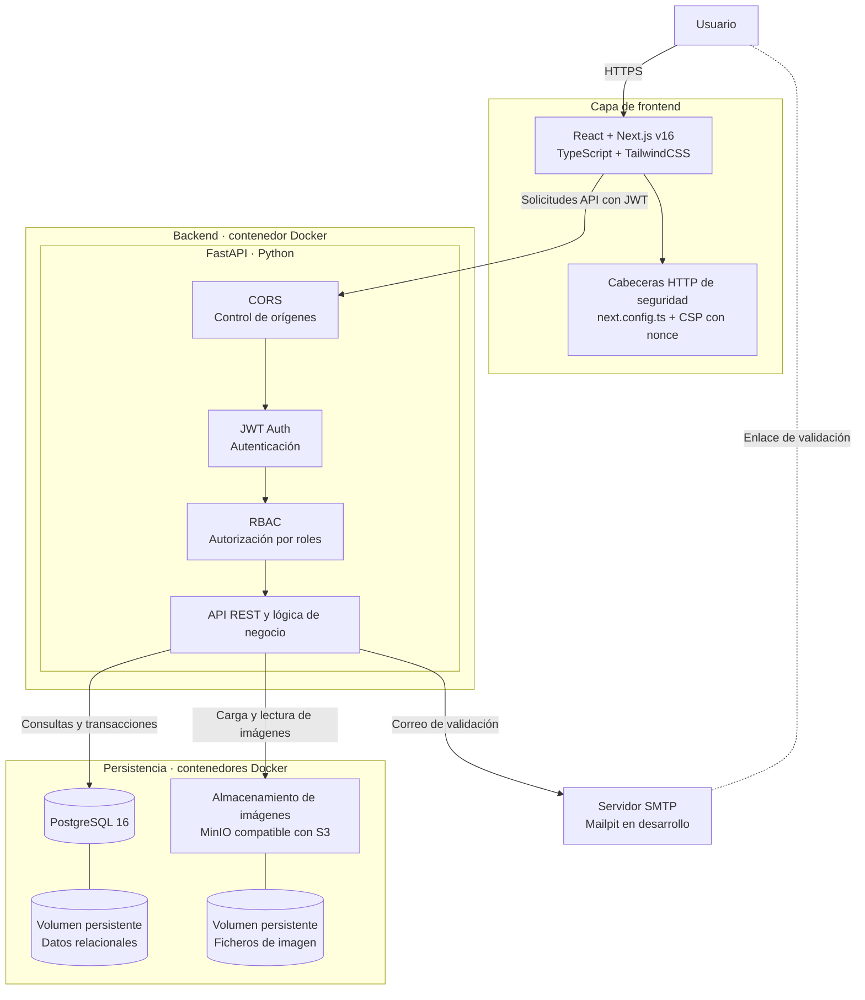
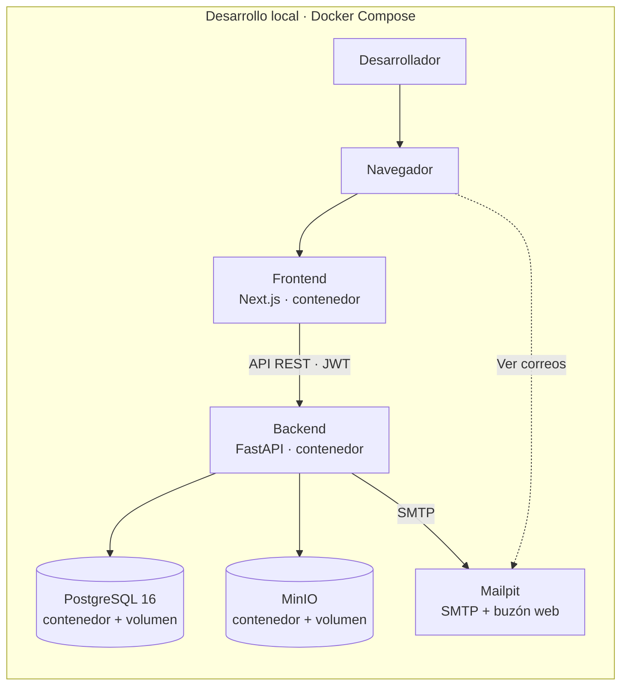
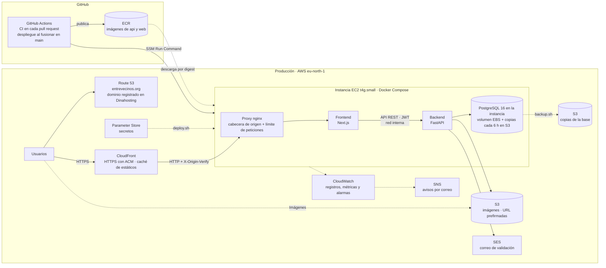

## Índice

0. [Ficha del proyecto](#0-ficha-del-proyecto)
1. [Descripción general del producto](#1-descripción-general-del-producto)
2. [Arquitectura del sistema](#2-arquitectura-del-sistema)
3. [Modelo de datos](#3-modelo-de-datos)
4. [Especificación de la API](#4-especificación-de-la-api)
5. [Historias de usuario](#5-historias-de-usuario)
6. [Tickets de trabajo](#6-tickets-de-trabajo)
7. [Pull requests](#7-pull-requests)

---

## 0. Ficha del proyecto

### **0.1. Tu nombre completo:**

Sergio Fernández García

### **0.2. Nombre del proyecto:**

EntreVecinos

### **0.3. Descripción breve del proyecto:**

**EntreVecinos** es una aplicación web de proximidad diseñada para facilitar el intercambio de productos, servicios y oportunidades entre personas que pertenecen a una misma comunidad, urbanización, barrio o entorno geográfico reducido.

La plataforma funciona como un escaparate y tablón de anuncios digital, donde cualquier usuario puede publicar aquello que quiere vender, ofrecer, comprar, intercambiar o encontrar, y donde el resto de miembros puede descubrir fácilmente qué hay disponible cerca de ellos.

### **0.4. URL del proyecto:**

https://entrevecinos.org (producción en AWS; ver §2.4).

### 0.5. URL o archivo comprimido del repositorio

https://github.com/serfer2/entrevecinos


---

## 1. Descripción general del producto

### **1.1. Objetivo:**

#### Propósito del producto

Crear una plataforma de intercambio de proximidad que conecte a las personas de una misma comunidad, urbanización, barrio o entorno geográfico reducido, facilitando que puedan **encontrar, ofrecer, comprar, vender, regalar o intercambiar productos y servicios** de forma sencilla y cercana.

El producto digitaliza el tradicional **tablón de anuncios local**, convirtiéndolo en un espacio organizado, accesible y dinámico donde la oferta y la demanda de una comunidad puedan encontrarse.

#### ¿Qué valor aporta?

##### Para las personas

- Permite encontrar productos y servicios **cerca de casa**.
- Facilita vender o dar una segunda vida a objetos que ya no se utilizan.
- Permite encontrar personas que ofrecen servicios o ayuda dentro del propio entorno.
- Reduce la dispersión de anuncios entre grupos de WhatsApp, Facebook, carteles físicos y otras plataformas.
- Facilita el contacto entre personas con necesidades u ofertas complementarias.
- Aporta un contexto de **proximidad y confianza** frente a los marketplaces generalistas.

##### Para los profesionales

- Proporciona un escaparate dirigido específicamente a personas de su entorno.
- Permite dar visibilidad a productos, servicios y habilidades sin depender de plataformas generalistas.
- Facilita encontrar clientes potenciales cercanos.
- Permite a profesionales y pequeños negocios locales promocionarse dentro de las comunidades donde trabajan.

##### Para las comunidades

- Facilita el intercambio y la colaboración entre sus miembros.
- Favorece el aprovechamiento de recursos existentes dentro de la propia comunidad.
- Puede contribuir a fortalecer las relaciones entre vecinos y generar nuevas oportunidades de colaboración.

#### ¿Qué problema soluciona?

Actualmente, muchas oportunidades de intercambio local están **fragmentadas y son difíciles de descubrir**.

Una persona puede necesitar un producto, contratar un servicio, encontrar ayuda o buscar un objeto concreto mientras, al mismo tiempo, otra persona cercana está ofreciendo exactamente aquello que necesita.

Sin embargo, ambas personas pueden no llegar a encontrarse porque la información está dispersa entre:

- Grupos de WhatsApp.
- Grupos de Facebook.
- Plataformas de compraventa generalistas.
- Carteles físicos.
- Recomendaciones personales.
- Conversaciones entre vecinos.

El producto crea un **punto de encuentro único y organizado** para concentrar esa oferta y demanda local.

#### Propuesta de valor

> **Conectar lo que una persona necesita con lo que otra persona cercana puede ofrecer.**

La diferencia fundamental frente a un marketplace generalista es que el producto no se centra únicamente en la **transacción**, sino en la **proximidad**: conseguir que las personas descubran oportunidades que existen a pocos minutos de ellas y que, de otro modo, podrían permanecer invisibles.

---

### **1.2. Características y funcionalidades principales:**

EntreVecinos combina las características de un **marketplace**, un **tablón de anuncios** y una **red de intercambio de proximidad**. Sus funcionalidades principales son:

#### Registro y perfiles

- Registro mediante correo electrónico y creación de un perfil personal con fotografía, nombre, teléfono y correo electrónico.
- Asociación de cada usuario a una comunidad o zona.
- Perfil profesional opcional para quienes ofrecen servicios habitualmente, con servicios, zona de actuación, descripción, fotografías y disponibilidad.

#### Comunidades y zonas

- Creación de comunidades que representan urbanizaciones, barrios u otros grupos locales.
- Incorporación de usuarios a una comunidad.
- Asociación de las publicaciones a las comunidades correspondientes.
- Herramientas para que los administradores de comunidad aprueben solicitudes de acceso, gestionen usuarios y moderen publicaciones.

#### Publicaciones y anuncios

Los usuarios pueden crear, editar y eliminar anuncios para ofrecer o solicitar productos y servicios en las comunidades a las que pertenecen. Cada publicación puede incluir título, descripción, fotografías, categoría, tipo de anuncio, precio y fecha de publicación.

Los tipos de publicación disponibles son:

- **Vendo:** productos que el usuario quiere vender.
- **Busco:** productos que necesita encontrar.
- **Ofrezco:** servicios que puede prestar.
- **Necesito:** servicios que necesita contratar.
- **Regalo:** productos que ofrece gratuitamente.
- **Otros:** anuncios que no encajan en las modalidades anteriores.

#### Búsqueda, filtros y detalle

- Búsqueda de publicaciones por palabras clave.
- Filtros por comunidad y tipo de publicación.
- Ordenación por precio o fecha de publicación.
- Página de detalle con título, fotografías, descripción, precio, información del anunciante y fecha de publicación, además de una opción para contactar.

#### Mensajería y notificaciones

- Mensajería privada entre usuarios para contactar con anunciantes.
- Gestión de conversaciones asociadas a publicaciones.
- Avisos al usuario cuando recibe respuestas a sus anuncios.

#### Denuncias y administración

- Los usuarios pueden denunciar publicaciones.
- Los administradores pueden revisar y gestionar denuncias.
- Panel de administración para gestionar usuarios, comunidades, publicaciones y denuncias.

#### Diseño responsive

La interfaz se adapta a ordenadores, tablets y smartphones para facilitar el uso desde distintos tamaños de pantalla.

### MVP

El MVP debe permitir que un vecino publique una oferta o necesidad dentro de su comunidad y que otra persona pueda encontrarla y contactar con él. Para cubrir ese recorrido, incluiría:
1. **Registro y perfil básico**
   - Registro, inicio y cierre de sesión con correo electrónico.
   - Validación del correo por enlace, con caducidad de 24 horas y posibilidad de recibirlo de nuevo; sin validarlo, la cuenta no se activa (salvo la de un administrador de la plataforma).
   - Recuperación de la contraseña olvidada desde el inicio de sesión: un enlace por correo, válido 1 hora, para elegir una contraseña nueva; al cambiarla se cierran las sesiones abiertas.
   - Perfil con nombre y datos de contacto.
   - Asociación del usuario a una comunidad.
   - Tras registrarse o iniciar sesión, llevar al usuario a la lista de comunidades si todavía no pertenece a ninguna, o directamente a su comunidad si solo pertenece a una.
2. **Comunidades**
   - Crear o seleccionar una comunidad local.
   - Permitir que sus miembros vean los anuncios asociados a ella.
   - Incluir una gestión sencilla de acceso, por ejemplo, aprobación por parte de un administrador.
   - Las comunidades nuevas quedan pendientes hasta que un administrador de la plataforma las aprueba; las que crea él quedan activas al momento. Cada usuario puede tener solo una comunidad pendiente a la vez.
   - El administrador de la plataforma accede a cualquier comunidad sin solicitar acceso: ve sus anuncios, publica en ella y la gestiona.
3. **Gestión de anuncios**
   - Crear, editar y eliminar anuncios propios.
   - Marcar los anuncios propios como reservados o finalizados.
   - Incluir título, descripción, categoría, tipo de publicación, precio opcional, fotografías y fecha.
   - Ofrecer los tipos principales: Vendo, Busco, Ofrezco, Necesito y Regalo. «Otros» puede servir como categoría general.
4. **Explorar y encontrar anuncios**
   - Ver los anuncios de la comunidad.
   - Buscar por palabras clave.
   - Filtrar por comunidad y tipo de publicación.
   - Ordenar por fecha o precio.
5. **Detalle y contacto**
   - Consultar la información completa del anuncio y del anunciante, con sus fotografías ampliables a pantalla completa.
   - Contactar con quien publicó el anuncio. Para el MVP puede bastar un canal de contacto directo; la mensajería interna puede añadirse cuando el flujo básico esté validado.
6. **Administración mínima**
   - Contar con una persona administradora que pueda gestionar miembros y ocultar anuncios problemáticos.
 
Quedan para una fase posterior el perfil profesional, las notificaciones automáticas, el sistema completo de denuncias y el panel avanzado de administración. Sus entidades del modelo de datos (§3.2) y sus operaciones de la API (`x-mvp: false` en [`docs/api/`](docs/api/README.md)) ya están diseñadas y marcadas como versión futura, igual que las de la mensajería interna.

---

### **1.3. Diseño y experiencia de usuario:**

> Proporciona imágenes y/o videotutorial mostrando la experiencia del usuario desde que aterriza en la aplicación, pasando por todas las funcionalidades principales.

**Pendiente** (imágenes y videotutorial). Se proporcionará una vez completado el desarrollo del frontend.

La Épica 11 (HU-28 a HU-32, TK-066 a TK-072) fija la identidad visual y mejora el uso de la web:

- **Identidad cercana a la naturaleza:** verde musgo para las acciones, neutros cálidos de piedra y tierra, ocre para avisos y terracota para errores, sobre un fondo claro, con contraste AA. Tipografías Figtree (texto) y Fraunces (títulos), autoalojadas, y un logotipo con un brote. Los colores se definen una sola vez en `apps/web/src/styles/globals.css`.
- **Sencillez:** espacios amplios, paneles blancos sobre el fondo, pocos elementos decorativos e iconos solo cuando ayudan a entender una acción (búsqueda, ubicación, ampliar).
- **Anuncios fáciles de explorar:** tarjetas que destacan fotografía, título y precio, con el tipo y «Reservado» sobre la imagen; búsqueda, filtros y orden agrupados en un panel.
- **Fotografías a pantalla completa** en el detalle, con botones, teclado y gestos táctiles.
- **Adaptable:** de una a cuatro columnas según el ancho; en móvil la cabecera no queda fija. Comprobado también en Firefox.
- **Accesibilidad:** foco visible, diálogos modales que atrapan el foco y animaciones desactivadas con `prefers-reduced-motion`.

---

### **1.4. Instrucciones de instalación:**
> Documenta de manera precisa las instrucciones para instalar y poner en marcha el proyecto en local (librerías, backend, frontend, servidor, base de datos, migraciones y semillas de datos, etc.)

Todo se ejecuta en contenedores: no hace falta instalar Python, Node.js ni PostgreSQL en el equipo.

**Requisitos:** Git, Docker con el plugin Compose v2 (`docker compose version`) y `make`. Puertos libres: 3000 (web), 8000 (API) y 8025 (buzón de correo); se cambian en `.env`.

**1. Código y variables de entorno**

```bash
git clone https://github.com/serfer2/entrevecinos.git && cd entrevecinos
cp .env.example .env    # cambia al menos POSTGRES_PASSWORD; el resto vale para desarrollo
```

`.env` no se sube al repositorio. Los valores de `.env.example` son ficticios y solo sirven en local.

**2. Arrancar**

```bash
make dev
```

Construye las imágenes de la web y la API, levanta PostgreSQL, MinIO (imágenes), Mailpit (correo), la API y la web, aplica las migraciones y muestra las direcciones:

| Servicio | Dirección |
|---|---|
| Web | http://localhost:3000 |
| API (documentación interactiva) | http://localhost:8000/docs |
| Buzón de correo de desarrollo (Mailpit) | http://localhost:8025 |

**3. Datos iniciales.** Las migraciones crean el esquema y las 10 categorías de anuncios; no hay más datos de ejemplo. Para probar:

1. Regístrate en http://localhost:3000/registro y abre el enlace de validación que llega a Mailpit.
2. Para tener un administrador de plataforma, que aprueba comunidades y entra en todas, promueve tu cuenta:

   ```bash
   docker compose --env-file .env -f infra/docker-compose.yml exec db \
     psql -U entrevecinos -d entrevecinos -c "UPDATE users SET platform_role = 'platform_admin' WHERE email = '<tu correo>'"
   ```

3. Crea una comunidad (la de un `platform_admin` queda activa al momento), publica anuncios con fotografías y, con otra cuenta, solicita acceso a la comunidad.

**4. Comandos habituales**

| Comando | Qué hace |
|---|---|
| `make migrate` | Aplica las migraciones pendientes |
| `make ci-api` / `make ci-web` | Lint, tipos y pruebas de la API y de la web, igual que la CI (ver §2.6) |
| `make build-backend` / `make build-frontend` | Reconstruye una imagen tras cambiar dependencias |
| `make clean` | Elimina contenedores e imágenes; **conserva** los datos |
| `make help` | Lista todos los comandos |

Para borrar también los datos: `docker compose --env-file .env -f infra/docker-compose.yml down -v`. Más detalle en [`infra/README.md`](infra/README.md), [`apps/api/README.md`](apps/api/README.md) y [`apps/web/README.md`](apps/web/README.md).

**Producción.** La instalación en AWS (Terraform, despliegue, operación y costes) está en [`infra/aws/README.md`](infra/aws/README.md).

---

## 2. Arquitectura del Sistema

### **2.1. Diagrama de arquitectura:**
> Usa el formato que consideres más adecuado para representar los componentes principales de la aplicación y las tecnologías utilizadas. Explica si sigue algún patrón predefinido, justifica por qué se ha elegido esta arquitectura, y destaca los beneficios principales que aportan al proyecto y justifican su uso, así como sacrificios o déficits que implica.


### 2.1. Diagrama de arquitectura



#### Patrón arquitectónico
La solución sigue una arquitectura cliente-servidor de tres capas: presentación, lógica de negocio y persistencia. El backend se organiza como un monolito modular, con una API FastAPI dividida internamente por áreas funcionales, como usuarios, comunidades y publicaciones.

**Justificación**

Next.js proporciona la interfaz web; FastAPI concentra las reglas de negocio y expone la API REST. PostgreSQL almacena los datos estructurados y relacionados. MinIO almacena los ficheros de imagen, mientras que PostgreSQL conserva sus metadatos y referencias. Los volúmenes persistentes mantienen los datos aunque se recreen los contenedores.

La seguridad de la API se aplica dentro de FastAPI, en este orden: CORS restringe los orígenes autorizados, JWT Auth valida la identidad y RBAC comprueba los permisos antes de ejecutar cada caso de uso. No hay una capa intermedia entre el frontend y el backend. En la web, Next.js configura las cabeceras HTTP de seguridad y una `Content-Security-Policy` con un *nonce* por petición, sin Helmet ni un servidor Node personalizado.

**Beneficios**

- La separación de responsabilidades facilita el desarrollo y el mantenimiento.
- Docker ayuda a reproducir y desplegar los componentes.
- El almacenamiento de objetos evita guardar el contenido de las imágenes en PostgreSQL.
- El frontend y el backend pueden escalarse por separado.
- El monolito modular mantiene sencilla la operación inicial y permite organizar el código por áreas funcionales.

**Sacrificios y déficits**
- Hay varios componentes que configurar y mantener, así como credenciales, permisos y copias de seguridad para los volúmenes.
- MinIO añade complejidad frente al almacenamiento local, aunque permite migrar a otros servicios compatibles con S3.
- El monolito modular no permite escalar cada módulo de negocio independientemente.
- Los volúmenes Docker requieren copias de seguridad para proteger los datos ante fallos del servidor.


### **2.2. Descripción de componentes principales:**

- **Frontend web:** construido con **React**, **Next.js v16** y **TypeScript**. Presenta las páginas de la aplicación y permite a los usuarios buscar, consultar y gestionar anuncios. **TailwindCSS** se utiliza para crear y adaptar los estilos a ordenadores, tablets y móviles. Next.js añade las cabeceras HTTP de seguridad a todas las respuestas (`next.config.ts`) y genera una `Content-Security-Policy` con un *nonce* por petición (`src/proxy.ts`).

- **API y lógica de negocio:** desarrollada en **Python con FastAPI** y ejecutada en un contenedor Docker. Gestiona usuarios, comunidades y publicaciones, aplica las reglas del producto y proporciona endpoints REST al frontend. También coordina el acceso a la base de datos y al almacenamiento de imágenes. La seguridad se aplica dentro de la propia API, antes de cada caso de uso: **CORS** (`CORSMiddleware`) limita los orígenes autorizados; **JWT Auth** (`CurrentUserDep`) valida el token y que el usuario siga activo; y **RBAC** (`CommunityAccess`) comprueba la membresía y el rol en la comunidad, con acceso total para el administrador de plataforma.

- **Base de datos relacional:** **PostgreSQL 16**, desplegada en un contenedor Docker. Guarda la información estructurada, como usuarios, comunidades, anuncios y mensajes. Un volumen persistente conserva los datos cuando se reinicia o recrea el contenedor.

- **Almacenamiento de imágenes:** un servicio compatible con S3, como **MinIO**, almacena las fotografías de los anuncios y perfiles. Sus ficheros se conservan en un volumen persistente. PostgreSQL guarda las referencias y metadatos de cada imagen, mientras que el backend gestiona las cargas y lecturas.

- **Envío de correo:** la API envía por **SMTP** los correos de la aplicación, como el enlace de validación del registro. En desarrollo los recoge **Mailpit**, que los muestra en `http://localhost:8025` sin enviarlos a nadie; en producción se envían con **Amazon SES** (por su API, con las credenciales del rol de la instancia).

- **Contenedores y red de despliegue:** **Docker** ejecuta frontend, backend, PostgreSQL y almacenamiento de imágenes en servicios separados. La base de datos y el almacenamiento deberían permanecer en una red interna, accesibles desde el backend, y no exponerse directamente a los usuarios.

### **2.3. Descripción de alto nivel del proyecto y estructura de ficheros**

```
entrevecinos/
├── apps/
│   ├── web/                         # Aplicación web (Next.js)
│   │   ├── src/
│   │   │   ├── app/                 # Rutas y layouts; zona privada en app/(privado)/
│   │   │   ├── features/            # Código por funcionalidad
│   │   │   │   ├── auth/            #   registro, inicio de sesión, sesión y validación del correo
│   │   │   │   ├── communities/
│   │   │   │   ├── listings/
│   │   │   │   ├── media/
│   │   │   │   ├── messaging/       #   versión futura
│   │   │   │   ├── platform-admin/
│   │   │   │   └── profile/
│   │   │   ├── components/          # Componentes compartidos de interfaz (ui/)
│   │   │   ├── lib/                 # Cliente de la API y utilidades
│   │   │   ├── styles/              # Tema visual y estilos globales
│   │   │   └── proxy.ts             # Content-Security-Policy con nonce por petición
│   │   ├── public/                  # Recursos estáticos
│   │   ├── Dockerfile               # Etapas dev y prod
│   │   └── package.json
│   │
│   └── api/                         # API de Python y FastAPI
│       ├── src/
│       │   └── entrevecinos/
│       │       ├── domain/          # Entidades y reglas de negocio
│       │       ├── application/     # Casos de uso y puertos
│       │       ├── infrastructure/  # PostgreSQL, S3, correo, seguridad y configuración
│       │       └── presentation/    # Endpoints, esquemas y dependencias FastAPI
│       ├── migrations/              # Migraciones de Alembic
│       ├── tests/
│       ├── Dockerfile               # Etapas dev y prod
│       └── pyproject.toml           # Dependencias con uv (uv.lock)
│
├── infra/
│   ├── docker-compose.yml           # Entorno local: db, storage, mail, api y web
│   ├── postgres/                    # Inicialización de PostgreSQL en local
│   ├── storage/                     # Inicialización de MinIO en local
│   ├── docker-compose.prod.yml      # Compose de producción: proxy, web, api y db
│   ├── prod/                        # Scripts de la instancia: despliegue, copias, restauración y proxy
│   └── aws/                         # Terraform de producción y guía de operación (README.md)
│
├── .github/
│   ├── workflows/                   # CI en cada pull request (ci.yml) y despliegue continuo (deploy.yml)
│   ├── dependabot.yml
│   └── pull_request_template.md
│
├── docs/
│   ├── api/                         # Contrato OpenAPI multi-fichero (openapi.yaml)
│   └── product/                     # Historias de usuario y tickets
│
├── openspec/                        # Especificaciones vigentes y cambios por ticket
├── Makefile                         # Atajos: make dev, ci-api, ci-web, tf-*…
├── AGENTS.md                        # Instrucciones para agentes de código
├── .env.example                     # Variables de entorno de ejemplo
├── prompts.md                       # Prompts utilizados con asistentes de código
└── readme.md
```

#### Propósito de las carpetas

- **`apps/web`** contiene la aplicación React con Next.js. `app/` define las rutas; `features/` agrupa pantallas, componentes y lógica de cada funcionalidad; y `components/` reúne elementos reutilizables.
- **`apps/api`** contiene el backend FastAPI. Separa las reglas de negocio de los detalles del framework, la base de datos y otros servicios.
- **`infra/`** guarda la configuración para ejecutar los servicios en local (Docker Compose) y en producción (Compose de producción, scripts de la instancia y Terraform de AWS).
- **`.github/`** contiene la integración y el despliegue continuos y la plantilla de *pull request*.
- **`docs/`** contiene el contrato de la API, que es la fuente de verdad (`docs/api/openapi.yaml`), y la planificación del producto: épicas, historias de usuario y tickets.
- **`openspec/`** guarda las especificaciones vigentes y un cambio archivado por cada ticket implementado.

#### Arquitectura y buenas prácticas

El repositorio aplica una **arquitectura limpia** en el backend, organizada en capas:

- **Dominio:** reglas y entidades del negocio, sin dependencias de FastAPI o PostgreSQL.
- **Aplicación:** casos de uso que coordinan las operaciones y dependen de interfaces o puertos.
- **Infraestructura:** implementaciones concretas, como repositorios PostgreSQL y almacenamiento de imágenes.
- **Presentación:** endpoints y modelos de entrada y salida de FastAPI.

Las dependencias apuntan hacia el núcleo: dominio y aplicación no dependen de infraestructura. Así se pueden cambiar tecnologías externas sin alterar las reglas principales del producto.

En el frontend, `features/` organiza el código por funcionalidad para mantener juntas sus páginas, componentes y lógica específica. Las rutas y layouts propios de Next.js permanecen en `app/`; los componentes y utilidades compartidos se extraen solo cuando tienen más de un uso.

Esta estructura mantiene el despliegue coordinado desde un repositorio común y, a la vez, establece límites claros entre módulos. El principal coste es que requiere mantener convenciones y configuración para varias aplicaciones; para un MVP, conviene evitar crear capas o paquetes compartidos que todavía no aporten valor.

### **2.4. Infraestructura y despliegue**





#### Desarrollo local

Docker Compose levanta los componentes necesarios en el equipo del desarrollador: frontend Next.js, API FastAPI, PostgreSQL, MinIO y Mailpit, el buzón que recoge el correo de desarrollo. Como MinIO ya no publica imágenes Docker oficiales, se usa la compilación comunitaria `pgsty/minio` con versión fija (licencia AGPLv3, usada sin modificar como servicio independiente); el detalle está en TK-019. Los servicios se comunican por una red de Docker y los datos sobreviven a reinicios mediante volúmenes persistentes.

Esta configuración facilita arrancar el proyecto con un entorno reproducible y probar la integración entre componentes. Las credenciales locales deben ser de desarrollo y no reutilizarse en producción.

#### Producción en AWS

Producción está en `https://entrevecinos.org`, en la región `eu-north-1` de AWS, y toda la infraestructura se define con Terraform en `infra/aws/` (guía, *runbook*, costes y decisiones en [`infra/aws/README.md`](infra/aws/README.md)). El dominio sigue registrado en Dinahosting, con el DNS en Route 53.

- **Entrada:** CloudFront termina HTTPS (certificado de ACM), redirige `www` y HTTP, guarda en caché solo los estáticos de Next.js y reenvía el resto a la instancia por HTTP con una cabecera secreta. No hay WAF: el plan del proyecto no admite el plan gratuito de CloudFront y una web ACL costaría unos 10 USD/mes, así que los límites de peticiones por IP los pone el proxy.
- **Aplicación:** una sola instancia EC2 `t4g.small` (Graviton, Amazon Linux 2023) ejecuta con Docker Compose el proxy nginx, la web, la API y PostgreSQL, con contenedores sin privilegios. Solo el proxy publica un puerto, y solo CloudFront puede llegar a él; **la API no es pública**: la web la llama por una red interna de Docker. No hay balanceador ni API Gateway.
- **Datos:** **PostgreSQL 16 en la propia instancia**, sobre un volumen EBS cifrado que sobrevive a la instancia, con copias de `pg_dump` cada 6 horas en S3 (30 días) y *snapshots* diarios (7). Las imágenes de los anuncios, en un bucket S3 privado con versionado, se leen con URL prefirmadas.
- **Secretos:** en Parameter Store; llegan a los contenedores solo por entorno durante el despliegue, sin ficheros `.env` en la instancia.
- **Correo:** SES, con el dominio verificado (DKIM, SPF y DMARC).
- **Operación:** registros, métricas y alarmas en CloudWatch con aviso por correo, y procedimientos de recuperación ensayados (RPO 6 horas, RTO 4 horas). Sin SSH: la instancia se opera con Session Manager.

#### Diferencias con la arquitectura prevista

La arquitectura prevista usaba contenedores gestionados detrás de un balanceador, PostgreSQL gestionado con alta disponibilidad, CDN con WAF y un gestor de secretos. Producción es distinta **para ahorrar costes mientras el proyecto no escale**, dentro del límite de 40 €/mes: unos 20 USD/mes, frente a más de 100 con lo previsto (los costes evitados se detallan en la guía).

| Área | Previsto | Elegido | Evolución cuando el proyecto escale |
|---|---|---|---|
| Cómputo | Contenedores gestionados y balanceador o API Gateway | Una instancia EC2 con Docker Compose, sin alta disponibilidad | ECS Fargate con ALB |
| Base de datos | PostgreSQL gestionado con alta disponibilidad | PostgreSQL 16 en la instancia, sin alta disponibilidad, con copias cada 6 horas (RPO 6 h) y volumen propio | Amazon RDS y después Multi-AZ |
| Protección web | CDN + WAF | CloudFront sin WAF y límites de peticiones en el proxy | WAF (plan de CloudFront o Web ACL) |
| DNS | Sin detallar | Route 53, sin DNSSEC | DNSSEC |
| Red | Base de datos en red privada | Subred pública sin NAT; base solo en la red interna de Compose; origen por HTTP con cabecera secreta | Origen cifrado y orígenes VPC de CloudFront |
| Secretos | Gestor de secretos | Parameter Store, solo por entorno | Secrets Manager para la contraseña de RDS |

Cada diferencia, con su motivo, coste evitado y riesgo aceptado, está en [«Decisiones de arquitectura»](infra/aws/README.md#decisiones-de-arquitectura); los pasos de evolución, en orden y con su señal de disparo y su coste, en [«Evolución»](infra/aws/README.md#evolución).

#### Integración y despliegue continuos

Todo cambio llega a `main` por *pull request* y solo se fusiona si pasan las comprobaciones de [`.github/workflows/ci.yml`](.github/workflows/ci.yml), las mismas órdenes que en local (`make ci-api`, `make ci-web`, `make tf-lint`, `make shellcheck`):

- `api`: ruff y pytest con PostgreSQL; `web`: lint, tipos y pruebas; `infra`: Terraform, tflint, checkov y shellcheck;
- `images (api)` e `images (web)`: construyen las imágenes de producción para arm64;
- `docs-infra`: un cambio de infraestructura debe actualizar `infra/aws/README.md`.

Al fusionar, [`.github/workflows/deploy.yml`](.github/workflows/deploy.yml) repite esas comprobaciones, publica las imágenes del commit en ECR, las despliega con un documento de SSM (migraciones con copia previa, comprobación de salud y **vuelta atrás automática** si la versión nueva no arranca) y prueba la URL pública. Nunca hay dos despliegues a la vez, y cualquier commit anterior de `main` se puede volver a desplegar a mano. GitHub Actions usa credenciales temporales de un rol que solo puede publicar imágenes y lanzar ese despliegue. Detalle en «Integración continua» y «Despliegue continuo» de [`infra/aws/README.md`](infra/aws/README.md).

#### Diferencias técnicas principales

- **Ejecución:** en local, Compose con imágenes de desarrollo; en producción, el mismo Compose con imágenes de producción por *digest*, contenedores endurecidos y una sola instancia, sin autoescalado.
- **Persistencia:** en local, volúmenes de Docker; en producción, PostgreSQL en un volumen EBS propio con copias en S3, e imágenes en S3 en lugar de MinIO.
- **Secretos:** en local, `.env`; en producción, Parameter Store y solo por entorno (sin Secrets Manager: el nivel estándar de Parameter Store es gratuito).
- **Correo:** en local, Mailpit por SMTP; en producción, SES por su API.
- **Red:** en producción la web solo es accesible a través de CloudFront, la API y PostgreSQL solo desde redes internas de Docker, y la instancia no tiene SSH.
- **Despliegue:** en local, `make dev`; en producción, GitHub Actions y SSM en cada fusión a `main`.

### **2.5. Seguridad**

Medidas implementadas en la aplicación y en producción (detalle en [`infra/aws/README.md`](infra/aws/README.md)):

- **Autenticación mediante JWT:** la API valida el token y que el usuario siga activo en cada petición. El navegador nunca recibe el JWT: la web lo guarda en la *cookie* `HttpOnly` y `Secure` `ev_session` y llama a la API desde el servidor con `Authorization: Bearer <token>`. La clave de firma vive en Parameter Store.

- **Recuperación de la contraseña:** el enlace del correo es de un solo uso y caduca en 1 hora; la base de datos solo guarda su hash. La petición responde igual exista o no la cuenta y envía como mucho un correo por minuto a cada cuenta. Cambiar la contraseña invalida los JWT emitidos antes (`users.password_changed_at`), así que cierra las sesiones abiertas en otros dispositivos, y avisa del cambio por correo.

- **Autorización basada en roles (RBAC):** la API comprueba la membresía y el rol en la comunidad antes de cada operación (`CommunityAccess`); ocultar un botón en la interfaz no sustituye esa comprobación.

- **CORS:** la API solo acepta el origen `https://entrevecinos.org`. CORS no sustituye la autenticación.

- **Cabeceras HTTP de seguridad en Next.js:** `X-Content-Type-Options: nosniff`, `X-Frame-Options: DENY`, `Referrer-Policy: strict-origin-when-cross-origin`, `Permissions-Policy` y, en producción, `Strict-Transport-Security`, sin `X-Powered-By` (`next.config.ts`). La `Content-Security-Policy` se genera en `src/proxy.ts` con un *nonce* por petición.

- **HTTPS y entrada protegida:** CloudFront sirve solo HTTPS (certificado de ACM, HTTP redirigido) con Shield Standard. La instancia solo admite tráfico de CloudFront (grupo de seguridad con su lista de prefijos) y el proxy rechaza con `403` las peticiones sin la cabecera secreta de origen. El proxy limita las peticiones por IP del visitante (inicio de sesión y registro, y general) con `429`.

- **Instancia endurecida:** sin SSH ni par de claves (Session Manager con registro de sesiones), IMDSv2 obligatorio, parches de seguridad automáticos y contenedores sin *root*, con el sistema de ficheros de solo lectura, sin capacidades y sin el socket de Docker.

- **Mínimo privilegio en AWS:** el rol de la instancia solo puede leer y escribir lo que usa la aplicación (validado con IAM Access Analyzer). GitHub Actions usa una clave que solo puede asumir, con un identificador externo, el rol de despliegue, desde el entorno `production` limitado a `main`; las comprobaciones de CI son obligatorias para fusionar.

- **Base de datos aislada:** PostgreSQL solo es accesible desde la API, por una red interna de Docker sin salida a Internet. La API usa `entrevecinos_app`, sin permisos de DDL; las migraciones, `entrevecinos_owner`.

- **Gestión de secretos:** contraseñas, clave de los JWT y cabecera de origen en Parameter Store (`SecureString`), generadas sin quedar en el estado de Terraform (salvo la cabecera). Llegan a los contenedores solo por entorno: no hay ficheros `.env` en la instancia. En local, `.env` está excluido del repositorio y `.env.example` documenta las variables con valores ficticios.

- **Copias protegidas y probadas:** copias de `pg_dump` cada 6 horas que la instancia no puede borrar (política del bucket), *snapshots* diarios, alarma si falta una copia y restauración ensayada.

- **Imágenes:** el bucket es privado; la API valida el contenido (*magic bytes*), el formato (JPEG, PNG o WebP) y el tamaño, y las imágenes solo se leen con URL prefirmadas.

- **Registros sin datos sensibles y alertas:** los registros no guardan contraseñas, *tokens* de validación o de restablecimiento ni *cookies* de sesión, y las alarmas avisan por correo de caídas, errores y falta de copias.

### **2.6. Tests**

> Describe brevemente algunos de los tests realizados

Cada ticket se implementa con sus pruebas (regla de OpenSpec: las tareas que cambian comportamiento incluyen las pruebas) y todas se ejecutan en contenedores, igual en local que en la integración continua. Recuento de la entrega 3: **485 pruebas de la API** y **358 de la web**.

```bash
make ci-api    # ruff (lint y formato), alembic check y pytest con PostgreSQL de pruebas
make ci-web    # ESLint, TypeScript y Vitest
make tf-lint   # Terraform: fmt, validate, tflint y checkov
make shellcheck
```

**API** (`apps/api/tests/`, pytest y el cliente de pruebas de FastAPI):

- **Casos de uso con dobles** (`tests/fakes.py`): reglas de negocio sin base de datos, p. ej. las transiciones de estado de un anuncio (`test_listing_status_rules.py`), el registro con correo pendiente de validar (`test_register_user.py`) o la visibilidad de los anuncios (`test_listing_visibility.py`).
- **Endpoints**: peticiones HTTP completas con autenticación y roles, p. ej. que un miembro sin aprobar no puede publicar (`test_listings_publish.py`), que un `community_admin` bloquea y expulsa miembros (`test_members_management.py`) o que la búsqueda ignora acentos (`test_listings_search.py`).
- **Integración con PostgreSQL** (marcador `db`, base `<POSTGRES_DB>_test` que se crea y migra sola): restricciones, consultas y migraciones reales, p. ej. que una cuenta activa debe tener el correo validado salvo un `platform_admin` (`test_db_users.py`) o que cada migración se puede deshacer.
- **Almacenamiento** (marcador `storage`, MinIO real) y **adaptadores de AWS** (S3 con URL prefirmadas y SES, con respuestas simuladas de boto3, `test_aws_adapters.py`).
- **Arquitectura** (`test_architecture.py`): `domain` no importa frameworks y `application` solo depende de `domain`.
- **Contrato** (`test_contract_scope.py`): las rutas implementadas son exactamente las operaciones `x-mvp: true` de `docs/api/openapi.yaml`.

**Web** (`apps/web/src/**/*.test.ts(x)`, Vitest y Testing Library, junto al código):

- **Server Actions y acceso a la API**: validación con zod, errores de la API convertidos en mensajes del formulario y redirecciones, p. ej. `features/auth/actions.test.ts` o `features/listings/actions.test.ts`.
- **Componentes**: formularios, galería a pantalla completa con teclado (`ListingGallery.test.tsx`), diálogos de confirmación y acciones según el rol (`ListingActions.test.tsx`).
- **Seguridad**: la `Content-Security-Policy` con *nonce* (`lib/security/csp.test.ts`, `proxy.test.ts`) y que el inicio de sesión guarda el JWT en una *cookie* `HttpOnly` (`features/auth/login.test.ts`).

**Integración continua** (`.github/workflows/ci.yml`): en cada *pull request* se ejecutan las comprobaciones anteriores, se construyen las imágenes de producción para arm64 y se comprueba que los cambios de infraestructura actualizan su guía; ninguna fusión a `main` sin que pasen.

**Producción**: cada despliegue comprueba la salud de los contenedores y la web a través del proxy (con vuelta atrás automática) y termina con una prueba de humo contra `https://entrevecinos.org`. La recuperación de copias, *snapshots* e imágenes se ha ensayado en producción ([registro de ensayos](infra/aws/README.md#registro-de-ensayos)).

---

## 3. Modelo de Datos

### **3.1. Diagrama del modelo de datos:**

```Mermaid
erDiagram
    USER {
        UUID id PK "Identificador; NOT NULL"
        VARCHAR email UK "VARCHAR(320); normalizado a minúsculas; NOT NULL"
        VARCHAR password_hash "VARCHAR(255); hash de contraseña; NOT NULL"
        VARCHAR full_name "VARCHAR(120); NOT NULL"
        VARCHAR phone "VARCHAR(32); NULL"
        UUID avatar_asset_id FK "NULL; FK a media_asset.id"
        user_role platform_role "NOT NULL; DEFAULT user"
        BOOLEAN is_active "NOT NULL; DEFAULT true"
        TIMESTAMPTZ email_verified_at "NULL; correo validado"
        TIMESTAMPTZ password_changed_at "NULL; último cambio de contraseña"
        TIMESTAMPTZ created_at "NOT NULL"
        TIMESTAMPTZ updated_at "NOT NULL"
        TIMESTAMPTZ deleted_at "NULL; borrado lógico"
    }

    EMAIL_VERIFICATION {
        CHAR token_hash PK "CHAR(64); SHA-256 del token; NOT NULL"
        UUID user_id FK "NOT NULL; FK a user.id; ON DELETE CASCADE"
        TIMESTAMPTZ expires_at "NOT NULL"
        TIMESTAMPTZ created_at "NOT NULL"
        TIMESTAMPTZ used_at "NULL; se validó el correo con él"
        TIMESTAMPTZ superseded_at "NULL; lo sustituyó otro más reciente"
    }

    PASSWORD_RESET {
        CHAR token_hash PK "CHAR(64); SHA-256 del token; NOT NULL"
        UUID user_id FK "NOT NULL; FK a user.id; ON DELETE CASCADE"
        TIMESTAMPTZ expires_at "NOT NULL"
        TIMESTAMPTZ created_at "NOT NULL"
    }

    COMMUNITY {
        UUID id PK "Identificador; NOT NULL"
        VARCHAR name "VARCHAR(120); NOT NULL"
        TEXT description "NULL"
        VARCHAR postal_code "VARCHAR(16); NULL"
        VARCHAR city "VARCHAR(120); NULL"
        UUID created_by FK "NOT NULL; FK a user.id"
        BOOLEAN is_active "NOT NULL; DEFAULT true"
        TIMESTAMPTZ created_at "NOT NULL"
        TIMESTAMPTZ updated_at "NOT NULL"
    }

    COMMUNITY_MEMBERSHIP {
        UUID community_id PK, FK "NOT NULL; FK a community.id"
        UUID user_id PK, FK "NOT NULL; FK a user.id"
        membership_role role "NOT NULL; DEFAULT member"
        membership_status status "NOT NULL; DEFAULT pending"
        UUID reviewed_by FK "NULL; FK a user.id"
        TIMESTAMPTZ requested_at "NOT NULL"
        TIMESTAMPTZ reviewed_at "NULL"
        TIMESTAMPTZ joined_at "NULL"
    }

    CATEGORY {
        UUID id PK "Identificador; NOT NULL"
        VARCHAR name UK "VARCHAR(80); NOT NULL"
        VARCHAR slug UK "VARCHAR(100); NOT NULL"
        BOOLEAN is_active "NOT NULL; DEFAULT true"
    }

    LISTING {
        UUID id PK "Identificador; NOT NULL"
        UUID community_id FK "NOT NULL; FK a community.id"
        UUID owner_id FK "NOT NULL; FK a user.id"
        UUID category_id FK "NOT NULL; FK a category.id"
        VARCHAR title "VARCHAR(160); NOT NULL"
        TEXT description "NOT NULL"
        listing_type type "NOT NULL"
        NUMERIC price "NUMERIC(10,2); NULL; CHECK price >= 0"
        CHAR currency "CHAR(3); código ISO 4217; NULL"
        listing_status status "NOT NULL; DEFAULT active"
        TIMESTAMPTZ published_at "NOT NULL"
        TIMESTAMPTZ created_at "NOT NULL"
        TIMESTAMPTZ updated_at "NOT NULL"
        TIMESTAMPTZ deleted_at "NULL; borrado lógico"
    }

    MEDIA_ASSET {
        UUID id PK "Identificador; NOT NULL"
        UUID uploaded_by FK "NOT NULL; FK a user.id"
        VARCHAR object_key UK "VARCHAR(512); NOT NULL"
        VARCHAR mime_type "VARCHAR(100); NOT NULL"
        BIGINT size_bytes "NOT NULL; CHECK size_bytes > 0"
        CHAR sha256 "CHAR(64); NULL"
        TIMESTAMPTZ created_at "NOT NULL"
    }

    LISTING_IMAGE {
        UUID listing_id PK, FK "NOT NULL; FK a listing.id"
        UUID asset_id PK, FK "NOT NULL; FK a media_asset.id"
        SMALLINT position "NOT NULL; DEFAULT 0; CHECK position >= 0"
        BOOLEAN is_cover "NOT NULL; DEFAULT false"
    }

    CONVERSATION {
        UUID id PK "Versión futura; identificador; NOT NULL"
        UUID listing_id FK "NOT NULL; FK a listing.id"
        UUID buyer_id FK "NOT NULL; FK a user.id"
        UUID seller_id FK "NOT NULL; FK a user.id; CHECK buyer_id <> seller_id"
        conversation_status status "NOT NULL; DEFAULT open"
        TIMESTAMPTZ created_at "NOT NULL"
        TIMESTAMPTZ updated_at "NOT NULL"
    }

    MESSAGE {
        UUID id PK "Versión futura; identificador; NOT NULL"
        UUID conversation_id FK "NOT NULL; FK a conversation.id"
        UUID sender_id FK "NOT NULL; FK a user.id"
        TEXT body "NOT NULL; no vacío"
        TIMESTAMPTZ created_at "NOT NULL"
        TIMESTAMPTZ read_at "NULL"
        TIMESTAMPTZ deleted_at "NULL; borrado lógico"
    }

    NOTIFICATION {
        UUID id PK "Versión futura; identificador; NOT NULL"
        UUID recipient_id FK "NOT NULL; FK a user.id"
        UUID message_id FK "NULL; FK a message.id"
        notification_type type "NOT NULL"
        JSONB payload "NULL"
        TIMESTAMPTZ created_at "NOT NULL"
        TIMESTAMPTZ read_at "NULL"
    }

    PROFESSIONAL_PROFILE {
        UUID id PK "Versión futura; identificador; NOT NULL"
        UUID user_id FK, UK "NOT NULL; FK a user.id; un perfil por usuario"
        TEXT description "NOT NULL"
        VARCHAR service_area "VARCHAR(160); NOT NULL"
        TEXT availability "NULL"
        BOOLEAN is_active "NOT NULL; DEFAULT true"
        TIMESTAMPTZ created_at "NOT NULL"
        TIMESTAMPTZ updated_at "NOT NULL"
    }

    PROFESSIONAL_SERVICE {
        UUID id PK "Versión futura; identificador; NOT NULL"
        UUID professional_profile_id FK "NOT NULL; FK a professional_profile.id"
        VARCHAR name "VARCHAR(120); NOT NULL"
        TEXT description "NULL"
        BOOLEAN is_active "NOT NULL; DEFAULT true"
    }

    PROFESSIONAL_PROFILE_IMAGE {
        UUID professional_profile_id PK, FK "Versión futura; NOT NULL; FK a professional_profile.id"
        UUID asset_id PK, FK "NOT NULL; FK a media_asset.id"
        SMALLINT position "NOT NULL; DEFAULT 0; CHECK position >= 0"
    }

    REPORT {
        UUID id PK "Versión futura; identificador; NOT NULL"
        UUID listing_id FK "NOT NULL; FK a listing.id"
        UUID reporter_id FK "NOT NULL; FK a user.id"
        report_reason reason "NOT NULL"
        TEXT details "NULL"
        report_status status "NOT NULL; DEFAULT pending"
        UUID reviewed_by FK "NULL; FK a user.id"
        TEXT resolution "NULL"
        TIMESTAMPTZ created_at "NOT NULL"
        TIMESTAMPTZ reviewed_at "NULL"
    }

    USER ||--o{ EMAIL_VERIFICATION : "valida su correo"
    USER ||--o{ PASSWORD_RESET : "restablece su contraseña"
    USER ||--o{ COMMUNITY : "crea"
    USER ||--o{ COMMUNITY_MEMBERSHIP : "solicita membresía"
    COMMUNITY ||--o{ COMMUNITY_MEMBERSHIP : "incluye miembros"
    USER o|--o{ COMMUNITY_MEMBERSHIP : "revisa solicitudes"

    USER ||--o{ LISTING : "publica"
    COMMUNITY ||--o{ LISTING : "contiene"
    CATEGORY ||--o{ LISTING : "clasifica"

    USER ||--o{ MEDIA_ASSET : "carga"
    MEDIA_ASSET o|--o{ USER : "puede ser avatar"
    LISTING ||--o{ LISTING_IMAGE : "incluye imágenes"
    MEDIA_ASSET ||--o{ LISTING_IMAGE : "se adjunta a anuncios"

    LISTING ||--o{ CONVERSATION : "origina"
    USER ||--o{ CONVERSATION : "participa como comprador"
    USER ||--o{ CONVERSATION : "participa como anunciante"
    CONVERSATION ||--o{ MESSAGE : "contiene"
    USER ||--o{ MESSAGE : "envía"
    USER ||--o{ NOTIFICATION : "recibe"
    MESSAGE o|--o{ NOTIFICATION : "puede generar"

    USER ||--o| PROFESSIONAL_PROFILE : "puede tener"
    PROFESSIONAL_PROFILE ||--o{ PROFESSIONAL_SERVICE : "ofrece"
    PROFESSIONAL_PROFILE ||--o{ PROFESSIONAL_PROFILE_IMAGE : "incluye imágenes"
    MEDIA_ASSET ||--o{ PROFESSIONAL_PROFILE_IMAGE : "se adjunta a perfiles"

    LISTING ||--o{ REPORT : "recibe denuncias"
    USER ||--o{ REPORT : "denuncia"
    USER o|--o{ REPORT : "revisa"
```

El MVP implementa 9 entidades: `user` (tabla `users`), `email_verification`, `password_reset`, `community`, `community_membership`, `category`, `listing`, `media_asset` y `listing_image`. Las otras 7 (`conversation`, `message`, `notification`, `professional_profile`, `professional_service`, `professional_profile_image` y `report`) están diseñadas para versiones futuras: su primer atributo lo indica en el diagrama y todavía no tienen tabla.


### **3.2. Descripción de entidades principales:**

El modelo cubre las funciones descritas en el README: usuarios, comunidades, anuncios e imágenes, que forman el MVP, y mensajería, notificaciones, perfiles profesionales y denuncias, previstas para versiones futuras. La tabla relaciona cada entidad con su alcance y con las operaciones de la API que la usan; en el contrato ([`docs/api/`](docs/api/README.md)), `x-mvp: true` marca las operaciones implementadas en el MVP y `x-mvp: false` las de versiones futuras.

| Entidad | Alcance | Operaciones de la API |
|---|---|---|
| `user` | MVP | `POST /auth/register`, `POST /auth/token`, `GET/PATCH /users/me`, `GET /users/me/memberships`. Versión futura: `DELETE /users/me`, `GET /users/me/listings`, `/admin/users` |
| `email_verification` | MVP | `POST /auth/email-verification`, `POST /auth/email-verification/resend` |
| `password_reset` | MVP | `POST /auth/password-reset`, `POST /auth/password-reset/confirm` |
| `community` | MVP | `GET/POST /communities`, `GET /communities/{community_id}`, `GET /admin/communities`, `PATCH /admin/communities/{community_id}`. Versión futura: `PATCH /communities/{community_id}` |
| `community_membership` | MVP | `GET/POST /communities/{community_id}/memberships`, `PATCH/DELETE /communities/{community_id}/memberships/{user_id}` |
| `category` | MVP | `GET /categories`. Versión futura: `POST /categories`, `PATCH /categories/{category_id}` |
| `listing` | MVP | `GET/POST /communities/{community_id}/listings`, `GET/PATCH/DELETE /listings/{listing_id}`, `PATCH /listings/{listing_id}/status` |
| `media_asset` | MVP | `POST /media`, `GET /media/{asset_id}`. Versión futura: `DELETE /media/{asset_id}` |
| `listing_image` | MVP | `PUT /listings/{listing_id}/images` |
| `conversation`, `message` | Versión futura | Mensajería: `/listings/{listing_id}/conversations`, `/conversations…`, `/messages/{message_id}` |
| `notification` | Versión futura | Notificaciones: `/notifications…` |
| `professional_profile`, `professional_service`, `professional_profile_image` | Versión futura | Perfil profesional: `/professionals…`, `/users/me/professional-profile…` |
| `report` | Versión futura | Denuncias: `/listings/{listing_id}/reports`, `/communities/{community_id}/reports`, `/reports/{report_id}` |

`GET /health` no usa ninguna entidad. Se propone para **PostgreSQL 16**. Las tablas se nombran en singular, igual que las entidades (`community`, `listing`…), salvo la de usuarios, que se llama `users` porque `user` es una palabra reservada de PostgreSQL. Los campos marcados `NOT NULL` no admiten valores nulos; `NULL` indica que el dato es opcional.

#### 1. `user` — Usuario

- `id UUID` — **PK**, identificador.
- `email VARCHAR(320)` — `NOT NULL`, `UNIQUE`; correo normalizado a minúsculas.
- `password_hash VARCHAR(255)` — `NOT NULL`; hash de contraseña, nunca la contraseña en texto claro.
- `full_name VARCHAR(120)` — `NOT NULL`.
- `phone VARCHAR(32)` — `NULL`.
- `avatar_asset_id UUID` — `NULL`, **FK** → `media_asset.id`.
- `platform_role user_role` — `NOT NULL`, `DEFAULT 'user'`; rol global.
- `is_active BOOLEAN` — `NOT NULL`, `DEFAULT TRUE`. El registro crea la cuenta con `FALSE` hasta que se valida el correo.
- `email_verified_at TIMESTAMPTZ` — `NULL`; fecha en que se validó el correo. La restricción `ck_users_active_requires_verified_email` (`CHECK (NOT is_active OR email_verified_at IS NOT NULL OR platform_role = 'platform_admin')`) impide tener activa una cuenta sin validar, salvo la de un `platform_admin`.
- `created_at TIMESTAMPTZ` — `NOT NULL`.
- `updated_at TIMESTAMPTZ` — `NOT NULL`.
- `deleted_at TIMESTAMPTZ` — `NULL`; permite borrado lógico.
- `password_changed_at TIMESTAMPTZ` — `NULL`; fecha del último cambio de contraseña. La API rechaza los JWT emitidos antes de esta fecha, así que cambiar la contraseña cierra las sesiones abiertas. Nula si la contraseña no ha cambiado desde el registro.

#### 2. `community` — Comunidad

- `id UUID` — **PK**.
- `name VARCHAR(120)` — `NOT NULL`.
- `description TEXT` — `NULL`.
- `postal_code VARCHAR(16)` — `NULL`.
- `city VARCHAR(120)` — `NULL`.
- `created_by UUID` — `NOT NULL`, **FK** → `user.id`.
- `is_active BOOLEAN` — `NOT NULL`, `DEFAULT TRUE`. En el MVP, `FALSE` significa pendiente de aprobación por un `platform_admin`.
- `created_at TIMESTAMPTZ` — `NOT NULL`.
- `updated_at TIMESTAMPTZ` — `NOT NULL`.

#### 3. `community_membership` — Relación entre usuarios y comunidades

Resuelve la relación muchos-a-muchos entre usuarios y comunidades.

- `community_id UUID` — **PK compuesta**, **FK** → `community.id`.
- `user_id UUID` — **PK compuesta**, **FK** → `user.id`.
- `role membership_role` — `NOT NULL`, `DEFAULT 'member'`.
- `status membership_status` — `NOT NULL`, `DEFAULT 'pending'`.
- `reviewed_by UUID` — `NULL`, **FK** → `user.id`; administrador que revisó la solicitud.
- `requested_at TIMESTAMPTZ` — `NOT NULL`.
- `reviewed_at TIMESTAMPTZ` — `NULL`.
- `joined_at TIMESTAMPTZ` — `NULL`.

La clave primaria compuesta `(community_id, user_id)` impide que un usuario tenga dos membresías para la misma comunidad.

#### 4. `category` — Categoría de anuncios

- `id UUID` — **PK**.
- `name VARCHAR(80)` — `NOT NULL`, `UNIQUE`.
- `slug VARCHAR(100)` — `NOT NULL`, `UNIQUE`; identificador legible para URLs.
- `is_active BOOLEAN` — `NOT NULL`, `DEFAULT TRUE`.

#### 5. `listing` — Anuncio

- `id UUID` — **PK**.
- `community_id UUID` — `NOT NULL`, **FK** → `community.id`.
- `owner_id UUID` — `NOT NULL`, **FK** → `user.id`.
- `category_id UUID` — `NOT NULL`, **FK** → `category.id`.
- `title VARCHAR(160)` — `NOT NULL`.
- `description TEXT` — `NOT NULL`.
- `type listing_type` — `NOT NULL`; modalidad del anuncio.
- `price NUMERIC(10,2)` — `NULL`; precio opcional.
- `currency CHAR(3)` — `NULL`; código ISO 4217 cuando hay precio.
- `status listing_status` — `NOT NULL`, `DEFAULT 'active'`.
- `published_at TIMESTAMPTZ` — `NOT NULL`.
- `created_at TIMESTAMPTZ` — `NOT NULL`.
- `updated_at TIMESTAMPTZ` — `NOT NULL`.
- `deleted_at TIMESTAMPTZ` — `NULL`; borrado lógico.

Restricciones recomendadas: `CHECK (price IS NULL OR price >= 0)` y exigir moneda cuando el anuncio tiene precio. Los anuncios sin precio, como los regalos, pueden dejar `price` y `currency` a `NULL`.

#### 6. `media_asset` — Fichero de imagen

Guarda metadatos y ubicación del fichero; el binario se almacena en MinIO o en un servicio de objetos compatible con S3.

- `id UUID` — **PK**.
- `uploaded_by UUID` — `NOT NULL`, **FK** → `user.id`.
- `object_key VARCHAR(512)` — `NOT NULL`, `UNIQUE`; clave del fichero en el almacenamiento.
- `mime_type VARCHAR(100)` — `NOT NULL`.
- `size_bytes BIGINT` — `NOT NULL`, `CHECK (size_bytes > 0)`.
- `sha256 CHAR(64)` — `NULL`; hash opcional para verificar integridad.
- `created_at TIMESTAMPTZ` — `NOT NULL`.

#### 7. `listing_image` — Imagen de anuncio

- `listing_id UUID` — **PK compuesta**, **FK** → `listing.id`.
- `asset_id UUID` — **PK compuesta**, **FK** → `media_asset.id`.
- `position SMALLINT` — `NOT NULL`, `DEFAULT 0`, `CHECK (position >= 0)`.
- `is_cover BOOLEAN` — `NOT NULL`, `DEFAULT FALSE`.

La clave compuesta `(listing_id, asset_id)` evita asociar dos veces la misma imagen al mismo anuncio.

#### 8. `conversation` — Conversación (versión futura)

Una conversación está vinculada a un anuncio y a sus dos participantes.

- `id UUID` — **PK**.
- `listing_id UUID` — `NOT NULL`, **FK** → `listing.id`.
- `buyer_id UUID` — `NOT NULL`, **FK** → `user.id`; usuario interesado.
- `seller_id UUID` — `NOT NULL`, **FK** → `user.id`; anunciante.
- `status conversation_status` — `NOT NULL`, `DEFAULT 'open'`.
- `created_at TIMESTAMPTZ` — `NOT NULL`.
- `updated_at TIMESTAMPTZ` — `NOT NULL`.

Restricciones recomendadas: `CHECK (buyer_id <> seller_id)` y `UNIQUE (listing_id, buyer_id, seller_id)` para evitar conversaciones duplicadas entre los mismos usuarios por el mismo anuncio.

#### 9. `message` — Mensaje (versión futura)

- `id UUID` — **PK**.
- `conversation_id UUID` — `NOT NULL`, **FK** → `conversation.id`.
- `sender_id UUID` — `NOT NULL`, **FK** → `user.id`.
- `body TEXT` — `NOT NULL`, no vacío tras quitar espacios.
- `created_at TIMESTAMPTZ` — `NOT NULL`.
- `read_at TIMESTAMPTZ` — `NULL`.
- `deleted_at TIMESTAMPTZ` — `NULL`; borrado lógico.

La aplicación debe comprobar que el remitente pertenece a la conversación.

#### 10. `notification` — Notificación (versión futura)

- `id UUID` — **PK**.
- `recipient_id UUID` — `NOT NULL`, **FK** → `user.id`.
- `message_id UUID` — `NULL`, **FK** → `message.id`.
- `type notification_type` — `NOT NULL`.
- `payload JSONB` — `NULL`; datos auxiliares de la notificación.
- `created_at TIMESTAMPTZ` — `NOT NULL`.
- `read_at TIMESTAMPTZ` — `NULL`.

#### 11. `professional_profile` — Perfil profesional (versión futura)

- `id UUID` — **PK**.
- `user_id UUID` — `NOT NULL`, `UNIQUE`, **FK** → `user.id`; un perfil profesional por usuario.
- `description TEXT` — `NOT NULL`.
- `service_area VARCHAR(160)` — `NOT NULL`.
- `availability TEXT` — `NULL`.
- `is_active BOOLEAN` — `NOT NULL`, `DEFAULT TRUE`.
- `created_at TIMESTAMPTZ` — `NOT NULL`.
- `updated_at TIMESTAMPTZ` — `NOT NULL`.

#### 12. `professional_service` — Servicio profesional ofrecido (versión futura)

- `id UUID` — **PK**.
- `professional_profile_id UUID` — `NOT NULL`, **FK** → `professional_profile.id`.
- `name VARCHAR(120)` — `NOT NULL`.
- `description TEXT` — `NULL`.
- `is_active BOOLEAN` — `NOT NULL`, `DEFAULT TRUE`.

#### 13. `professional_profile_image` — Imagen de perfil profesional (versión futura)

- `professional_profile_id UUID` — **PK compuesta**, **FK** → `professional_profile.id`.
- `asset_id UUID` — **PK compuesta**, **FK** → `media_asset.id`.
- `position SMALLINT` — `NOT NULL`, `DEFAULT 0`, `CHECK (position >= 0)`.

#### 14. `report` — Denuncia (versión futura)

- `id UUID` — **PK**.
- `listing_id UUID` — `NOT NULL`, **FK** → `listing.id`.
- `reporter_id UUID` — `NOT NULL`, **FK** → `user.id`.
- `reason report_reason` — `NOT NULL`.
- `details TEXT` — `NULL`.
- `status report_status` — `NOT NULL`, `DEFAULT 'pending'`.
- `reviewed_by UUID` — `NULL`, **FK** → `user.id`.
- `resolution TEXT` — `NULL`.
- `created_at TIMESTAMPTZ` — `NOT NULL`.
- `reviewed_at TIMESTAMPTZ` — `NULL`.

#### 15. `email_verification` — Enlace de validación del correo

- `token_hash CHAR(64)` — **PK**; SHA-256 en hexadecimal del token. El token en claro solo viaja en el correo, así que una copia de la base de datos no permite validar cuentas.
- `user_id UUID` — `NOT NULL`, **FK** → `user.id` `ON DELETE CASCADE`, con índice.
- `expires_at TIMESTAMPTZ` — `NOT NULL`; 24 horas tras la emisión (`EMAIL_VERIFICATION_TTL_HOURS`).
- `created_at TIMESTAMPTZ` — `NOT NULL`, `DEFAULT now()`; limita los reenvíos a uno por minuto.
- `used_at TIMESTAMPTZ` — `NULL`; fecha en que se validó el correo con este enlace.
- `superseded_at TIMESTAMPTZ` — `NULL`; fecha en que otro enlace más reciente lo sustituyó.
- `CHECK (used_at IS NULL OR superseded_at IS NULL)` (`ck_email_verification_used_or_superseded`).
- Índice único parcial `uq_email_verification_one_active_per_user` sobre `user_id` `WHERE used_at IS NULL AND superseded_at IS NULL`: como mucho un enlace vigente por usuario.

Solo vale el último enlace: emitir uno marca los anteriores como sustituidos y validar el correo marca el usado y sustituye el resto. Se conservan para explicar por qué un enlace antiguo ya no vale (HU-27); al emitir uno nuevo se borran los del usuario caducados hace más de 30 días.

#### 16. `password_reset` — Enlace para restablecer la contraseña

- `token_hash CHAR(64)` — **PK**; SHA-256 en hexadecimal del token. El token en claro solo viaja en el correo, así que una copia de la base de datos no permite cambiar contraseñas.
- `user_id UUID` — `NOT NULL`, **FK** → `user.id` `ON DELETE CASCADE`, con índice.
- `expires_at TIMESTAMPTZ` — `NOT NULL`; 1 hora tras la emisión (`PASSWORD_RESET_TTL_MINUTES`).
- `created_at TIMESTAMPTZ` — `NOT NULL`, `DEFAULT now()`; limita las peticiones a una por minuto para cada cuenta.

Solo vale el último enlace: pedir uno nuevo borra los anteriores del usuario, y cambiar la contraseña borra el usado. A diferencia de `email_verification`, no se conservan: a quien abre un enlace que ya no vale le basta con pedir otro.

#### Tipos enumerados

Se recomienda definir estos enums en PostgreSQL:

- `user_role`: `user`, `platform_admin`
- `membership_role`: `member`, `community_admin`, `moderator`
- `membership_status`: `pending`, `approved`, `rejected`, `blocked`
- `listing_type`: `sell`, `wanted`, `offer_service`, `need_service`, `free`, `other`
- `listing_status`: `draft`, `active`, `reserved`, `completed`, `hidden`, `deleted`
- `conversation_status`: `open`, `closed`, `archived` (versión futura)
- `notification_type`: `new_message`, `listing_response`, `system` (versión futura)
- `report_reason`: `inappropriate`, `fraud`, `prohibited_item`, `spam`, `other` (versión futura)
- `report_status`: `pending`, `reviewing`, `resolved`, `rejected` (versión futura)

#### Índices recomendados

Las claves primarias y restricciones `UNIQUE` crean índices automáticamente. Además, estos índices cubren las consultas más habituales:

| Tabla | Índice | Uso |
|---|---|---|
| `community_membership` | `(user_id, status)` | Listar comunidades y solicitudes de un usuario |
| `community_membership` | `(community_id, status)` | Gestionar miembros y solicitudes de una comunidad |
| `listing` | `(community_id, status, published_at DESC)` | Mostrar anuncios recientes de una comunidad |
| `listing` | `(community_id, type, published_at DESC)` | Filtrar anuncios por tipo |
| `listing` | `(category_id, published_at DESC)` | Filtrar anuncios por categoría |
| `listing` | `(price)` | Ordenar por precio |
| `listing` | GIN sobre `title` y `description` | Búsqueda de texto completo |
| `listing_image` | `(asset_id)` | Encontrar anuncios que referencian una imagen |
| `conversation` | `(listing_id, buyer_id, seller_id)` | Localizar conversaciones de un anuncio (versión futura) |
| `message` | `(conversation_id, created_at)` | Cargar mensajes en orden cronológico (versión futura) |
| `notification` | `(recipient_id, read_at, created_at DESC)` | Consultar notificaciones recientes y pendientes (versión futura) |
| `report` | `(status, created_at)` | Listar denuncias pendientes de revisión (versión futura) |
| `professional_service` | `(professional_profile_id, is_active)` | Listar servicios activos de un perfil (versión futura) |
| `professional_profile_image` | `(asset_id)` | Encontrar perfiles que referencian una imagen (versión futura) |

Para búsqueda de texto completo, puede crearse una columna `tsvector` generada o un índice GIN sobre una expresión `to_tsvector` que combine título y descripción. Si la mayoría de consultas solo muestran anuncios activos, pueden evaluarse índices parciales con `WHERE status = 'active'`.

Las reglas `ON DELETE` deben definirse explícitamente. Para anuncios y usuarios conviene considerar el borrado lógico para preservar el historial; para tablas de relación como `listing_image`, puede usarse `ON DELETE CASCADE` al eliminar el anuncio correspondiente.

---

## 4. Especificación de la API

La especificación completa de la API es [`docs/api/openapi.yaml`](docs/api/openapi.yaml) (OpenAPI 3.1), la **fuente de verdad** del contrato. [`docs/api/README.md`](docs/api/README.md) explica su estructura y convenciones, cómo validarla y previsualizarla, y resume qué operaciones son del MVP y cuáles de versiones futuras: `x-mvp: true` marca las implementadas en el MVP y `x-mvp: false` las pendientes, y las pruebas de la API comprueban que coinciden con lo implementado.

Este es un extracto del contrato con tres operaciones del recorrido principal: listar y publicar anuncios en una comunidad, registrarse e iniciar sesión. El listado incluye búsqueda, filtros y ordenación; la publicación exige un JWT y una membresía aprobada en la comunidad. El contacto del MVP usa los datos del anunciante; la mensajería interna es de una versión futura. **Si el extracto y el contrato difieren, prevalece el contrato**; para regenerarlo, consulta `docs/api/README.md`.

<!-- openapi-extract:start -->
```yaml
openapi: 3.1.0
info:
  title: API de EntreVecinos
  version: 1.0.0
  description: |
    API REST del marketplace de proximidad **EntreVecinos**.

    ## Convenciones
    - **Autenticación:** JWT en `Authorization: Bearer <token>` (`/auth/token`, o `/auth/email-verification` tras registrarse con `/auth/register`). Los endpoints públicos declaran `security: []`.
    - **Autorización (RBAC):** cada operación indica en su descripción el rol necesario: usuario autenticado, miembro aprobado de la comunidad, `community_admin`/`moderator` o `platform_admin`.
    - **MVP:** la extensión `x-mvp` vale `true` en las operaciones implementadas en el MVP y `false` en las pendientes de una versión futura, cuya descripción empieza por «Versión futura».
    - **Paginación:** los listados aceptan `page` y `page_size` y devuelven `{items, page, page_size, total}`.
    - **Errores:** cuerpo `{"detail": "..."}`; los errores de validación (422) siguen el formato estándar de FastAPI.
    - **Imágenes:** se suben con `POST /media` y se asocian después a anuncios, perfiles o al avatar por su `id`.
    - **Borrado:** usuarios, anuncios y mensajes usan borrado lógico.
servers:
- url: http://localhost:8000/v1
  description: Desarrollo local
- url: http://api:8000/v1
  description: Producción, solo en la red interna de Docker (la API no es pública; la llama el servidor
    de la web)
security:
- bearerAuth: []
tags:
- name: Autenticación
  description: Registro, validación del correo e inicio de sesión.
- name: Anuncios
  description: Consulta, publicación y gestión de anuncios.
paths:
  /communities/{community_id}/listings:
    parameters:
    - $ref: '#/components/parameters/CommunityId'
    get:
      tags:
      - Anuncios
      operationId: listCommunityListings
      summary: Buscar anuncios de una comunidad
      description: Permite explorar anuncios y aplicar búsqueda, filtros y ordenación. Solo devuelve anuncios
        `active` y `reserved` cuyo autor tiene una membresía aprobada en la comunidad (los de miembros
        bloqueados o expulsados quedan ocultos). Requiere una membresía aprobada en la comunidad.
      x-mvp: true
      parameters:
      - name: q
        in: query
        required: false
        description: 'Busca palabras clave en el título y la descripción. Se recortan los espacios: vacío
          equivale a no enviarlo; con menos de 2 caracteres responde 422. Las palabras de un solo carácter
          se ignoran.'
        schema:
          type: string
          maxLength: 160
      - name: type
        in: query
        required: false
        description: Filtra por modalidad de anuncio.
        schema:
          $ref: '#/components/schemas/ListingType'
      - name: category_id
        in: query
        required: false
        description: Filtra por categoría.
        schema:
          type: string
          format: uuid
      - name: sort
        in: query
        required: false
        description: Campo de ordenación.
        schema:
          type: string
          enum:
          - published_at
          - price
          default: published_at
      - name: order
        in: query
        required: false
        description: Dirección de ordenación.
        schema:
          type: string
          enum:
          - asc
          - desc
          default: desc
      - $ref: '#/components/parameters/Page'
      - $ref: '#/components/parameters/PageSize'
      responses:
        '200':
          description: Anuncios encontrados.
          content:
            application/json:
              schema:
                allOf:
                - $ref: '#/components/schemas/PageMeta'
                - type: object
                  required:
                  - items
                  properties:
                    items:
                      type: array
                      items:
                        $ref: '#/components/schemas/Listing'
        '401':
          $ref: '#/components/responses/Unauthorized'
        '403':
          $ref: '#/components/responses/MembershipForbidden'
        '404':
          $ref: '#/components/responses/NotFound'
        '422':
          $ref: '#/components/responses/ValidationError'
    post:
      tags:
      - Anuncios
      operationId: createListing
      summary: Publicar un anuncio
      description: Crea un anuncio `active` en la comunidad. El usuario debe tener una membresía aprobada.
      x-mvp: true
      requestBody:
        required: true
        content:
          application/json:
            schema:
              $ref: '#/components/schemas/ListingCreate'
            example:
              category_id: 98bff8e2-588e-4cdf-8ba2-03166a249477
              title: Bicicleta infantil
              description: Bicicleta en buen estado, poco uso.
              type: sell
              price: 45
              currency: EUR
      responses:
        '201':
          description: Anuncio creado.
          content:
            application/json:
              schema:
                $ref: '#/components/schemas/Listing'
        '400':
          $ref: '#/components/responses/BadRequest'
        '401':
          $ref: '#/components/responses/Unauthorized'
        '403':
          $ref: '#/components/responses/MembershipForbidden'
        '404':
          $ref: '#/components/responses/NotFound'
        '422':
          $ref: '#/components/responses/ValidationError'
  /auth/register:
    post:
      tags:
      - Autenticación
      operationId: registerUser
      summary: Registrar una cuenta
      description: 'Crea una cuenta inactiva con rol `user` y envía un correo con un enlace de validación
        que caduca a las 24 horas. No inicia la sesión: la cuenta se activa al validar el correo (`POST
        /auth/email-verification`). Acceso público.'
      x-mvp: true
      security: []
      requestBody:
        required: true
        content:
          application/json:
            schema:
              $ref: '#/components/schemas/RegisterRequest'
            example:
              email: vecino@example.com
              password: UnaClaveSegura123!
              full_name: Alex Vecino
              phone: '+34600111222'
      responses:
        '201':
          description: Cuenta creada, pendiente de validar el correo.
          content:
            application/json:
              schema:
                $ref: '#/components/schemas/RegistrationResponse'
              example:
                email: vecino@example.com
                verification_expires_at: '2026-10-22T10:00:00Z'
        '409':
          description: El correo ya está registrado. Con una cuenta pendiente de validación, `code` es
            `email_pending_verification` y la cuenta no cambia.
          content:
            application/json:
              schema:
                $ref: '#/components/schemas/RegistrationConflict'
              examples:
                enUso:
                  value:
                    detail: El correo ya está en uso.
                    code: email_in_use
                pendiente:
                  value:
                    detail: Este correo está pendiente de validación.
                    code: email_pending_verification
        '422':
          $ref: '#/components/responses/ValidationError'
        '503':
          description: 'Cupo de correos del periodo agotado (restricción de costes): no se crea nada ni
            se envía nada. `Retry-After` indica los segundos hasta el inicio del periodo siguiente.'
          headers:
            Retry-After:
              description: Segundos hasta el inicio del periodo siguiente (el día 6 a las 00:00, hora
                de Madrid).
              schema:
                type: integer
          content:
            application/json:
              schema:
                $ref: '#/components/schemas/EmailQuotaExceeded'
              example:
                detail: Ahora mismo no podemos enviar correos. Inténtalo de nuevo más tarde.
                code: email_quota_exceeded
  /auth/token:
    post:
      tags:
      - Autenticación
      operationId: loginUser
      summary: Iniciar sesión
      description: Valida las credenciales y emite un token JWT. Acceso público.
      x-mvp: true
      security: []
      requestBody:
        required: true
        content:
          application/json:
            schema:
              $ref: '#/components/schemas/LoginRequest'
            example:
              email: vecino@example.com
              password: UnaClaveSegura123!
      responses:
        '200':
          description: Inicio de sesión correcto.
          content:
            application/json:
              schema:
                $ref: '#/components/schemas/AuthResponse'
        '401':
          description: Correo o contraseña incorrectos, o cuenta desactivada.
          content:
            application/json:
              schema:
                $ref: '#/components/schemas/Error'
        '403':
          description: Credenciales correctas, pero la cuenta no ha validado su correo (no aplica a un
            `platform_admin`). Solo se responde tras comprobar la contraseña.
          content:
            application/json:
              schema:
                allOf:
                - $ref: '#/components/schemas/Error'
                - type: object
                  required:
                  - code
                  properties:
                    code:
                      type: string
                      enum:
                      - email_not_verified
              example:
                detail: Tienes que validar tu correo electrónico antes de iniciar sesión.
                code: email_not_verified
        '422':
          $ref: '#/components/responses/ValidationError'
components:
  securitySchemes:
    bearerAuth:
      type: http
      scheme: bearer
      bearerFormat: JWT
      description: 'Token JWT obtenido en `/auth/register` o `/auth/token`, enviado en la cabecera `Authorization:
        Bearer <token>`.'
  parameters:
    CommunityId:
      name: community_id
      in: path
      required: true
      description: Identificador de la comunidad.
      schema:
        type: string
        format: uuid
    Page:
      name: page
      in: query
      required: false
      description: Número de página (empieza en 1).
      schema:
        type: integer
        minimum: 1
        default: 1
    PageSize:
      name: page_size
      in: query
      required: false
      description: Elementos por página.
      schema:
        type: integer
        minimum: 1
        maximum: 100
        default: 20
  responses:
    BadRequest:
      description: Solicitud inválida o incompatible con el estado actual del recurso.
      content:
        application/json:
          schema:
            $ref: '#/components/schemas/Error'
          example:
            detail: Datos inválidos.
    MembershipForbidden:
      description: El usuario no pertenece a la comunidad (o no tiene permisos), o su membresía no está
        aprobada; en este último caso el cuerpo incluye `status`.
      content:
        application/json:
          schema:
            oneOf:
            - $ref: '#/components/schemas/MembershipError'
            - $ref: '#/components/schemas/Error'
          examples:
            notApproved:
              summary: Membresía no aprobada
              value:
                detail: Tu membresía en esta comunidad no está aprobada.
                status: pending
            forbidden:
              summary: Sin membresía o sin permisos
              value:
                detail: No tienes permisos para realizar esta acción.
    NotFound:
      description: El recurso no existe o no es visible para el usuario.
      content:
        application/json:
          schema:
            $ref: '#/components/schemas/Error'
          example:
            detail: Recurso no encontrado.
    Unauthorized:
      description: Token ausente, inválido o caducado.
      content:
        application/json:
          schema:
            $ref: '#/components/schemas/Error'
          example:
            detail: Autenticación requerida.
    ValidationError:
      description: Los datos enviados no superan la validación (formato estándar de FastAPI).
      content:
        application/json:
          schema:
            $ref: '#/components/schemas/ValidationError'
  schemas:
    AuthResponse:
      type: object
      required:
      - access_token
      - token_type
      - expires_in
      - user
      properties:
        access_token:
          type: string
          description: JWT de acceso.
        token_type:
          type: string
          enum:
          - Bearer
        expires_in:
          type: integer
          description: Duración del token en segundos.
        user:
          $ref: '#/components/schemas/User'
    EmailQuotaExceeded:
      description: Cupo de correos del periodo agotado (extensión de `Error`, TK-099). Por coste, la aplicación
        envía como mucho un número fijo de correos entre el día 6 de un mes y el día 6 del siguiente;
        al llegar al límite no crea la cuenta ni el enlace y no envía nada.
      allOf:
      - $ref: '#/components/schemas/Error'
      - type: object
        required:
        - code
        properties:
          code:
            type: string
            enum:
            - email_quota_exceeded
    Error:
      type: object
      required:
      - detail
      properties:
        detail:
          type: string
          description: Descripción legible del error.
    Listing:
      type: object
      required:
      - id
      - community_id
      - owner
      - category_id
      - title
      - description
      - type
      - status
      - published_at
      properties:
        id:
          type: string
          format: uuid
        community_id:
          type: string
          format: uuid
        owner:
          $ref: '#/components/schemas/ListingOwner'
        category_id:
          type: string
          format: uuid
        title:
          type: string
          maxLength: 160
        description:
          type: string
        type:
          $ref: '#/components/schemas/ListingType'
        price:
          type:
          - number
          - 'null'
          minimum: 0
        currency:
          type:
          - string
          - 'null'
          pattern: ^[A-Z]{3}$
        images:
          type: array
          items:
            $ref: '#/components/schemas/ListingImage'
        status:
          $ref: '#/components/schemas/ListingStatus'
        published_at:
          type: string
          format: date-time
        updated_at:
          type: string
          format: date-time
    ListingCreate:
      type: object
      additionalProperties: false
      required:
      - category_id
      - title
      - description
      - type
      properties:
        category_id:
          type: string
          format: uuid
        title:
          type: string
          minLength: 1
          maxLength: 160
        description:
          type: string
          minLength: 1
          maxLength: 5000
        type:
          $ref: '#/components/schemas/ListingType'
        price:
          type:
          - number
          - 'null'
          minimum: 0
          multipleOf: 0.01
        currency:
          type:
          - string
          - 'null'
          pattern: ^[A-Z]{3}$
          description: Código de moneda ISO 4217. Si se indica precio sin moneda, se usa `EUR`; una moneda
            sin precio es un error.
        image_asset_ids:
          type: array
          maxItems: 10
          description: Ficheros subidos con `POST /media`. El primero se usa como portada.
          items:
            type: string
            format: uuid
    ListingImage:
      type: object
      required:
      - asset_id
      - url
      - position
      - is_cover
      properties:
        asset_id:
          type: string
          format: uuid
        url:
          type: string
          format: uri-reference
        position:
          type: integer
          minimum: 0
        is_cover:
          type: boolean
    ListingOwner:
      type: object
      description: Anunciante. `phone` y `email` son el canal de contacto del MVP y solo se muestran a
        miembros aprobados de la comunidad del anuncio.
      required:
      - id
      - full_name
      - email
      properties:
        id:
          type: string
          format: uuid
        full_name:
          type: string
        phone:
          type:
          - string
          - 'null'
        email:
          type: string
          format: email
        avatar_url:
          type:
          - string
          - 'null'
          format: uri-reference
    ListingStatus:
      type: string
      description: 'Estado visible del anuncio. `draft` y `deleted` del modelo de datos no se exponen:
        un anuncio borrado responde 404.'
      enum:
      - active
      - reserved
      - completed
      - hidden
    ListingType:
      type: string
      description: 'Modalidad del anuncio: vendo, busco, ofrezco servicio, necesito servicio, regalo,
        otros.'
      enum:
      - sell
      - wanted
      - offer_service
      - need_service
      - free
      - other
    LoginRequest:
      type: object
      additionalProperties: false
      required:
      - email
      - password
      properties:
        email:
          type: string
          format: email
        password:
          type: string
          format: password
    MembershipError:
      description: Error de una operación sobre la membresía del usuario autenticado, con su estado actual
        (extensión de `Error`). Permite mostrar «Solicitud pendiente» o «Sin acceso».
      allOf:
      - $ref: '#/components/schemas/Error'
      - type: object
        required:
        - status
        properties:
          status:
            $ref: '#/components/schemas/MembershipStatus'
    MembershipStatus:
      type: string
      description: Estado de la solicitud de acceso a la comunidad.
      enum:
      - pending
      - approved
      - rejected
      - blocked
    PageMeta:
      type: object
      description: Metadatos de paginación comunes a todos los listados.
      required:
      - page
      - page_size
      - total
      properties:
        page:
          type: integer
          minimum: 1
        page_size:
          type: integer
          minimum: 1
        total:
          type: integer
          minimum: 0
          description: Total de elementos que cumplen el filtro.
    PlatformRole:
      type: string
      description: Rol global del usuario en la plataforma.
      enum:
      - user
      - platform_admin
    RegisterRequest:
      type: object
      additionalProperties: false
      required:
      - email
      - password
      - full_name
      properties:
        email:
          type: string
          format: email
          maxLength: 320
        password:
          type: string
          format: password
          minLength: 12
          maxLength: 128
        full_name:
          type: string
          minLength: 1
          maxLength: 120
        phone:
          type:
          - string
          - 'null'
          maxLength: 32
    RegistrationConflict:
      description: 'Conflicto al registrarse (extensión de `Error`): el correo ya pertenece a una cuenta
        validada (`email_in_use`) o a una pendiente de validar (`email_pending_verification`), que puede
        pedir otro enlace con `POST /auth/email-verification/resend`.'
      allOf:
      - $ref: '#/components/schemas/Error'
      - type: object
        required:
        - code
        properties:
          code:
            type: string
            enum:
            - email_in_use
            - email_pending_verification
    RegistrationResponse:
      type: object
      description: Cuenta creada e inactiva hasta que se valide el correo. No incluye token de acceso.
      required:
      - email
      - verification_expires_at
      properties:
        email:
          type: string
          format: email
          description: Correo al que se ha enviado el enlace de validación.
        verification_expires_at:
          type: string
          format: date-time
          description: Caducidad del enlace de validación (24 horas tras el registro).
    User:
      type: object
      description: Datos completos del usuario autenticado (nunca incluye el hash de contraseña).
      required:
      - id
      - email
      - full_name
      - platform_role
      - is_active
      - created_at
      properties:
        id:
          type: string
          format: uuid
        email:
          type: string
          format: email
        full_name:
          type: string
        phone:
          type:
          - string
          - 'null'
        avatar_url:
          type:
          - string
          - 'null'
          format: uri-reference
          description: URL relativa del avatar (`/media/{asset_id}`).
        platform_role:
          $ref: '#/components/schemas/PlatformRole'
        is_active:
          type: boolean
        created_at:
          type: string
          format: date-time
    ValidationError:
      type: object
      required:
      - detail
      properties:
        detail:
          type: array
          items:
            type: object
            required:
            - loc
            - msg
            - type
            properties:
              loc:
                type: array
                description: Ruta del campo erróneo (`body`, `query`, `path` y nombre del campo).
                items:
                  type:
                  - string
                  - integer
              msg:
                type: string
              type:
                type: string
```
<!-- openapi-extract:end -->

---

## 5. Historias de Usuario

He utilizado `openspec` junto con Claude para elaborar las historias de usuario

Las historias completas del MVP (18 historias en 6 épicas) están en [`docs/product/user-stories.md`](docs/product/user-stories.md). Se seleccionan tres que cubren el recorrido principal del MVP: publicar, encontrar y contactar.

### **Historia de Usuario 1** — HU-07 Publicar un anuncio

**Como** miembro de una comunidad, **quiero** publicar un anuncio con su información y fotografías, **para** ofrecer o solicitar productos y servicios a mis vecinos.

**AC1 — Publicación correcta**

- **Given** que soy miembro aprobado de una comunidad
- **When** completo título, descripción, categoría y tipo (Vendo, Busco, Ofrezco, Necesito, Regalo u Otros) y publico
- **Then** el anuncio aparece en el listado de la comunidad con la fecha de publicación actual

**AC2 — Precio opcional**

- **Given** que estoy creando un anuncio
- **When** lo publico sin precio (asumido: es habitual en Regalo o Busco)
- **Then** el anuncio se publica sin precio y se muestra sin él

**AC3 — Fotografías**

- **Given** que estoy creando un anuncio
- **When** adjunto una o varias fotografías (asumido: con un máximo de imágenes y de tamaño por imagen)
- **Then** las fotografías se muestran en el anuncio

**AC4 — Campos obligatorios**

- **Given** que estoy creando un anuncio
- **When** intento publicar sin título, descripción, categoría o tipo
- **Then** veo un mensaje de error en los campos que faltan y el anuncio no se publica

**AC5 — Sin acceso aprobado**

- **Given** que no soy miembro aprobado de la comunidad
- **When** intento publicar un anuncio en ella
- **Then** no puedo hacerlo

### **Historia de Usuario 2** — HU-11 Buscar anuncios por palabras clave

**Como** miembro, **quiero** buscar anuncios por palabras clave, **para** encontrar rápidamente lo que necesito.

**AC1 — Coincidencias**

- **Given** que estoy en el listado de mi comunidad
- **When** escribo una palabra clave y busco
- **Then** veo solo los anuncios cuyo título o descripción la contienen

**AC2 — Sin resultados**

- **Given** que estoy en el listado de mi comunidad
- **When** busco una palabra que no aparece en ningún anuncio
- **Then** veo un mensaje de que no hay resultados

**AC3 — Limpiar la búsqueda**

- **Given** que he aplicado una búsqueda
- **When** la borro
- **Then** vuelvo a ver todos los anuncios de la comunidad

**AC4 — Búsqueda demasiado corta**

- **Given** que estoy en el listado de mi comunidad
- **When** busco un texto de menos de 2 caracteres
- **Then** veo un mensaje que indica que la búsqueda debe tener al menos 2 caracteres y el listado no cambia

### **Historia de Usuario 3** — HU-15 Contactar con el anunciante

**Como** miembro interesado en un anuncio, **quiero** contactar directamente con quien lo publicó, **para** acordar la compra, el servicio o el intercambio.

**AC1 — Canal de contacto visible**

- **Given** que soy miembro aprobado y estoy en el detalle de un anuncio
- **When** elijo la opción de contactar
- **Then** se me muestran los datos de contacto directos del anunciante (teléfono y/o correo, según los que haya informado) (asumido)

**AC2 — Anunciante sin teléfono**

- **Given** que el anunciante no ha informado teléfono
- **When** elijo contactar
- **Then** se me muestra su correo electrónico como canal de contacto (asumido)

**AC3 — Datos protegidos**

- **Given** que no he iniciado sesión o no soy miembro aprobado de la comunidad
- **When** intento ver los datos de contacto de un anuncio
- **Then** no se me muestran (asumido)

---

## 6. Tickets de Trabajo

Los tickets completos están en [`docs/product/tickets/`](docs/product/tickets/). Los tres primeros tickets del desarrollo preparan el entorno: base de datos (Docker Compose con PostgreSQL 16), esqueleto del backend (FastAPI) y configuración del frontend (Next.js).

**Ticket 1** — TK-001 · Infraestructura: Docker Compose con PostgreSQL 16

| Campo | Valor |
|---|---|
| **Tipo** | Infraestructura / DevOps |
| **Componente** | `infra/` |
| **Prioridad** | Alta (bloquea TK-002 y TK-003) |
| **Depende de** | — |
| **Referencias** | `readme.md` §2.1 (arquitectura), §2.3 (estructura de ficheros), §2.4 (desarrollo local), §2.5 (seguridad) |

Las inferencias que no aparecen explícitamente en el README se marcan con `(asumido)`.

#### 1. Contexto y objetivo

El README define que el entorno local se levanta con Docker Compose y que PostgreSQL 16 se ejecuta en un contenedor con volumen persistente, dentro de una red interna y sin exponerse a Internet. El repositorio aún no contiene ninguna configuración de Docker.

**Objetivo:** crear la base de la configuración de Docker Compose del proyecto con un primer servicio, `db` (PostgreSQL 16), con datos persistentes, credenciales fuera del repositorio y comprobación de salud, de forma que TK-002 y TK-003 puedan añadir sus servicios sobre esta base.

#### 2. Alcance

**Incluye**
- Fichero `infra/docker-compose.yml` con el servicio `db`, un volumen con nombre y las redes.
- Fichero `.env.example` con las variables de la base de datos y `.env` excluido del repositorio.
- Carpeta `infra/postgres/` con el espacio previsto en el README para inicialización y configuración.
- Ajustes de `.gitignore` necesarios.
- Documentación breve de uso en `infra/README.md`.

**No incluye**
- Esquema, tablas, enums, migraciones ni datos semilla (tickets posteriores de base de datos).
- Servicios `api` y `web` (TK-002 y TK-003).
- Almacenamiento de imágenes, copias de seguridad automáticas y configuración de producción.

#### 3. Requisitos técnicos

##### 3.1 Servicio `db`

- **Imagen:** `postgres:16` (Debian) (asumido: se prefiere a la variante Alpine porque el modelo de datos prevé búsqueda de texto completo y la variante glibc evita diferencias de *collation* respecto a producción). Fijar solo la versión mayor en local; fijar la menor en el ticket de producción.
- **Volumen persistente:** volumen con nombre `db_data` montado en `/var/lib/postgresql/data`. No usar *bind mounts* a carpetas del repositorio para los datos.
- **Credenciales:** `POSTGRES_USER`, `POSTGRES_PASSWORD` y `POSTGRES_DB` se leen del entorno. `POSTGRES_PASSWORD` es obligatoria: si falta, Compose debe fallar con un mensaje claro (`${POSTGRES_PASSWORD:?...}`).
- **Zona horaria:** `TZ=UTC` y `PGTZ=UTC` (asumido: el modelo usa `TIMESTAMPTZ`).
- **Healthcheck:** `pg_isready -U $POSTGRES_USER -d $POSTGRES_DB` con intervalo, *timeout*, reintentos y `start_period` explícitos. Los servicios que dependan de `db` usarán `depends_on: condition: service_healthy`.
- **Reinicio:** `restart: unless-stopped`.
- **Inicialización:** montar `infra/postgres/initdb/` en `/docker-entrypoint-initdb.d/` en modo solo lectura. Esos scripts solo se ejecutan cuando el volumen está vacío; documentarlo. La carpeta se entrega vacía (con `.gitkeep`).

##### 3.2 Redes

- `data`: red interna (`internal: true`) para `db` y, más adelante, `api`. Impide que la base de datos sea accesible desde fuera de Docker.
- `edge`: red normal donde se conectarán `web` y `api` (se usa en TK-002 y TK-003; se declara ya para no reescribir el fichero).

##### 3.3 Acceso desde el host

- Por defecto, `db` **no publica puertos**, en línea con §2.5 del README.
- Para depurar con un cliente local se ofrece un mecanismo opcional (asumido): un fichero `infra/docker-compose.db-debug.yml` que publica `127.0.0.1:${POSTGRES_HOST_PORT:-5432}:5432`. Nunca se publica en `0.0.0.0`.

##### 3.4 Variables de entorno (`.env.example`, valores ficticios)

```dotenv
# --- PostgreSQL ---
POSTGRES_USER=entrevecinos
POSTGRES_PASSWORD=change-me
POSTGRES_DB=entrevecinos
POSTGRES_HOST_PORT=5432   # solo para docker-compose.db-debug.yml
```

`.env` real: excluido en `.gitignore`. Docker Compose lo lee desde la raíz del repositorio (`--env-file .env` al usar `-f infra/docker-compose.yml`).

##### 3.5 Referencia de `infra/docker-compose.yml`

```yaml
name: entrevecinos

services:
  db:
    image: postgres:16
    restart: unless-stopped
    environment:
      POSTGRES_USER: ${POSTGRES_USER:-entrevecinos}
      POSTGRES_PASSWORD: ${POSTGRES_PASSWORD:?Define POSTGRES_PASSWORD en .env}
      POSTGRES_DB: ${POSTGRES_DB:-entrevecinos}
      TZ: UTC
      PGTZ: UTC
    volumes:
      - db_data:/var/lib/postgresql/data
      - ./postgres/initdb:/docker-entrypoint-initdb.d:ro
    networks:
      - data
    healthcheck:
      test: ["CMD-SHELL", "pg_isready -U $${POSTGRES_USER} -d $${POSTGRES_DB}"]
      interval: 10s
      timeout: 5s
      retries: 5
      start_period: 10s

volumes:
  db_data:

networks:
  data:
    internal: true
  edge:
```

##### 3.6 Ficheros a crear o modificar

```
.env.example
.gitignore                         # añadir: .env
infra/
├── README.md                      # cómo levantar, parar, borrar datos, depurar
├── docker-compose.yml
├── docker-compose.db-debug.yml    # publicación opcional en 127.0.0.1
└── postgres/
    └── initdb/.gitkeep
```

#### 4. Criterios de aceptación

**AC1 — Arranque con base de datos sana**

- **Given** un `.env` creado a partir de `.env.example` y Docker instalado
- **When** ejecuto `docker compose --env-file .env -f infra/docker-compose.yml up -d db`
- **Then** el contenedor `db` alcanza el estado `healthy` y acepta conexiones con las credenciales del `.env`

**AC2 — Persistencia de datos**

- **Given** que `db` está en marcha y he creado una tabla de prueba con un registro
- **When** ejecuto `down` (sin `-v`) y vuelvo a ejecutar `up -d db`
- **Then** la tabla y el registro siguen existiendo

**AC3 — Contraseña obligatoria**

- **Given** que no existe `.env` o no define `POSTGRES_PASSWORD`
- **When** ejecuto `docker compose -f infra/docker-compose.yml config`
- **Then** el comando falla con el mensaje que pide definir `POSTGRES_PASSWORD`

**AC4 — Base de datos no expuesta**

- **Given** que `db` está en marcha con la configuración por defecto
- **When** intento conectarme a `localhost:5432` desde el host
- **Then** la conexión es rechazada porque el puerto no está publicado

**AC5 — Secretos fuera del repositorio**

- **Given** un `.env` local con credenciales
- **When** ejecuto `git status`
- **Then** `.env` no aparece como fichero a añadir y `.env.example` solo contiene valores ficticios

#### 5. Plan de tareas

1. Crear la estructura `infra/` y `infra/postgres/initdb/`.
2. Escribir `infra/docker-compose.yml` con `db`, `db_data`, redes `data` y `edge`.
3. Escribir `.env.example` y actualizar `.gitignore`.
4. Crear `infra/docker-compose.db-debug.yml`.
5. Redactar `infra/README.md` (comandos, advertencia sobre `initdb`, cómo borrar el volumen con `down -v`).
6. Validar con la lista de verificación de la sección 6.

#### 6. Verificación

```bash
cp .env.example .env
docker compose --env-file .env -f infra/docker-compose.yml config          # sintaxis y variables
docker compose --env-file .env -f infra/docker-compose.yml up -d db
docker compose --env-file .env -f infra/docker-compose.yml ps               # estado healthy
docker compose --env-file .env -f infra/docker-compose.yml exec db \
  psql -U entrevecinos -d entrevecinos -c "select version();"               # PostgreSQL 16.x
docker compose --env-file .env -f infra/docker-compose.yml exec db \
  psql -U entrevecinos -c "create table t(id int); insert into t values (1);"
docker compose --env-file .env -f infra/docker-compose.yml down
docker compose --env-file .env -f infra/docker-compose.yml up -d db
docker compose --env-file .env -f infra/docker-compose.yml exec db \
  psql -U entrevecinos -c "select * from t;"                                # el dato persiste
docker compose --env-file .env -f infra/docker-compose.yml down -v          # limpieza
```

#### 7. Definición de terminado

- [ ] Los cinco criterios de aceptación se cumplen.
- [ ] `docker compose config` no emite advertencias.
- [ ] No hay credenciales reales en el repositorio.
- [ ] `infra/README.md` permite a otra persona levantar la base de datos sin ayuda.
- [ ] Cambios revisados y fusionados mediante pull request.

#### 8. Riesgos y decisiones abiertas

- **Conflicto de puerto 5432:** por eso no se publica por defecto y el puerto del host es configurable.
- **Scripts de `initdb` no se reejecutan** si el volumen ya existe; documentado en `infra/README.md`.
- **Copias de seguridad de `db_data`:** el README las exige en producción; quedan fuera de este ticket.

**Ticket 2** — TK-002 · Backend: esqueleto de FastAPI y su contenedor

| Campo | Valor |
|---|---|
| **Tipo** | Backend / estructura |
| **Componente** | `apps/api/` e `infra/` |
| **Prioridad** | Alta (bloquea toda la implementación del backend) |
| **Depende de** | TK-001 |
| **Referencias** | `readme.md` §2.2 (componentes), §2.3 (estructura y arquitectura limpia), §2.5 (seguridad), §4 (API); `docs/api/openapi.yaml` |

Las inferencias que no aparecen explícitamente en el README se marcan con `(asumido)`.

#### 1. Contexto y objetivo

El README describe el backend como una API FastAPI en Python, dentro de un contenedor Docker, organizada con **arquitectura limpia** en cuatro capas (`domain`, `application`, `infrastructure`, `presentation`) dentro de `apps/api/src/entrevecinos/`. La especificación de la API ya está documentada en `docs/api/`.

**Objetivo:** crear la estructura vacía del backend —proyecto Python, capas, configuración y arranque de la aplicación— y añadirlo a Docker y Docker Compose con un volumen persistente para los ficheros (assets). **No se implementa ningún endpoint ni lógica de negocio.**

#### 2. Alcance

**Incluye**
- Proyecto Python (`pyproject.toml`) con las dependencias mínimas.
- Paquete `entrevecinos` con las cuatro capas como paquetes vacíos.
- Fábrica de la aplicación FastAPI, configuración por variables de entorno, CORS y un router `/v1` vacío.
- `Dockerfile` con etapas de desarrollo y producción.
- Servicio `api` en `infra/docker-compose.yml` y volumen persistente `api_assets`.
- Una prueba mínima de arranque y una prueba de respeto de las dependencias entre capas.

**No incluye**
- Endpoints de negocio ni el de `/health` que figura en `docs/api/` (se implementará en un ticket propio).
- Entidades, casos de uso, repositorios, ORM, driver de base de datos ni migraciones.
- Autenticación JWT y RBAC.
- Servicio de almacenamiento de imágenes: solo se prepara el volumen y la ruta configurada.

#### 3. Requisitos técnicos

##### 3.1 Estructura de ficheros

```
apps/api/
├── pyproject.toml
├── Dockerfile
├── .dockerignore
├── src/
│   └── entrevecinos/
│       ├── __init__.py
│       ├── domain/__init__.py
│       ├── application/__init__.py
│       ├── infrastructure/
│       │   ├── __init__.py
│       │   └── settings.py          # configuración por entorno
│       └── presentation/
│           ├── __init__.py
│           ├── main.py              # create_app() y `app`
│           └── v1/
│               ├── __init__.py
│               └── router.py       # APIRouter vacío
└── tests/
    ├── test_app.py
    └── test_architecture.py
```

Las carpetas por área funcional (usuarios, comunidades, anuncios…) se crearán dentro de cada capa cuando se implemente cada funcionalidad.

##### 3.2 Dependencias

- **Runtime:** `fastapi`, `uvicorn[standard]`, `pydantic-settings`.
- **Desarrollo:** `pytest`, `httpx` (cliente de pruebas de FastAPI) y `ruff` (asumido).
- Python 3.12 o superior (asumido). Fijar rangos en `pyproject.toml` y generar un fichero de bloqueo con el gestor elegido (asumido: `uv`).
- Fuera de este ticket: SQLAlchemy/Alembic, driver de PostgreSQL, JWT, cliente S3.

##### 3.3 Aplicación

- `create_app()` en `presentation/main.py` devuelve la instancia de `FastAPI` con título `API de EntreVecinos` y versión `1.0.0` (coherentes con `docs/api/openapi.yaml`); `app = create_app()` para uvicorn.
- Se monta un `APIRouter` vacío con prefijo `/v1`, para coincidir con el servidor `http://localhost:8000/v1` de la especificación.
- Se configura `CORSMiddleware` con los orígenes de `CORS_ORIGINS` (§2.5 del README: CORS restringe los orígenes autorizados; nunca `*` por defecto).
- La documentación interactiva de FastAPI (`/docs`) y `/openapi.json` quedan activas en desarrollo (asumido). No se añade ninguna ruta propia.

##### 3.4 Configuración (`infrastructure/settings.py`)

Clase `Settings` (`pydantic-settings`), sin valores secretos por defecto:

| Variable | Uso | Valor por defecto |
|---|---|---|
| `DATABASE_URL` | Cadena de conexión (aún no se usa) | — (obligatoria en Compose) |
| `ASSETS_DIR` | Ruta de los ficheros persistentes | `/var/lib/entrevecinos/assets` |
| `CORS_ORIGINS` | Orígenes permitidos, separados por comas | `http://localhost:3000` |
| `ENVIRONMENT` | `development` / `production` | `development` |

##### 3.5 Reglas de la arquitectura limpia

- `domain` no importa `fastapi`, `pydantic-settings`, `uvicorn` ni nada de `infrastructure` o `presentation`.
- `application` solo depende de `domain`.
- `infrastructure` y `presentation` pueden depender de `application` y `domain`.
- `test_architecture.py` recorre los módulos de `domain` y `application` y falla si importan librerías de framework o capas exteriores.

##### 3.6 Docker

`apps/api/Dockerfile` con dos etapas objetivo (asumido):

- **`dev`:** instala dependencias de desarrollo, ejecuta `uvicorn entrevecinos.presentation.main:app --host 0.0.0.0 --port 8000 --reload`. El código se monta como volumen desde Compose.
- **`prod`:** instala solo dependencias de runtime, sin `--reload`.

Requisitos comunes:
- Imagen base `python:3.12-slim`.
- Ejecución con usuario **no root**.
- El directorio `ASSETS_DIR` se crea en la imagen y su propietario es el usuario no root, para que el volumen con nombre herede los permisos.
- `.dockerignore` excluye `.venv`, `__pycache__`, `.pytest_cache`, `.env`, `.git` y `tests` en `prod`.
- `EXPOSE 8000`.

##### 3.7 Docker Compose (añadir a `infra/docker-compose.yml`)

```yaml
services:
  api:
    build:
      context: ../apps/api
      target: dev
    restart: unless-stopped
    environment:
      ENVIRONMENT: development
      DATABASE_URL: postgresql://${POSTGRES_USER:-entrevecinos}:${POSTGRES_PASSWORD:?}@db:5432/${POSTGRES_DB:-entrevecinos}
      ASSETS_DIR: /var/lib/entrevecinos/assets
      CORS_ORIGINS: ${CORS_ORIGINS:-http://localhost:3000}
    depends_on:
      db:
        condition: service_healthy
    ports:
      - "${API_PORT:-8000}:8000"
    volumes:
      - ../apps/api/src:/app/src            # recarga en desarrollo
      - api_assets:/var/lib/entrevecinos/assets
    networks:
      - data
      - edge
    healthcheck:
      test: ["CMD", "python", "-c", "import socket; socket.create_connection(('127.0.0.1', 8000), 3)"]
      interval: 10s
      timeout: 5s
      retries: 5
      start_period: 10s

volumes:
  api_assets:
```

- El `healthcheck` comprueba el puerto TCP porque todavía no existe un endpoint de salud.
- `api` está en `data` (para llegar a `db`) y en `edge` (para ser accesible desde `web` y el navegador).
- Añadir a `.env.example`: `API_PORT=8000` y `CORS_ORIGINS=http://localhost:3000`.

##### 3.8 Nota sobre el volumen de assets

El README describe MinIO (compatible con S3) como almacenamiento de imágenes. Este ticket sigue la instrucción de crear un volumen persistente para los assets asociado a la API. El acceso a ese directorio quedará detrás de un puerto de `application` implementado en `infrastructure`, de modo que sustituirlo por MinIO no afecte al resto del código. **Decisión abierta:** confirmar si el volumen local es la solución definitiva del MVP o un paso previo a MinIO.

#### 4. Criterios de aceptación

**AC1 — La aplicación arranca vacía**

- **Given** que `db` está sana y el `.env` está definido
- **When** ejecuto `docker compose --env-file .env -f infra/docker-compose.yml up -d --build api`
- **Then** el contenedor `api` queda `healthy` y `http://localhost:8000/docs` responde con la documentación sin ninguna operación de negocio

**AC2 — Sin endpoints ni lógica**

- **Given** que la API está en marcha
- **When** consulto `/openapi.json`
- **Then** el campo `paths` está vacío y las carpetas `domain`, `application` e `infrastructure` no contienen clases ni funciones de negocio

**AC3 — Persistencia de los assets**

- **Given** que la API está en marcha y he creado un fichero en `/var/lib/entrevecinos/assets` del contenedor
- **When** recreo el contenedor (`down` sin `-v` y `up -d api`)
- **Then** el fichero sigue existiendo y es escribible por el usuario no root del contenedor

**AC4 — Dependencias entre capas**

- **Given** el código del backend
- **When** ejecuto `pytest`
- **Then** las pruebas de arranque y de arquitectura pasan, y una importación de `fastapi` dentro de `domain` haría fallar la prueba

**AC5 — Configuración y seguridad**

- **Given** que la variable `DATABASE_URL` no está definida
- **When** arranca la aplicación
- **Then** el proceso falla con un error de configuración explícito, y el contenedor no se ejecuta como root

#### 5. Plan de tareas

1. Crear `pyproject.toml`, estructura de paquetes y fichero de bloqueo de dependencias.
2. Implementar `Settings` y `create_app()` con CORS y el router `/v1` vacío.
3. Escribir `tests/test_app.py` (la app se crea y `paths` está vacío) y `tests/test_architecture.py`.
4. Escribir `Dockerfile` (`dev` y `prod`) y `.dockerignore`.
5. Añadir el servicio `api` y el volumen `api_assets` a Compose; actualizar `.env.example`.
6. Configurar `ruff` en `pyproject.toml` y documentar los comandos en `apps/api/README.md`.
7. Verificar según la sección 6.

#### 6. Verificación

```bash
# Pruebas dentro del contenedor
docker compose --env-file .env -f infra/docker-compose.yml run --rm api pytest

# Arranque
docker compose --env-file .env -f infra/docker-compose.yml up -d --build api
docker compose --env-file .env -f infra/docker-compose.yml ps
curl -s http://localhost:8000/openapi.json | python -c "import sys,json; print(json.load(sys.stdin)['paths'])"   # {}

# Usuario no root y persistencia del volumen
docker compose --env-file .env -f infra/docker-compose.yml exec api id -u                                    # distinto de 0
docker compose --env-file .env -f infra/docker-compose.yml exec api sh -c 'echo ok > /var/lib/entrevecinos/assets/prueba.txt'
docker compose --env-file .env -f infra/docker-compose.yml up -d --force-recreate api
docker compose --env-file .env -f infra/docker-compose.yml exec api cat /var/lib/entrevecinos/assets/prueba.txt  # ok

# Lint
docker compose --env-file .env -f infra/docker-compose.yml run --rm api ruff check .
```

#### 7. Definición de terminado

- [ ] Los cinco criterios de aceptación se cumplen.
- [ ] `pytest` y `ruff check` pasan en el contenedor.
- [ ] No existe ningún endpoint ni lógica de negocio.
- [ ] El contenedor se ejecuta sin privilegios de root y `.env` no está en el repositorio.
- [ ] `apps/api/README.md` documenta cómo ejecutar, probar y añadir un módulo nuevo por capas.
- [ ] Cambios revisados y fusionados mediante pull request.

#### 8. Riesgos y decisiones abiertas

- **Volumen local frente a MinIO** (ver 3.8).
- **Permisos del volumen:** si el directorio no pertenece al usuario no root, las escrituras fallarán; se cubre con AC3.
- **Cadena de conexión:** se define `DATABASE_URL` sin usarla todavía; si el driver elegido más adelante requiere otro esquema (por ejemplo `postgresql+psycopg://`), se ajusta en el ticket de persistencia.
- **`/health`:** aparece en `docs/api/` pero no se implementa aquí por la restricción del ticket; el healthcheck de Compose usa TCP hasta entonces.

**Ticket 3** — TK-003 · Frontend: configuración de Next.js y su contenedor

| Campo | Valor |
|---|---|
| **Tipo** | Frontend / configuración |
| **Componente** | `apps/web/` e `infra/` |
| **Prioridad** | Alta (bloquea toda la implementación del frontend) |
| **Depende de** | TK-001 y TK-002 (comparte `infra/docker-compose.yml` y la red `edge`) |
| **Referencias** | `readme.md` §2.1, §2.2 (frontend), §2.3 (estructura), §2.5 (Helmet y cabeceras) |

Las inferencias que no aparecen explícitamente en el README se marcan con `(asumido)`.

#### 1. Contexto y objetivo

El README define el frontend como una aplicación **React + Next.js 16 + TypeScript + TailwindCSS**, organizada en `apps/web/src/` con `app/`, `features/`, `components/`, `lib/` y `styles/`. Indica también que las cabeceras de seguridad que aportaría Helmet deben configurarse en Next.js o en un proxy frontal cuando no se usa un servidor Node personalizado.

**Objetivo:** dejar el proyecto web configurado y ejecutable en Docker y Docker Compose —herramientas, dependencias, cabeceras de seguridad, estilos base y contenedor— **sin implementar todavía código de la aplicación**.

#### 2. Alcance

**Incluye**
- Proyecto Node/TypeScript con Next.js 16, React, TailwindCSS, ESLint y sus ficheros de configuración.
- Estructura de carpetas del README (vacías salvo lo imprescindible para compilar).
- Cabeceras de seguridad configuradas en `next.config.ts`.
- Variables de entorno para la URL de la API.
- `Dockerfile` con etapas de desarrollo y producción y servicio `web` en Compose.

**No incluye**
- Pantallas, componentes, cliente de la API, autenticación ni lógica de las funcionalidades (`auth`, `communities`, `listings`, `messaging`).
- Diseño visual, tema ni contenido.
- Pruebas de interfaz y despliegue en cloud.

**Nota sobre código mínimo:** Next.js exige al menos un `layout` raíz y una `page` para compilar. Se incluyen como marcadores sin contenido de producto (una página con el nombre del proyecto), y se sustituirán al implementar el frontend.

#### 3. Requisitos técnicos

##### 3.1 Herramientas y versiones

- **Next.js 16** con App Router y **React** en la versión que exija Next 16; **TypeScript** ≥ 5.1 (mínimo requerido por Next 16).
- **Node.js LTS** ≥ 20.9 (mínimo de Next 16); imagen `node:22-alpine` (asumido). Declarar `engines.node` en `package.json`.
- **Gestor de paquetes:** npm con `package-lock.json` versionado (asumido).
- **TailwindCSS** con su integración PostCSS y ESLint con la configuración de Next.js (`eslint-config-next`).
- Las versiones concretas se fijan con el lockfile al crear el proyecto.

##### 3.2 Estructura de ficheros

```
apps/web/
├── package.json
├── package-lock.json
├── tsconfig.json                # alias de ruta @/* → src/*
├── next.config.ts               # output standalone y cabeceras de seguridad
├── postcss.config.mjs           # plugin de Tailwind
├── eslint.config.mjs
├── next-env.d.ts                # generado por Next
├── .env.example                 # variables públicas y de servidor
├── .dockerignore
├── Dockerfile
├── public/.gitkeep
└── src/
    ├── app/
    │   ├── layout.tsx           # marcador mínimo: <html lang="es">, importa estilos
    │   └── page.tsx             # marcador mínimo: nombre del proyecto
    ├── features/
    │   ├── auth/.gitkeep
    │   ├── communities/.gitkeep
    │   ├── listings/.gitkeep
    │   └── messaging/.gitkeep
    ├── components/.gitkeep
    ├── lib/.gitkeep
    └── styles/
        └── globals.css          # solo la importación de Tailwind
```

##### 3.3 `next.config.ts`

- `output: 'standalone'` para generar una imagen de producción mínima.
- `poweredByHeader: false`.
- `headers()` para todas las rutas, sustituyendo a Helmet (README §2.5):
  - `X-Content-Type-Options: nosniff`
  - `X-Frame-Options: DENY`
  - `Referrer-Policy: strict-origin-when-cross-origin`
  - `Permissions-Policy` restrictivo (asumido)
  - `Strict-Transport-Security` (`max-age=63072000; includeSubDomains`) **solo cuando `NODE_ENV=production`**, porque solo tiene sentido tras HTTPS (asumido).
- La política `Content-Security-Policy` queda para cuando exista código real, porque depende de los orígenes de la API y de las imágenes (decisión abierta, ver sección 8).

##### 3.4 Variables de entorno

| Variable | Ámbito | Uso | Valor local |
|---|---|---|---|
| `NEXT_PUBLIC_API_BASE_URL` | Navegador | URL de la API que usa el navegador | `http://localhost:8000/v1` |
| `API_INTERNAL_URL` | Servidor (Next) | URL de la API dentro de la red de Docker | `http://api:8000/v1` |

Solo las variables con prefijo `NEXT_PUBLIC_` llegan al navegador; no se guardan secretos en ellas. `NEXT_PUBLIC_*` se incorpora en tiempo de compilación, por lo que la imagen de producción las recibe como *build args*.

##### 3.5 Docker

`apps/web/Dockerfile` con etapas (asumido):

- **`deps`:** `npm ci` para aprovechar la caché de capas.
- **`dev`:** ejecuta `npm run dev` escuchando en `0.0.0.0:3000`; el código se monta desde Compose.
- **`build`:** `npm run build` con los *build args* `NEXT_PUBLIC_*`.
- **`prod`:** copia `.next/standalone`, `.next/static` y `public`; ejecuta `node server.js` con usuario **no root**.

`.dockerignore`: `node_modules`, `.next`, `.env*` (salvo `.env.example`), `.git`, `Dockerfile`.

##### 3.6 Docker Compose (añadir a `infra/docker-compose.yml`)

```yaml
services:
  web:
    build:
      context: ../apps/web
      target: dev
    restart: unless-stopped
    environment:
      NEXT_PUBLIC_API_BASE_URL: ${NEXT_PUBLIC_API_BASE_URL:-http://localhost:8000/v1}
      API_INTERNAL_URL: http://api:8000/v1
      WATCHPACK_POLLING: "true"          # recarga fiable en Docker (asumido)
    depends_on:
      api:
        condition: service_healthy
    ports:
      - "${WEB_PORT:-3000}:3000"
    volumes:
      - ../apps/web:/app
      - web_node_modules:/app/node_modules   # evita pisar las dependencias del contenedor
      - web_next_cache:/app/.next
    networks:
      - edge
    healthcheck:
      test: ["CMD", "wget", "-qO-", "http://127.0.0.1:3000/"]
      interval: 15s
      timeout: 5s
      retries: 5
      start_period: 30s

volumes:
  web_node_modules:
  web_next_cache:
```

- `web` solo está en `edge`: no puede alcanzar `db`, que está en la red interna `data`.
- Añadir a `.env.example`: `WEB_PORT=3000` y `NEXT_PUBLIC_API_BASE_URL=http://localhost:8000/v1`.

##### 3.7 Scripts de `package.json`

`dev`, `build`, `start`, `lint` y `typecheck` (`tsc --noEmit`).

#### 4. Criterios de aceptación

**AC1 — Arranque del contenedor**

- **Given** que `db` y `api` funcionan y el `.env` está definido
- **When** ejecuto `docker compose --env-file .env -f infra/docker-compose.yml up -d --build web`
- **Then** el contenedor `web` queda `healthy` y `http://localhost:3000` muestra la página marcador con el nombre del proyecto

**AC2 — Tailwind operativo**

- **Given** que el frontend está en marcha
- **When** aplico una clase de Tailwind a la página marcador (por ejemplo `text-red-600`) y guardo
- **Then** el navegador refleja el estilo sin reiniciar el contenedor

**AC3 — Cabeceras de seguridad**

- **Given** que el frontend está en marcha
- **When** ejecuto `curl -I http://localhost:3000`
- **Then** la respuesta incluye `X-Content-Type-Options: nosniff`, `X-Frame-Options: DENY` y `Referrer-Policy`, y no incluye `X-Powered-By`

**AC4 — Imagen de producción**

- **Given** el `Dockerfile` del frontend
- **When** construyo la etapa `prod` con `docker build --target prod`
- **Then** la imagen se genera con `output: standalone`, se ejecuta con un usuario distinto de root y responde en el puerto 3000

**AC5 — Estructura sin implementación**

- **Given** el resultado del ticket
- **When** reviso `apps/web/src`
- **Then** existen las carpetas `features/{auth,communities,listings,messaging}`, `components`, `lib` y `styles`, y el único código de producto es la página y el layout marcadores; además `npm run lint` y `npm run typecheck` pasan

#### 5. Plan de tareas

1. Crear el proyecto en `apps/web` con Next.js 16, TypeScript, Tailwind y ESLint; ajustar a la estructura de la sección 3.2 (`src/`, alias `@/*`).
2. Configurar `next.config.ts` (`standalone`, cabeceras, `poweredByHeader`).
3. Crear la estructura de carpetas con `.gitkeep`, el layout y la página marcadores y `styles/globals.css`.
4. Definir `.env.example` y los scripts de `package.json`, incluido `engines.node`.
5. Escribir `Dockerfile` (`deps`, `dev`, `build`, `prod`) y `.dockerignore`.
6. Añadir el servicio `web` y los volúmenes a Compose; ampliar `.env.example` de la raíz.
7. Añadir `node_modules/` y `.next/` a `.gitignore`.
8. Documentar los comandos en `apps/web/README.md` y verificar según la sección 6.

#### 6. Verificación

```bash
docker compose --env-file .env -f infra/docker-compose.yml up -d --build web
docker compose --env-file .env -f infra/docker-compose.yml ps                      # web healthy
curl -I http://localhost:3000                                                       # cabeceras de seguridad
docker compose --env-file .env -f infra/docker-compose.yml exec web npm run lint
docker compose --env-file .env -f infra/docker-compose.yml exec web npm run typecheck

# Etapa de producción
docker build --target prod -t entrevecinos-web:prod \
  --build-arg NEXT_PUBLIC_API_BASE_URL=http://localhost:8000/v1 apps/web
docker run --rm -d -p 3001:3000 --name web-prod entrevecinos-web:prod
curl -I http://localhost:3001                                                       # 200 y cabeceras
docker exec web-prod id -u                                                          # distinto de 0
docker stop web-prod
```

#### 7. Definición de terminado

- [ ] Los cinco criterios de aceptación se cumplen.
- [ ] `npm run lint`, `npm run typecheck` y `npm run build` pasan.
- [ ] No hay código de funcionalidades: solo los marcadores imprescindibles.
- [ ] Ningún secreto en variables `NEXT_PUBLIC_*` ni en el repositorio.
- [ ] `apps/web/README.md` documenta cómo ejecutar el frontend con y sin Docker.
- [ ] Cambios revisados y fusionados mediante pull request.

#### 8. Riesgos y decisiones abiertas

- **`Content-Security-Policy`:** se define al implementar las pantallas, cuando se conozcan los orígenes de la API y de las imágenes.
- **Recarga en Docker:** en algunos sistemas el sondeo de ficheros (`WATCHPACK_POLLING`) consume CPU; se puede desactivar en Linux nativo.
- **`NEXT_PUBLIC_*` en compilación:** cambiar la URL de la API en producción exige reconstruir la imagen; se revisará en el ticket de despliegue cloud.
- **HSTS:** solo se envía en producción y tras HTTPS; en local por HTTP no aplica.

---

## 7. Pull Requests

**Pull Request 1**

#### URL

https://github.com/serfer2/entrevecinos/pull/2

#### Titulo

```
feat: implementar el MVP de EntreVecinos (TK-001 a TK-046)
```

#### Contenido

~~~markdown
## Resumen

Implementación completa del MVP de EntreVecinos: los 46 tickets de `docs/product/tickets/` (infraestructura y épicas 1 a 6, incluida HU-09b). Cada ticket tiene su cambio de OpenSpec archivado en `openspec/changes/archive/` y un commit propio.

### Infraestructura
- PostgreSQL 16, API FastAPI y web Next.js 16 en Docker Compose, con `Makefile` (TK-001…TK-004).
- Almacenamiento de imágenes en MinIO con bucket privado y usuario de mínimos privilegios (TK-019). Usa la compilación comunitaria `pgsty/minio` con versión fija (AGPLv3), porque las imágenes oficiales ya no están en Docker Hub.
- Content-Security-Policy con nonce por petición (TK-046).
- `GET /v1/health`, usado por el healthcheck de la API.

### Funcionalidad
- **Épica 1:** registro, inicio de sesión (JWT en cookie `httpOnly`) y perfil.
- **Épica 2:** crear y buscar comunidades, solicitar el acceso y revisar las solicitudes; política única de permisos `CommunityAccess`.
- **Épica 3:** publicar anuncios con hasta 10 fotos (URL prefirmadas servidas por `/media/<id>`), editar, eliminar, y reservar o finalizar (HU-09b).
- **Épica 4:** listado paginado, búsqueda de texto completo en español sin tildes, filtros por tipo y categoría, orden por fecha o precio y selector de comunidad.
- **Épica 5:** detalle con galería y contacto con el anunciante (teléfono y correo, solo para miembros aprobados).
- **Épica 6:** bloquear, desbloquear y expulsar miembros (los anuncios del bloqueado se ocultan), y retirar o restaurar anuncios.

### Cambios de contrato (`docs/api`, compatibles)
- `CommunityCreate`/`CommunityUpdate.description` (2000) y `ListingCreate`/`ListingUpdate.description` (5000).
- `EUR` por defecto cuando hay precio sin moneda.
- `q` de la búsqueda con un mínimo de 2 caracteres.
- `MembershipError` y las respuestas `MembershipForbidden` (403) y `MembershipConflict` (409).
- `ListingOwner.email` obligatorio.
- Transiciones de estado del autor, con 409 para las no permitidas.

### Migraciones
`0001` users · `0002` community · `0003` unaccent · `0004` category/listing/media · `0005` búsqueda · `0006` auditoría de retirada.

## Cómo probar

```bash
cp .env.example .env      # un .env existente necesita las variables de «Almacenamiento»
make dev
COMPOSE="docker compose --env-file .env -f infra/docker-compose.yml"
$COMPOSE run --rm api pytest
$COMPOSE exec web npm run lint && $COMPOSE exec web npm run typecheck && $COMPOSE exec web npm run test
```

Resultado: 392 pruebas de API (más `ruff` y `alembic check`) y 293 de web, todas en verde; el build de producción compila.

## Notas
- **BREAKING (entorno local):** desaparecen el volumen `api_assets` y `ASSETS_DIR`. El volumen antiguo se puede borrar con `docker volume rm entrevecinos_api_assets`.
- El servicio `api` monta `docs/api` en solo lectura para la prueba que compara el esquema con el contrato.
- Operaciones del contrato marcadas como MVP pero sin historia ni ticket, y no implementadas: `POST`/`PATCH /categories`, `PATCH /communities/{id}`, `DELETE /media/{id}`, `GET /users/me/listings`, `DELETE /users/me` y el cambio de rol de un miembro.

🤖 Generated with [Claude Code](https://claude.com/claude-code)

~~~


**Pull Request 2**

#### URL

https://github.com/serfer2/entrevecinos/pull/3

#### Título

```
feat: mejoras del MVP, aprobación de comunidades, cierre de sesión y validación del correo
```

#### Contenido

~~~markdown
## Resumen

Segunda tanda de funcionalidad sobre el MVP: épicas 7 a 10 (TK-047 a TK-062) y los tickets de la HU-27, pendientes de implementar. Cada ticket tiene su cambio de OpenSpec archivado en `openspec/changes/archive/` y las especificaciones de `openspec/specs/` están sincronizadas.                                                                                ### Épica 7 — Mejoras del MVP- `/` redirige a `/inicio` con sesión y a `/iniciar-sesion` sin ella (TK-047).  - Tras el registro o el inicio de sesión: sin comunidades → lista de comunidades; con una sola → esacomunidad (TK-048, TK-049).                                                     ### Épica 8 — Gestión de comunidades                                            - Las comunidades nuevas quedan pendientes hasta que un `platform_admin` las aprueba desde`/admin/comunidades` (TK-050, TK-051).                                          - Las que crea un `platform_admin` quedan activas al momento (TK-052).- Una sola comunidad pendiente por usuario: `409` y aviso en la web (TK-053, TK-### Épica 9 — Cierre de sesión                                                  - Botón «Cerrar sesión» en la cabecera privada (*Server Action* por `POST`, borra la *cookie* y va a`/`) (TK-055).                                                                  ### Épica 10 — Validación del correo                                            - **Mailpit** en Docker Compose como buzón de desarrollo (`http://localhost:8025`) y envío por SMTPdesde la API (TK-056).                                                          - El registro crea la cuenta **inactiva** y envía un enlace válido 24 horas; abrirlo activa la cuenta,inicia la sesión y lleva a `/comunidades`. Sin validar no se puede iniciar sesión (`403 email_not_verified`), salvo un `platform_admin`. Una restricción de la base de datos garantiza la regla (TK-057, TK-058, TK-060).
- Reenvío del correo de validación desde el registro, el enlace caducado y el inicio de sesión. Siempre responde `202`, para no revelar qué correos existen, y como mucho envía un correo por minuto (TK-059, TK-061).
- Documentación actualizada: `readme.md`, historias, `infra/`, `apps/api` y `apps/web` (TK-062).
- `/verificar-correo/error` enlaza siempre con la raíz.

### HU-27 (solo tickets)
TK-063 a TK-065 corrigen el mensaje «Tu correo ya está validado» que aparece al abrir un enlace
sustituido por un reenvío cuando la cuenta sigue pendiente. Están documentados y **pendientes de
implementar**.

### Cambios de contrato (`docs/api`)
- **Incompatible:** `registerUser` responde `RegistrationResponse` (`email`, `verification_expires_at`) en lugar de un JWT (TK-058).
- Nuevos `verifyEmail` (`POST /auth/email-verification`) y `resendEmailVerification` (`POST /auth/email-verification/resend`) (TK-058, TK-059).
- `loginUser`: `403` con `code: email_not_verified` (TK-058).
- `registerUser`: el `409` lleva `code` `email_in_use` o `email_pending_verification` (TK-059).
- `createCommunity` crea la comunidad pendiente de aprobación (salvo un `platform_admin`) y responde `409` si el usuario ya tiene una pendiente (TK-050, TK-052, TK-053).
- `adminListCommunities` y `adminUpdateCommunity` pasan al MVP (TK-050).

### Migraciones
`0007` una comunidad pendiente por usuario · `0008` validación del correo (`users.email_verified_at`, `ck_users_active_requires_verified_email`, tabla `email_verification`). Las cuentas existentes se dan por validadas.

## Cómo probar

```bash
# Un .env existente necesita las variables de «Correo (SMTP)» de .env.example
make dev
COMPOSE="docker compose --env-file .env -f infra/docker-compose.yml"
$COMPOSE run --rm -v "$PWD/apps/api/tests:/app/tests" api python -m pytest -q
$COMPOSE exec web npm run lint && $COMPOSE exec web npm run typecheck && $COMPOSE exec web npm run test
```

1. Regístrate en http://localhost:3000/registro y abre el correo en http://localhost:8025. El enlace te lleva a `/comunidades` con la sesión iniciada.
2. Con otra cuenta sin validar, inicia sesión: verás el aviso y el botón de reenvío.

Resultado: 461 pruebas de API (más `ruff`, `alembic check` y `redocly lint`) y 339 de web, todas en verde. El flujo de validación y reenvío está comprobado de extremo a extremo con Mailpit.

## Notas
- **BREAKING (entorno):** los `.env` existentes necesitan `SMTP_HOST`, `SMTP_PORT`, `SMTP_USERNAME`, `SMTP_PASSWORD`, `SMTP_STARTTLS`, `MAIL_FROM`, `WEB_PUBLIC_URL`, `EMAIL_VERIFICATION_TTL_HOURS` y `MAIL_UI_HOST_PORT`. Sin ellas, la API no arranca. Comprobación: `diff <(grep -o '^[A-Z_]*=' .env.example | sort) <(grep -o '^[A-Z_]*=' .env | sort)`.
- En producción, `SMTP_STARTTLS=true` y `WEB_PUBLIC_URL` con `https` son obligatorios (validados en `Settings`).

🤖 Generated with [Claude Code](https://claude.com/claude-code)
~~~

**Pull Request 3**

#### URL

https://github.com/serfer2/entrevecinos/pull/6

#### Título

```
Feature/entrega 3 sfg producción en AWS (TK-078 a TK-089), rediseño de la web y documentación
```

#### Contenido

~~~markdown
## Qué cambia y por qué

Tercera entrega. Pone EntreVecinos en producción en AWS (Épica 13, HU-36 y HU-37) e incluye el rediseño de la web (Épica 11) y la documentación de HU-33 a HU-35.

### Producción en AWS (Épica 13)

`https://entrevecinos.org` funciona en AWS. Guía, operación, costes y decisiones: `infra/aws/README.md`.

| Ticket | Cambio |
|---|---|
| TK-078 a TK-084 | Terraform en contenedores (`make tf-*`), presupuesto, red, ECR y bucket de imágenes, PostgreSQL con copias, SES, Parameter Store, DNS en Route 53 y certificado de ACM |
| TK-081 | La API usa las credenciales del rol para S3 y envía el correo con SES |
| TK-085 | Instancia EC2 `t4g.small` endurecida: sin SSH (Session Manager), IMDSv2, rol de mínimo privilegio y parches automáticos |
| TK-086 | Compose de producción endurecido (proxy nginx, web, api y db) y despliegue por SSM con migraciones, salud y vuelta atrás automática; secretos solo por entorno |
| TK-087 | CloudFront con HTTPS, redirección de `www`, caché de estáticos y origen protegido por cabecera; límites por IP en el proxy |
| TK-088 | Identidad de GitHub Actions de mínimo privilegio para el despliegue continuo |
| TK-089 | CI en cada *pull request*: `api`, `web`, `infra`, `images` (arm64) y `docs-infra`; Dependabot |

Decisiones que se apartan de los tickets (detalle en «Decisiones de arquitectura» de la guía):
- **Sin WAF:** el plan gratuito de AWS deniega el plan Free de CloudFront (`pricingplanmanager:*`). Los límites por IP los pone nginx (`429`).
- **Sin OIDC:** el plan gratuito deniega `iam:CreateOpenIDConnectProvider`. GitHub usa la clave de un usuario IAM que solo puede asumir el rol de despliegue; la clave está solo en el entorno `production`, limitado a `main`.
- **nginx en lugar de Caddy:** el binario oficial de Caddy no arranca sin *root* con `no-new-privileges`.

Verificado en producción: despliegue y vuelta atrás, aislamiento de redes, contenedores endurecidos, ningún secreto en disco, redirecciones, HSTS y CSP, caché, límites, y el recorrido completo (registro con correo real por SES, comunidad y anuncio con dos fotografías).

### Otros cambios

- **Épica 11:** rediseño de la web con estética natural.
- **HU-33 a HU-35:** dónde se aplica la seguridad, alcance del MVP del modelo de datos y la API, y `docs/api/openapi.yaml` como fuente de verdad.
- `AGENTS.md` con las instrucciones para agentes, contexto de OpenSpec y regla de documentación de la infraestructura (TK-094).

## Comprobaciones

- [x] Pruebas, lint y formato pasan en contenedores (ver `AGENTS.md`, «Entorno y comandos»): `make ci-api` (485 pruebas) y `make ci-web` (358 pruebas).
- [x] Si cambia una petición o respuesta de la API, he actualizado `docs/api/openapi.yaml`.
- [x] Si cambia el modelo de datos, hay una migración Alembic revisada a mano, con `downgrade()`.
- [x] Si cambia la infraestructura (`infra/aws/`, `infra/prod/`, `infra/docker-compose.prod.yml` o `.github/workflows/`), he actualizado `infra/aws/README.md`.
~~~

**Pull Request 4**

#### URL

https://github.com/serfer2/entrevecinos/pull/37

#### Título

```
Feature/entrega 3 sfg - fix SMTP sending
```

#### Contenido

~~~markdown
## Qué cambia y por qué

**HU-40 (TK-096 y TK-098):** el correo de producción pasa a Brevo por SMTP, porque SES sigue en *sandbox*. Incluye IP elástica autorizada en Brevo, dominio autenticado (DKIM alineado y DMARC con informes a Brevo), salida SMTP por el 587 y credenciales solo en Parameter Store. `SmtpEmailSender` ahora verifica el certificado del servidor en STARTTLS. El seguimiento de clics de Brevo no se puede desactivar y se acepta como riesgo documentado.
- **Revisión de la documentación:** secciones pendientes del `readme.md`, `prompts.md` y URL del contrato.
~~~

**Pull Request 5**

#### URL

https://github.com/serfer2/entrevecinos/pull/38

#### Título

```
Feature/entrega 3 sfg - feat: límite de 5.000 correos por periodo por coste (TK-099)
```

#### Contenido

~~~markdown
## Qué cambia y por qué

HU-40 AC5. **Restricción de costes:** el correo de producción no puede costar más que el plan de pago más barato de Brevo (5.000 correos al mes, ≈ 9 USD/mes), y el proyecto debe seguir por debajo del límite de 40 €/mes. Hasta ahora nada impedía que un error o un registro masivo lo superase.

### Cupo de correos (TK-099)
- La API envía como mucho **5.000 correos por periodo**, desde el **día 6 a las 00:00 (hora de Madrid)**
hasta el día 6 del mes siguiente. Se configura con `EMAIL_MONTHLY_LIMIT` (5000) y
`EMAIL_QUOTA_RESET_DAY` (6).                                                                            
- Contador en PostgreSQL (migración `0010`, tabla `email_quota`, una fila por periodo) con **reserva
atómica** (`INSERT … ON CONFLICT … WHERE sent < límite`): dos peticiones simultáneas no pueden pasarse  
del límite.
- **Registro:** reserva plaza antes de crear la cuenta; si el registro falla después (p. ej. correo     
duplicado), la plaza se devuelve con la transacción.
- **Reenvío:** comprueba el cupo antes de buscar la cuenta, así que el `503` no revela si un correo está
registrado; reserva plaza solo cuando envía.
- **Sin cupo:** `503` con `code: email_quota_exceeded` y `Retry-After` hasta el siguiente periodo; no se
crea la cuenta ni el enlace y no se envía nada. La web lo explica y conserva los datos del formulario.
- **Avisos:** aviso en el registro de la API al llegar al 80 % (una vez por periodo) y error en cada    
envío bloqueado, sin direcciones de correo. Alarmas `email-quota-80` y `email-quota-exceeded`, yaaplicadas en AWS.
- **Contrato:** `503` con `EmailQuotaExceeded` en `registerUser` y `resendEmailVerification`; extracto del `readme.md` regenerado.
- **Documentación:** el límite queda documentado como restricción de costes en `infra/aws/README.md` («Decisiones de arquitectura», «Costes» y *runbook* de las alarmas), `apps/api/README.md` y `.env.example`.

### Otros
- TK-098 archivado tras verificarlo en producción: registros con Gmail y Outlook no verificados, correo en la bandeja de entrada y `dkim=pass` y `dmarc=pass`.

## Despliegue

`make tf-apply` ya aplicado (filtros, alarmas y variables en el documento de SSM). Al fusionar, `deploy.sh` detecta la migración pendiente, **hace una copia de la base antes de migrar**, aplica `0010` y arranca la API con el cupo.

## Comprobaciones

- [x] Pruebas, lint y formato pasan en contenedores (ver `AGENTS.md`, «Entorno y comandos»):
  - `make ci-api`: 516 pruebas, con `alembic check`. Incluyen los bordes del periodo, las plazas 5.000 y 5.001, la concurrencia real contra PostgreSQL y el `503` del reenvío para un correo inexistente.
  - `make ci-web`: 361 pruebas.
  - Prueba local con `EMAIL_MONTHLY_LIMIT=2`: 201, 201 y 503, con el aviso y el bloqueo en los registros.
- [x] Si cambia una petición o respuesta de la API, he actualizado `docs/api/openapi.yaml`.
- [x] Si cambia el modelo de datos, hay una migración Alembic revisada a mano, con `downgrade()` (`0010`, probada su reversión).
- [x] Si cambia la infraestructura (`infra/aws/`, `infra/prod/`, `infra/docker-compose.prod.yml` o `.github/workflows/`), he actualizado `infra/aws/README.md`.

🤖 Generated with [Claude Code](https://claude.com/claude-code)
~~~

**Pull Request 6**

#### URL

https://github.com/serfer2/entrevecinos/pull/39

#### Título

```
Feature/entrega 3 sfg - feat(infra): aviso del primer fallo de envío y cierre de la HU-40 (TK-097)
```

#### Contenido

~~~markdown
## Qué cambia y por qué

Cierra la HU-40 y la Épica 13.

### TK-097 · Correo sin restos del *sandbox* y aviso de fallos de envío
- **Alarma `email-send-failures`:** salta con el primer «No se pudo enviar el correo» en el registro de la API. Hasta ahora un envío rechazado solo dejaba una línea de registro, mientras el registro respondía `201`; así nadie notó que el *sandbox* de SES bloqueaba los registros.
- **Sin destinatarios de prueba de SES:** se borra la identidad de prueba y `ses:SendEmail` queda limitado al dominio y al *configuration set*. La variable se mantiene por si hay que volver a SES.
- **`infra/aws/README.md`:** límites reales del correo (300 al día en Brevo y 5.000 por periodo en la API), *runbook* de la alarma y costes.

Verificado en producción:
- la alarma avisó al pasar a `ALARM` y al volver a `OK`;
- SES solo conserva la identidad `entrevecinos.org`;
- un correo a una dirección inexistente rebotó en Brevo sin disparar la alarma. La cuenta de prueba se ha borrado.

### Otros
- TK-099 archivado tras verificarlo en producción: copia previa automática, migración `0010` y alarmas del cupo en `OK`.
- Índice de tickets: la HU-40 y la Épica 13 quedan como completadas.

## Despliegue

Infraestructura ya aplicada (`make tf-apply`). Al fusionar no cambia nada en producción: el despliegue vuelve a publicar las mismas imágenes.

## Comprobaciones

- [x] Pruebas, lint y formato pasan en contenedores (sin cambios de código en esta PR; `make tf-lint` sin fallos).
- [x] Si cambia una petición o respuesta de la API, he actualizado `docs/api/openapi.yaml`. (No cambia)
- [x] Si cambia el modelo de datos, hay una migración Alembic revisada a mano, con `downgrade()`. (No cambia)
- [x] Si cambia la infraestructura (`infra/aws/`, `infra/prod/`, `infra/docker-compose.prod.yml` o `.github/workflows/`), he actualizado `infra/aws/README.md`.

🤖 Generated with [Claude Code](https://claude.com/claude-code)
~~~

**Pull Request 7**

#### URL

https://github.com/serfer2/entrevecinos/pull/40

#### Título

```
Feature/entrega 3 sfg - feat: recuperación de la contraseña olvidada (Épica 14, TK-100 a TK-105)
```

#### Contenido

~~~markdown
## Qué cambia y por qué

La pantalla de inicio de sesión no tenía ninguna salida para quien olvidaba su contraseña: no podía volver a entrar ni registrarse de nuevo con el mismo correo. La Épica 14 (HU-41 y HU-42) añade la recuperación por correo y la documenta como funcionalidad del MVP (`readme.md` §1.2 y `user-stories.md`).

### Recorrido

1. En `/iniciar-sesion`, «¿Has olvidado tu contraseña?» lleva a `/recuperar-contrasena`, con el correo de un intento fallido ya escrito.
2. El vecino pide el enlace y siempre ve el mismo aviso, exista o no la cuenta.
3. Recibe «Restablece tu contraseña de EntreVecinos» con un enlace de un solo uso, válido 1 hora.
4. El enlace guarda el *token* en una *cookie* `HttpOnly` y lleva a `/restablecer-contrasena`, sin el *token* en la URL.
5. Escribe dos veces la contraseña nueva y vuelve al inicio de sesión con «Tu contraseña se ha cambiado. Inicia sesión con la nueva.». Recibe un aviso del cambio por correo.

### Tickets

- **TK-100 · BD:** migración `0011` con la tabla `password_reset` (solo el SHA-256 del *token*) y `users.password_changed_at`; modelo de datos del `readme.md`.
- **TK-101 · API:** `POST /v1/auth/password-reset`. Siempre `202`; cupo comprobado antes de buscar la cuenta (`503`); un enlace por minuto y cuenta; cada envío cuenta para el cupo de 5.000.
- **TK-102 · API:** `POST /v1/auth/password-reset/confirm`. `204` sin iniciar sesión; `410`/`400` si el enlace caducó o no vale. **Cierra las sesiones anteriores** (rechaza los JWT con `iat` anterior al cambio), valida el correo si estaba pendiente y avisa por correo.
- **TK-103 · Web:** enlace en el inicio de sesión y página `/recuperar-contrasena`.
- **TK-104 · Web:** `/restablecer-contrasena/enlace` (pasa el *token* a una *cookie*, sin llamar a la API) y `/restablecer-contrasena` con confirmación.
- **TK-105 · Infra:** las rutas nuevas comparten con el inicio de sesión y el registro el límite del proxy (20 `POST` en 5 minutos por IP); `PASSWORD_RESET_TTL_MINUTES` en el Compose de producción; guía de producción.

### Seguridad

- No revela qué correos están registrados: la misma respuesta, y el mismo `503` sin cupo, exista o no la cuenta.
- El *token* no queda en la base de datos (solo su hash), en la URL, en el historial, en el `Referer` (`no-referrer`) ni en los registros del proxy y de CloudFront.
- Abrir el enlace no lo consume (un escáner de correo no lo gasta): hay que enviar el formulario.
- Cambiar la contraseña invalida los JWT emitidos antes. Reescribir el hash al iniciar sesión no cierra sesiones.
- **Riesgo aceptado** (2026-11-08, `infra/aws/README.md`): el seguimiento de clics de Brevo también reescribe el enlace de restablecimiento.

### Contrato

- Nuevas `requestPasswordReset` y `confirmPasswordReset` con `x-mvp: true`; esquemas `PasswordResetRequest`, `PasswordResetRequested`, `PasswordResetConfirmRequest` y `PasswordResetError`. En total, 61 operaciones, 29 del MVP.
- Compatible: son dos operaciones nuevas. Las operaciones autenticadas responden `401` a un JWT emitido antes del último cambio de contraseña.

### Otros

- `readme.md` §7: PR #37, #38 y #39; TK-097 marcado como fusionado.

## Despliegue

`make tf-apply` ya aplicado (documento de SSM con el proxy y el Compose nuevos). Al fusionar, `deploy.sh` detecta la migración `0011`, **hace una copia de la base antes de migrar**, la aplica (solo añade una tabla y una columna) y despliega API, web y proxy.

Tras desplegar se comprueba: `429` en `POST /recuperar-contrasena`, que el registro del proxy muestra `/restablecer-contrasena/enlace` sin `token=` y el recorrido completo con un correo real.

## Comprobaciones

- [x] Pruebas, lint y formato pasan en contenedores (ver `AGENTS.md`, «Entorno y comandos»): `make ci-api` (568 pruebas) y `make ci-web` (404 pruebas); recorrido completo en local con Mailpit y en el navegador.
- [x] Si cambia una petición o respuesta de la API, he actualizado `docs/api/openapi.yaml` (`redocly lint` sin errores).
- [x] Si cambia el modelo de datos, hay una migración Alembic revisada a mano, con `downgrade()` (`0011`, con prueba de reversión).
- [x] Si cambia la infraestructura (`infra/aws/`, `infra/prod/`, `infra/docker-compose.prod.yml` o `.github/workflows/`), he actualizado `infra/aws/README.md` (`make tf-lint`, `make shellcheck` y `nginx -t` sin fallos).

🤖 Generated with [Claude Code](https://claude.com/claude-code)
~~~

**Pull Request 8**

#### URL

https://github.com/serfer2/entrevecinos/pull/41

#### Título

```
docs: cierre de la Épica 14 tras verificarla en producción
```

#### Contenido

~~~markdown
## Qué cambia y por qué

Cierra la Épica 14 (recuperación de la contraseña) tras verificarla en producción con la PR #40. Solo cambia documentación.

### Verificado en producción

- **Despliegue:** copia previa de la base antes de migrar (`20261108T221257Z.dump`), migración `0010 -> 0011` y despliegue correcto.
- **Límite del proxy:** `POST /recuperar-contrasena` responde `429` desde la 12.ª petición.
- **Enlace del correo:** `/restablecer-contrasena/enlace` responde `303` con `Referrer-Policy: no-referrer` y `Cache-Control: no-store`.
- **Registros sin *token*:** ni el proxy ni CloudFront registran `token=`; solo la ruta `/restablecer-contrasena/enlace`.
- **Recorrido completo con un correo real:** enlace recibido, contraseña cambiada, inicio de sesión con la nueva y aviso del cambio recibido. Sin fallos de envío en la API.

### Documentación

- **Tickets TK-100 a TK-105:** definición de terminado completa; TK-104 con el recorrido comprobado en producción.
- **`docs/product/tickets/README.md`:** la Épica 14 queda implementada y verificada.
- **OpenSpec:** TK-105 archivado; la spec `production-deployment` incluye el límite del proxy en las rutas de recuperación.
- **`readme.md` §7:** se añade la PR #40.

## Despliegue

Sin cambios de código ni de infraestructura: al fusionar, el despliegue vuelve a publicar las mismas imágenes y no cambia nada en producción.

## Comprobaciones

- [x] Pruebas, lint y formato pasan en contenedores (sin cambios de código en esta PR).
- [x] Si cambia una petición o respuesta de la API, he actualizado `docs/api/openapi.yaml`. (No cambia)
- [x] Si cambia el modelo de datos, hay una migración Alembic revisada a mano, con `downgrade()`. (No cambia)
- [x] Si cambia la infraestructura (`infra/aws/`, `infra/prod/`, `infra/docker-compose.prod.yml` o `.github/workflows/`), he actualizado `infra/aws/README.md`. (No cambia)

🤖 Generated with [Claude Code](https://claude.com/claude-code)
~~~
